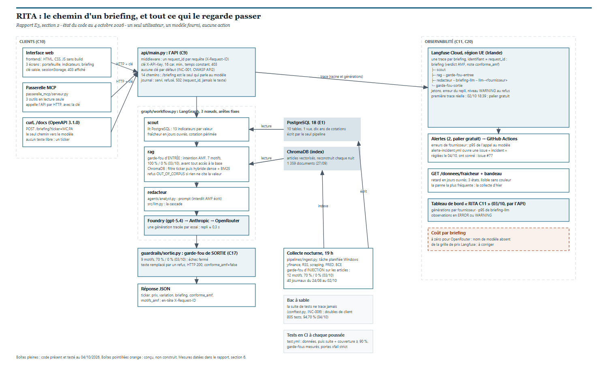

# Architecture de RITA

> **À quoi sert ce document.** Décrire en un seul endroit de quoi RITA est faite, comment une demande la traverse, où
> vivent les données, comment l'accès est contrôlé, comment le modèle est surveillé et comment le code est livré.
> Chaque brique renvoie à son dossier et aux tests qui la prouvent. Critères visés : C9 (« la documentation couvre
> l'architecture, tous les points de terminaison et les règles d'authentification ») et C17 (documentation technique).
> État décrit : 24 octobre 2026 (schémas et tableaux), complété le 16/11 par des notes datées ; au 16/11, la
> production sert `8b2509f`. Les schémas
> sont dans `docs/rapports/E3/schemas/` (un `.drawio` pour corriger, un `.png` pour lire, générés par un seul script).
> Ils ont été refaits le 24/10 : le schéma d'architecture montre les deux chemins vers le modèle (briefing et questions)
> et `/sante` ; la vigie, qui tourne hors de l'API, n'y figure pas.

## 1. RITA en une phrase

Une application mono-utilisateur qui **collecte** des données de marché et d'actualité, les **range** dans PostgreSQL,
les **expose** par une API REST, et fait **rédiger** par un modèle de langage fourni (aucun entraînement) un court
briefing en français sur une valeur, ou une réponse à une question libre tirée des articles collectés, avec ses
sources. Des **garde-fous** relisent la question, les articles et le texte produit, et retiennent toute recommandation
d'achat ou de vente (contrainte AMF). Aide à la lecture, jamais un conseil.

## 2. Les chemins

| Chemin | Quand | De → vers | Schéma |
|---|---|---|---|
| **Collecte du poste** | chaque soir à 19 h (tâche planifiée Windows) | sources externes → `pipelines/ingest.py` → PostgreSQL du poste et index ChromaDB | `E3-architecture` (bas) ; rapport E1 |
| **Ingestion de la production** | à la demande, workflow « Ingestion » | flux RSS → base de production → nouvel index vérifié, puis mis en service | pas encore de schéma ; `exploitation.md` § 8 |
| **Lecture de données** | à la demande | écran ou passerelle MCP → `GET /donnees/*` → PostgreSQL | `E3-architecture` |
| **Briefing** | à la demande | écran ou passerelle MCP → `POST /briefing` → graphe → modèle → garde-fou → réponse | `E3-architecture`, `E3-integration-briefing` |
| **Question** | à la demande | écran `question.html` → `POST /question` → garde-fous de la question → recherche dans les articles → modèle → contrôles de la réponse → réponse avec ses sources, ou refus | `E3-architecture` (depuis le 24/10) |
| **Surveillance** | à la main ou par tâche planifiée | vigie (`monitorage/vigie.py`) → `/health` puis `/sante` → une issue par signal en problème | `E3-monitorage` (avant la vigie) |

## 3. Les briques, une par une

| Brique | Dossier | Rôle | Technologie | Tests principaux |
|---|---|---|---|---|
| Sources | `sources/` | une fonction par source : cours (Yahoo Finance), taux BCE, séries FRED, flux RSS, scraping, fichier de positions | Python, `httpx`, `feedparser`, `yfinance` | `test_cotations`, `test_ecb`, `test_fred`, `test_rss`, `test_scraper`, `test_positions` |
| Collecte | `pipelines/ingest.py` | six étapes indépendantes (taux, macro, cotations, articles, scraping, indexation), une étape en échec n'arrête pas les autres, un échec total est déclaré, un manifeste par exécution | Python | `test_ingest`, `test_manifeste_collecte`, `test_rattrapage` |
| Base | `db/` | schéma Merise (`schema.sql`, 10 tables, 1 vue), import (`importer.py`), rôles (`roles.sql`), purge RGPD (`rgpd_purge.py`) | PostgreSQL 18, port 5433 en local | `test_schema`, `test_importer`, `test_vue_valorisation`, `test_rgpd_purge`, `test_role_lecture` |
| Indicateurs | `indicateurs/` | 13 indicateurs par valeur (socle, risque, RSI) et 2 indicateurs de portefeuille, calculés en SQL | SQL avec fonctions fenêtre | `test_indicateurs_socle`, `_risque`, `_portefeuille` |
| Recherche documentaire | `rag/` | index des articles (`indexation.py`), recherche filtrée par valeur puis hybride dense et BM25 fusionnés par rangs (`recherche.py`, 3 passages par défaut), rejeu des questions de démonstration avant une mise en service (`controle_questions.py`) | ChromaDB, `rank-bm25` | `test_rag_indexation`, `test_rag_recherche`, `test_mesurer_rag`, `test_questions_demo` |
| Graphe | `graph/` | trois nœuds à arêtes fixes : `scout` (lit la base), `rag` (cherche les articles), `redacteur` (écrit) | LangGraph | `test_workflow`, `test_scout_base` |
| Rédacteur | `agents/analyst.py` | construit le prompt du briefing : les faits (cours, variation, capitaux moyens, 10 indicateurs, passages), la consigne AMF | Python | `test_analyst` |
| Question | `agents/question.py` | répond à une question libre : sortie du modèle en JSON imposé puis revérifiée ; les références montrées viennent des données stockées, jamais du texte du modèle | Python, Pydantic | `test_question_contrat`, `test_question_parcours`, `test_api_question` |
| Appel au modèle | `src/llm.py` | **au 16/11** : depuis le 14/11, `LLM_ORDRE=foundry,mistral` sur le serveur : Azure d'abord, Mistral Large 3 (`mistral-large-2512`, adresse européenne) si Azure échoue, pour le briefing et la question ; une question ne part jamais chez Anthropic ni OpenRouter. **Au 24/10** : briefing : ordre des fournisseurs réglé par `LLM_ORDRE`, par défaut Azure AI Foundry `gpt-5.4` seul depuis le 31/10 (règle UE seule ; le poste l'appliquait depuis le 11/10, la production le prend depuis la livraison du 31/10) ; Anthropic et OpenRouter ne sont appelés que si `LLM_ORDRE` les nomme ; question : Azure seul, en JSON strict (`generer_json`) | `httpx`, SDK `anthropic` | `test_llm` |
| Garde-fous | `guardrails/` | **question** : intention AMF (`entree.py`), injection et extraction (`detournement.py`) ; **articles collectés** : injection (`injection.py`) ; **texte produit** : recommandation et fuite (`sortie.py`), et pour une réponse, chaque nombre présent dans un article cité (`nombres.py`) | motifs lexicaux | `test_entree`, `test_garde_fou_question`, `test_injection`, `test_controle_nombres`, `test_evals` |
| API | `api/` | FastAPI : 19 chemins, décrits au § 4 ; limite de débit sur les deux routes qui appellent le modèle (`limiteur.py`) ; documentation OpenAPI 3.1.0 sur `/docs` | FastAPI, Uvicorn | `test_health`, `test_api_donnees`, `test_request_id`, `test_audit_mcp`, `test_limiteur`, `test_exercice` |
| Interface | `frontend/` | cinq écrans : portefeuille, indicateurs, briefing, question, tableau de bord de la vigie ; aucune clé dans le code, la clé est saisie | HTML, CSS, JavaScript sans outil de construction | `test_frontend`, `test_smoke_ui` (vrai navigateur) |
| Passerelle MCP | `passerelle_mcp/serveur.py` | trois outils en lecture seule pour un assistant ; passe par l'API avec la clé, jamais par la base | protocole MCP | `test_passerelle_mcp` |
| Traçage | `src/traces.py` | une trace Langfuse par briefing ou question, une étape par nœud et par garde-fou, une génération par tentative de fournisseur, identifiant = celui de la requête | Langfuse Cloud, région UE | `test_traces`, `test_trace_chemin`, `test_trace_verdict_amf`, `test_traces_question` |
| Vigie | `monitorage/` | compteurs tenus par l'API (`compteurs.py`), verdicts contre des seuils écrits (`signaux.py`, `seuils.json`) servis par `/sante`, vigie hors de l'API (`vigie.py`), exercices de panne et de dérive (`exercice.py`, `exercer.py`) | Python | `test_compteurs`, `test_signaux`, `test_seuils`, `test_vigie`, `test_exercice` |
| Fraîcheur | `monitorage/fraicheur.py` | de quand datent les données, en jours ouvrés | SQL | `test_fraicheur` |
| Déploiement | `deploy/` | script du serveur (`deployer.py` : ordres `livrer`, `revenir`, `ingerer`, `version`, un verrou, le créneau du matin, un journal), point d'entrée de la clé dédiée (`deployer.sh`), fichiers Compose de production | Python, Docker Compose | `test_deployer_regles`, `test_deployer_scenarios`, `test_workflows_livraison` |

## 4. Les points de terminaison et l'authentification

La liste complète, avec les paramètres et les réponses, est le contrat **OpenAPI 3.1.0** que l'API publie elle-même
(`/openapi.json`, et sa lecture interactive sur `/docs`) : 19 chemins le 24/10, dont 12 sous `/donnees`. Le rapport E3
la résume en section 3.1.

| Famille | Routes | Clé |
|---|---|---|
| Service | `GET /health` | **non** : ne rend aucune donnée ; annonce la version servie (commit, date de construction) et l'index |
| Données (C5) | `GET /donnees/valeurs`, `/cotations`, `/macro`, `/portefeuille`, `/mouvements`, `/volumes-anormaux`, `/articles`, `/articles/{article_id}`, `/indicateurs`, `/indicateurs-portefeuille`, `/indicateurs-risque`, `/fraicheur` | `X-API-Key` |
| Modèle (C9) | `POST /briefing?ticker=`, `POST /question` | `X-API-Key`, et au plus 10 appels par minute par défaut (429 au-delà) |
| Surveillance | `GET /sante` | `X-API-Key` |
| Exercices | `POST /exercice/panne`, `POST /exercice/fin` | `X-Cle-Exercice`, une autre clé ; 503 si le serveur n'en a pas, ce qui est le cas en production |
| Audit | `POST /audit/mcp` | `X-API-Key` |
| Interface | `/`, `/index.html`, `/indicateurs.html`, `/briefing.html`, `/question.html`, `/tableau-de-bord.html` et leurs fichiers | non : aucune donnée, la clé est demandée à l'écran |

**Règles d'accès.** Deux clés, chacune dans son en-tête. La clé de l'API (`X-API-Key`) est lue dans l'environnement,
fait au moins 16 caractères et se compare à temps constant ; sans elle, l'application démarre mais ne peut autoriser
aucun accès protégé : la configuration est contrôlée à l'authentification, et Docker Compose exige une valeur non
vide avant de lancer le conteneur (aucune valeur par défaut depuis l'incident INC-001). Elle est posée sur les routeurs entiers des données, des questions et de la santé :
une nouvelle route ne peut pas oublier la protection. La clé d'exercice (`X-Cle-Exercice`) ne sert qu'aux exercices :
avec la clé des questions, on ne pose pas de panne. Un refus laisse une ligne de journal (identifiant de requête,
route, motif), jamais la clé. La limite de débit est une fenêtre glissante commune à tous les appelants (`RITA_QUOTA_PAR_MINUTE`),
vérifiée après la clé : un appel sans clé valide ne consomme pas le quota. Chaque réponse, y compris une erreur, porte un
identifiant `X-Request-ID`. Le choix d'une clé unique et ses limites sont défendus dans
`evidence/C17/preuve-droits-acces-2026-10-03.md` ; la revue de sécurité est `evidence/C17/revue-owasp-top10-2025-2026-10-03.md`.

Jusqu'au 24/10, le contrat publié se trompait sur les exercices : les deux clés portaient le même nom de schéma, et
`/docs` annonçait `X-API-Key` sur `/exercice/*`. Corrigé, avec un test qui lit le contrat (`tests/test_exercice.py`).

## 5. Les données

| Réserve | Contenu | Écrite par | Lue par |
|---|---|---|---|
| PostgreSQL | référentiel des valeurs et alias, dix ans de cotations, taux de change, séries macro, articles, positions, journaux d'audit | `pipelines/ingest.py`, `db/importer.py` (seuls écrivains) ; en production, l'ingestion avec le compte `rita_ingestion` (articles seulement) | l'API et le graphe |
| ChromaDB | les articles découpés et vectorisés ; sur le poste, reconstruit à chaque collecte ; en production, un index par livraison ou ingestion, dans un volume à part, dont `/health` annonce l'identité | `rag/indexation.py` | le nœud `rag`, la question |
| Fichiers | journaux de collecte (`logs/`), manifeste par exécution, archive Parquet du big data (`bigdata/`, hors image) ; sur le serveur, le journal des opérations, l'état, les configurations gardées et les rapports de rejeu (`/root/rita-deploy/`) | la collecte, le script du serveur | l'humain, les preuves |

Ce qui part chez le fournisseur du modèle : pour un briefing, le prompt du rédacteur seulement (cours, variation,
capitaux moyens, dix indicateurs, au plus trois extraits d'articles) ; pour une question, la question et les extraits
retenus. **Aucune position, aucun prix de revient** : le nœud `scout` ne lit que des données de marché publiques.

## 6. Le modèle, et ce qui l'entoure

Le modèle est **fourni** : RITA ne l'entraîne pas et ne le règle pas. Ce qui se teste et se surveille est son
**comportement sous garde-fous**. Cinq garde-fous à trois places : la question (intention AMF, détournement), les
articles collectés (injection), le texte produit (recommandation et fuite ; pour une réponse, les nombres). Chacun est
mesuré par `evals/` et porté par une porte de qualité dans la chaîne. Le choix des fournisseurs est mesuré par le banc
C7 (`evals/benchmark_fournisseurs.py`, `evidence/C7/`).

## 7. La surveillance

Collecte des métriques par les traces Langfuse (latence, jetons, fournisseur, verdict du garde-fou) et le journal de l'API
(une ligne par briefing servi ou refusé, jamais le texte). Depuis le sprint 5, l'API compte aussi elle-même ses erreurs,
ses refus, sa latence et son coût estimé (`monitorage/compteurs.py`), et `/sante` rend les verdicts de ces signaux
contre des seuils écrits (`monitorage/seuils.json`). La vigie tourne hors de l'API, parce qu'une API arrêtée ne peut
pas annoncer sa propre panne : elle sonde `/health`, lit `/sante`, ouvre une issue par signal en problème et la ferme
quand il est résolu. Restitution par le tableau de bord de la vigie (`tableau-de-bord.html`), le tableau de bord
Langfuse « RITA C11 » et le bandeau de fraîcheur de l'écran 1. Une règle Langfuse peut aussi appeler GitHub, qui ouvre
une issue « incident » (`.github/workflows/alerte-incident.yml`). La suite de tests ne trace jamais (`tests/conftest.py`).
Détail : rapport E3, section 5, le schéma `E3-monitorage`, et `exploitation.md` (alertes, vigie, exercices).

## 8. Les environnements et la livraison

| Environnement | Ce qui tourne | Comment |
|---|---|---|
| Poste de développement | API (port 8000), PostgreSQL (5433), collecte planifiée | `uvicorn`, tâche planifiée Windows |
| Copie du sprint 5 | API et PostgreSQL en conteneurs, projet `rita-s5` (port 8011) : déploiement, retour arrière, exercices | `scripts/copie_sprint5.py` (`exploitation.md`) |
| Pré-production locale | API et PostgreSQL en conteneurs | `docker compose up -d --build` (port 8001) |
| Intégration continue | lint, secrets, tests, test des données, garde-fous, construction et vérification de l'image | GitHub Actions, huit workflows (`docs/CI-CD.md`) |
| Production | API en conteneur derrière Caddy (HTTPS), serveur Hetzner | **livrée automatiquement** après chaque fusion dans `main` depuis le 14/10 ; retour arrière et ingestion d'un bouton |

`main` ne change que par une pull request relue, avec sept checks verts (règles GitHub). Une fusion publie l'image
vérifiée et la livre en production ; un livrable est un tag `livrable-E<n>-v<k>` posé sur `main`, qui publie aussi son
image. Le retour arrière de la production est écrit dans `exploitation.md`
([Revenir à la version précédente en production](exploitation.md#rollback-production)).

## 9. Ce que cette architecture ne fait pas

- Pas de comptes ni de rôles : un utilisateur, une clé, plus la clé d'exercice de l'opérateur.
- Au 24/10, pas d'en-têtes de sécurité posés par l'API (revue OWASP, carte #75) : posés en production depuis le
  07/11. La limite de débit existe depuis le sprint 4, mais seulement sur les deux routes qui appellent le modèle ;
  depuis le 07/11, un frein des essais de clé par adresse (`api/limiteur.py`, registre T9).
- Au 24/10, l'API lisait la base avec le rôle propriétaire (carte #76) : rôle `rita_api` en production depuis le 07/11.
- Le retour arrière ne revient que d'un pas et ne restaure pas la base ; aucune approbation n'est demandée avant un
  déploiement.
- Les compteurs de la vigie vivent en mémoire : ils repartent à zéro à chaque redémarrage de l'API.
- Le graphe est linéaire : aucun choix de chemin n'est confié au modèle, par conception.

## 📖 Glossaire

| Terme | En clair |
|---|---|
| **API REST** | interface qui expose des ressources par des adresses et des verbes HTTP (`GET`, `POST`) |
| **OpenAPI** | format standard qui décrit une API : routes, paramètres, réponses, et les clés qu'elles exigent |
| **Graphe (LangGraph)** | enchaînement de nœuds qui se passent un état ; ici trois nœuds dans un ordre fixe |
| **Modèle fourni** | modèle de langage déjà entraîné, appelé par une API, que le projet n'entraîne pas |
| **Cascade de fournisseurs** | liste ordonnée de services de modèle : si le premier échoue, le suivant est essayé |
| **Garde-fou** | contrôle qui retient une entrée, un contenu collecté ou un texte produit interdit |
| **RAG** | génération augmentée par la recherche : le modèle reçoit des extraits d'articles trouvés pour la valeur ou la question |
| **BM25** | méthode de recherche par mots-clés, combinée ici à la recherche par sens (vecteurs) |
| **Trace** | enregistrement d'une requête et de chacune de ses étapes, avec durées et résultats |
| **Limite de débit** | nombre maximal d'appels acceptés par minute ; au-delà, la réponse est 429 avec le délai d'attente |
| **Vigie** | programme qui regarde l'API de dehors et ouvre une issue quand un signal passe en problème |
| **Retour arrière** | remise en service de la version précédente, en une opération |
| **Tag** | étiquette posée sur un commit précis ; le lien d'un livrable |
