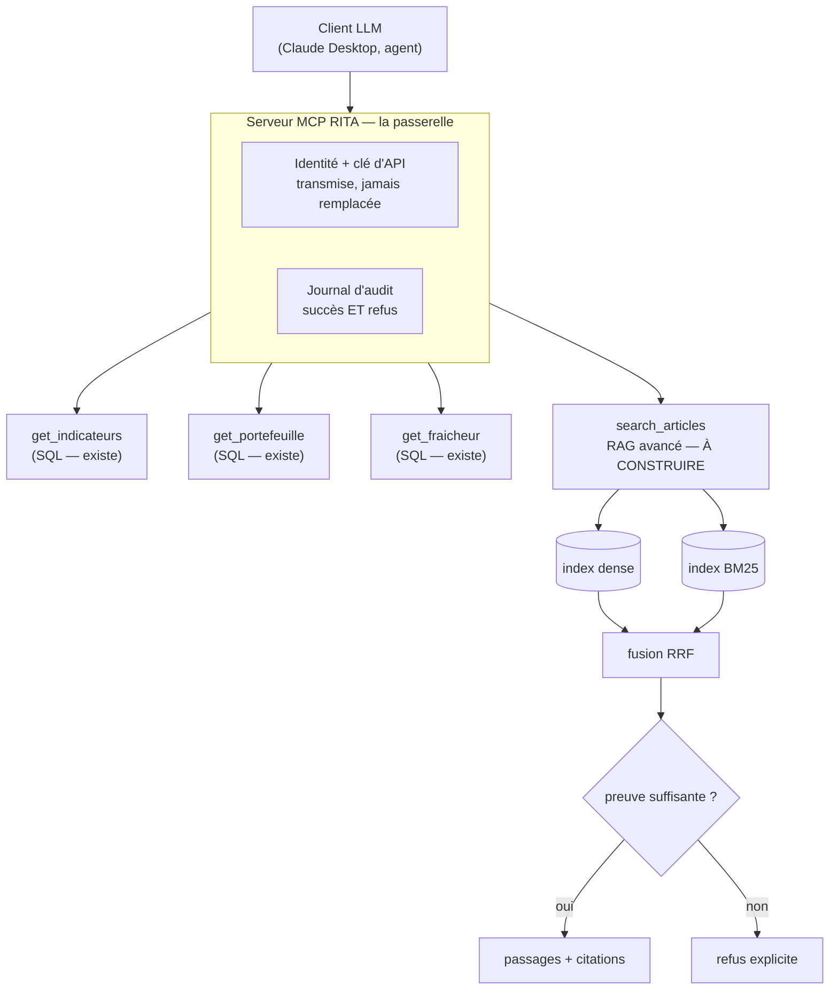

# Plan — chantier E : RAG avancé et passerelle MCP

> **Établi le 2026-08-28**, après consigne du formateur. Complète `docs/PLAN-12-SEMAINES.md`,
> qui ne prévoyait **aucun créneau** pour ces deux sujets.
> **Spec d'abord, code ensuite.** Rien n'est implémenté tant que ce document n'est pas relu.

---

## 1. Pourquoi ce chantier existe

**Consigne du formateur, 28/08/2026** (échange direct, rapporté par Era) :

| Technique | Statut |
|---|---|
| **RAG** — *Retrieval-Augmented Generation*, génération augmentée par récupération | **obligatoire**, et il faut de l'**avancé** |
| **MCP** — *Model Context Protocol*, protocole d'exposition d'outils à un modèle | **obligatoire** |
| **Text-to-SQL** — génération de SQL par le modèle | *« pas vraiment »* → **écarté** |

**Text-to-SQL écarté reste cohérent avec C2**, qui exige que ce soit *Era* qui écrive les
requêtes SQL. Un modèle qui les génère affaiblirait la preuve au lieu de la renforcer.

⚠️ **Information manquante — à poser au formateur, ne pas supposer :**
1. Ce qu'il entend précisément par **« avancé »** — hybride dense + lexical ? reranker ?
   évaluation par ablation ?
2. Dans **quel livrable** il attend la preuve — E3 (C9) ou E4 (C15/C17) ?

**Ce que la consigne résout au passage** : RITA signifie *Retrieval Intelligence*, et
`RITA-V2-ARCHITECTURE.md` décrit un RAG qui n'existait pas dans le code. La contradiction
était réelle (6ᵉ occurrence du défaut « documenté mais absent », cf. `evidence/C21/INC-004`).
**On ne corrige plus le document : on rattrape le code.**

---

## 2. Où ça tient dans le calendrier — l'avance paie les deux chantiers

`PLAN-12-SEMAINES.md` prévoyait S36 pour les indicateurs lot 2 et S37 pour la couverture de
tests. **Les deux sont déjà faits** — lots 2 et 3 le 19/08, couverture **92 %** avec seuil CI
à 90 % le 19/08 également.

| Semaine | Prévu au plan initial | État réel | Devient |
|---|---|---|---|
| **S36** 31/08–06/09 | A — indicateurs lot 2 | ✅ fait le 19/08 | **E — MCP puis RAG** |
| **S37** 07–13/09 | C — `pytest-cov`, seuil | ✅ fait le 19/08 | **E — RAG (suite) + évaluation** |
| S38 | A + D monitorage | C20 amorcé le 25/08 | inchangé |

**Le chantier E ne repousse rien** : il consomme une avance réellement constituée, pas une
marge espérée. *Si l'avance n'avait pas existé, il aurait fallu sacrifier autre chose et le
dire.*

---

## 3. Ce que « RAG avancé » veut dire, décomposé

Un RAG **basique** fait : `question → embeddings → 5 passages les plus proches → prompt`.
Un RAG **avancé** ajoute des étages, et **mesure ce que chacun apporte**.

| Étage | Ce que ça fait | Pourquoi c'est utile **pour des actualités financières** |
|---|---|---|
| **Dense** (embeddings) | cherche par le **sens** | « chute du titre » retrouve « recul de l'action » |
| **BM25** (*Best Matching 25*) | cherche par les **mots exacts** | **décisif ici** : « LVMH », « MC.PA », « TotalEnergies » sont des correspondances littérales qu'un embedding dilue |
| **Fusion RRF** (*Reciprocal Rank Fusion*) | fusionne les deux classements sans régler de poids | évite d'inventer un arbitrage arbitraire entre sens et mots |
| **Reranker** | second juge, plus fin, sur les **quelques** meilleurs candidats | coûteux : ne s'applique qu'au top-k, pas au corpus |
| **Seuil de pertinence** | **refuser** quand la preuve est insuffisante | RITA a déjà cette culture : garde-fou AMF, `OUT_OF_CORPUS` |
| **Évaluation par ablation** | mesurer chaque étage séparément | *c'est ça qui fait « avancé »* : on ne dit pas « c'est mieux », on le montre |

**🟢 La méthode est déjà écrite** — dans le brief **Sorabel** conçu la même semaine
(`Desktop\Sorabel-Day-1`) : hybride dense + BM25 + RRF, reranker sur un petit ensemble, RBAC
avant la recherche, refus sans preuve, et un protocole d'ablation **D0 → D1 → H0 → H1**.
⚠️ **Transporter la méthode, pas le code.** Sorabel et RITA gardent des rendus séparés.

---

## 4. L'architecture cible

**Pourquoi le MCP d'abord** : les tools 1 à 3 **existent déjà** — ce sont tes points de
terminaison REST authentifiés et testés. Le serveur MCP est un **emballage**, pas une
reconstruction. Une fois posé, le RAG s'y branche comme un tool de plus.

**La règle de sécurité, reprise de Sorabel** : la passerelle **transmet** l'identité, elle ne
la remplace pas. Ta clé d'API reste exigée — un tool MCP ne doit jamais être une porte
dérobée qui contourne le 403.

---

## 5. Les étapes, dans l'ordre

### E1 — Serveur MCP sur l'existant · ½ journée · S36

| | |
|---|---|
| **Ce qui doit exister à la fin** | un serveur MCP exposant **3 tools** (`get_indicateurs`, `get_portefeuille`, `get_fraicheur`), interrogeable depuis un client LLM |
| **Preuve** | capture d'une question en langage naturel → réponse chiffrée venant de RITA · appel sans clé → refus |
| **Compétences** | **C10** (intégrer l'API dans une application — *à confirmer avec le formateur*) · C15 · C17 |
| **Piège** | ne pas contourner l'authentification pour « simplifier ». Un tool qui répond sans clé annule OWASP API2, corrigé le 18/08 (`evidence/C21/INC-001`) |

### E2 — Corpus et indexation · 1 journée · S36

| | |
|---|---|
| **Ce qui doit exister** | les articles découpés, vectorisés (**dense**) et indexés (**BM25**), avec leurs métadonnées : source, date, ticker mentionné |
| **Corpus** | 73 articles au 28/08, **+30/jour** par la collecte automatique → ~2 000 en octobre |
| **Décision à prendre** | quelle base vectorielle. ChromaDB (déjà pratiqué en Veille-Tech) reste le choix par défaut — **à trancher avec Era avant de coder** |
| **Piège** | un article court se garde **entier** ; on ne découpe que ce qui est long. Découper 4 phrases en 3 morceaux détruit le sens |

### E3 — Recherche hybride + refus · 1 journée · S37

| | |
|---|---|
| **Ce qui doit exister** | `search_articles(question, ticker?)` → dense + BM25 → **fusion RRF** → seuil → passages **cités** (source, date, lien) ou **refus explicite** |
| **Preuve** | une question sur LVMH ne doit pas remonter un article qui ne fait que **mentionner** LVMH en passant |
| **Piège** | le seuil. ⚠️ Voir §7 — c'est le sujet de la veille S35 |

### E4 — Branchement au briefing · ½ journée · S37

| | |
|---|---|
| **Ce qui doit exister** | `/briefing` passe de **5 valeurs** (prix, variation, volume, devise, ticker) à : **13 indicateurs + passages d'articles cités** |
| **Pourquoi c'est le cœur** | aujourd'hui le briefing **n'utilise ni la base ni les articles**. Le graphe fait `scout → redacteur`, sans aucune lecture. **C'est le vrai trou, plus grand que l'absence de RAG** |
| **Compétences** | C9 · C17 · et le nom « **Retrieval** » redevient exact |

### E5 — Évaluation par ablation · 1 journée · S37

| | |
|---|---|
| **Ce qui doit exister** | un jeu de questions annotées + la comparaison **D0 → D1 → H0 → H1**, avec métriques et latence |
| **Métriques** | Hit@1/@5 · refus correct · citations exactes · latence p50/p95 |
| **Pourquoi c'est ce qui fait « avancé »** | sans ablation, on affirme ; avec, on démontre. C'est aussi ce que le protocole Sorabel exige |

---

## 6. Les compétences à acquérir — et par quoi passer

### Ce qu'Era doit comprendre pour le défendre à l'oral

| Sujet | Le minimum à savoir expliquer |
|---|---|
| **Embedding** | transformer un texte en vecteur de nombres, pour que « proche » veuille dire « de sens voisin » |
| **BM25** | classement par mots exacts, avec pondération : un mot rare pèse plus qu'un mot courant |
| **RRF** | fusionner deux classements par le **rang**, pas par le score — ce qui évite de comparer des échelles incomparables |
| **Reranker** | modèle qui relit **question + passage ensemble**, plus juste mais trop lent pour tout le corpus |
| **Hit@k / MRR** | « la bonne réponse est-elle dans les k premiers ? » · « à quel rang, en moyenne ? » |
| **MCP** | protocole standard qui décrit des *tools* à un modèle : nom, entrées, sorties, erreurs |

### Les skills à invoquer pendant l'implémentation

| Skill | Pour quelle étape |
|---|---|
| `anthropic-skills:mcp-builder` | **E1** — construire le serveur MCP |
| `rag-implementation` · `ai-rag-pipeline` | **E2, E3** — chunking, embeddings, retrieval |
| `anthropic-skills:langgraph-agents` | **E4** — brancher le RAG dans le graphe |
| `test-driven-development` | toutes — le test avant le code |
| `agent-standard` | **E3, E4** — mémoire, garde-fous, boucle qualité |

---

## 7. Les risques, nommés à l'avance

| Risque | Réalité | Parade |
|---|---|---|
| **Le corpus est petit** — 73 articles | le RAG se justifie à partir de milliers de documents | **on construit quand même** : le formateur l'exige, et le corpus grossit de 30/jour tout seul. L'architecture est identique à 73 ou 2 000 |
| **Le seuil de pertinence** | *Confidently Wrong* (arXiv 2606.22659) montre qu'un seuil calibré sur un corpus figé peut voir son taux d'échec passer de 0,01 à **0,97** ailleurs | **c'est la question ouverte de la veille S35** — la traiter là, pas ici. ⚠️ Le brief Sorabel porte **le même risque** (`relevance_threshold: calibrated`) |
| **Confusion Sorabel / RITA** | deux projets, deux rendus, la même semaine | **transporter la méthode, jamais le code**. Aucun fichier copié |
| **Documenter avant de construire** | 6 occurrences déjà (`INC-004`) | **rien n'entre dans `RITA-V2-ARCHITECTURE.md` avant d'exister**, et chaque ✅ porte sa commande de vérification |
| **Le MCP contourne l'authentification** | tentation de « simplifier » pour faire marcher la démo | la clé d'API reste exigée, testée par un cas dédié |

---

## 8. Ce que ce plan ne dit pas — à lire avant d'y croire

- **Il suppose que « avancé » signifie hybride + reranker + ablation.** C'est une
  interprétation, tirée du brief Sorabel — **pas une réponse du formateur**. Si sa définition
  diffère, les étapes E3 et E5 changent.
- **Il suppose que le MCP compte pour C10.** Non confirmé. Si ce n'est pas le cas, le MCP
  reste obligatoire par consigne mais ne coche aucun critère — et passe donc après le RAG.
- **Il consomme toute l'avance.** Après S37, il n'y a plus de marge : le moindre retard sur
  le chantier E décale D (monitorage) et la rédaction d'E4.
- **Il ne dit rien de C16** (méthode agile, toujours à zéro) ni de C11. Ces deux-là restent
  au calendrier initial, et ils n'ont pas bougé depuis le 16/08.

---

## 📖 Glossaire

| Terme | En clair |
|---|---|
| **RAG** (*Retrieval-Augmented Generation*) | Aller **chercher** des passages pertinents avant de **générer** la réponse, pour que le modèle réponde avec tes données et cite ses sources |
| **MCP** (*Model Context Protocol*) | Protocole standard décrivant des outils à un modèle : nom, entrées, sorties, erreurs typées |
| **Tool** | Fonction qu'un modèle peut appeler. Il décide **quand** ; le code décide **comment** |
| **Dense / BM25** | Recherche par le sens / par les mots exacts |
| **RRF** (*Reciprocal Rank Fusion*) | Fusionner deux classements en se fondant sur le rang plutôt que sur le score |
| **Reranker** | Second classement, plus fin et plus lent, appliqué aux seuls meilleurs candidats |
| **Ablation** | Retirer un composant pour mesurer ce qu'il apportait vraiment |
| **Hit@k** | La bonne réponse est-elle dans les *k* premiers résultats ? 0 ou 1 par question |
| **Chunking** | Découper un document en morceaux indexables sans détruire le sens |
