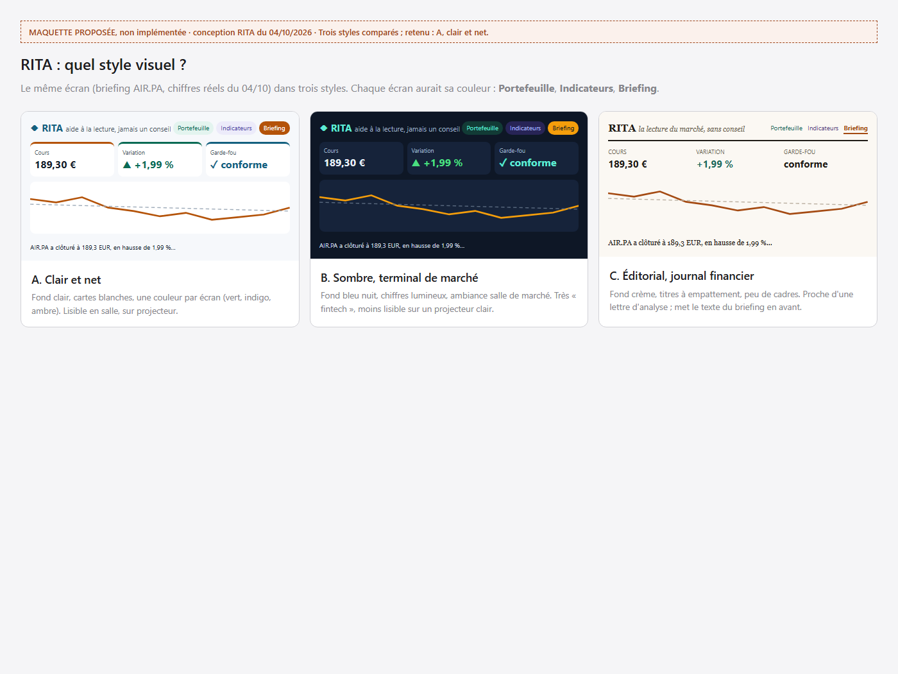
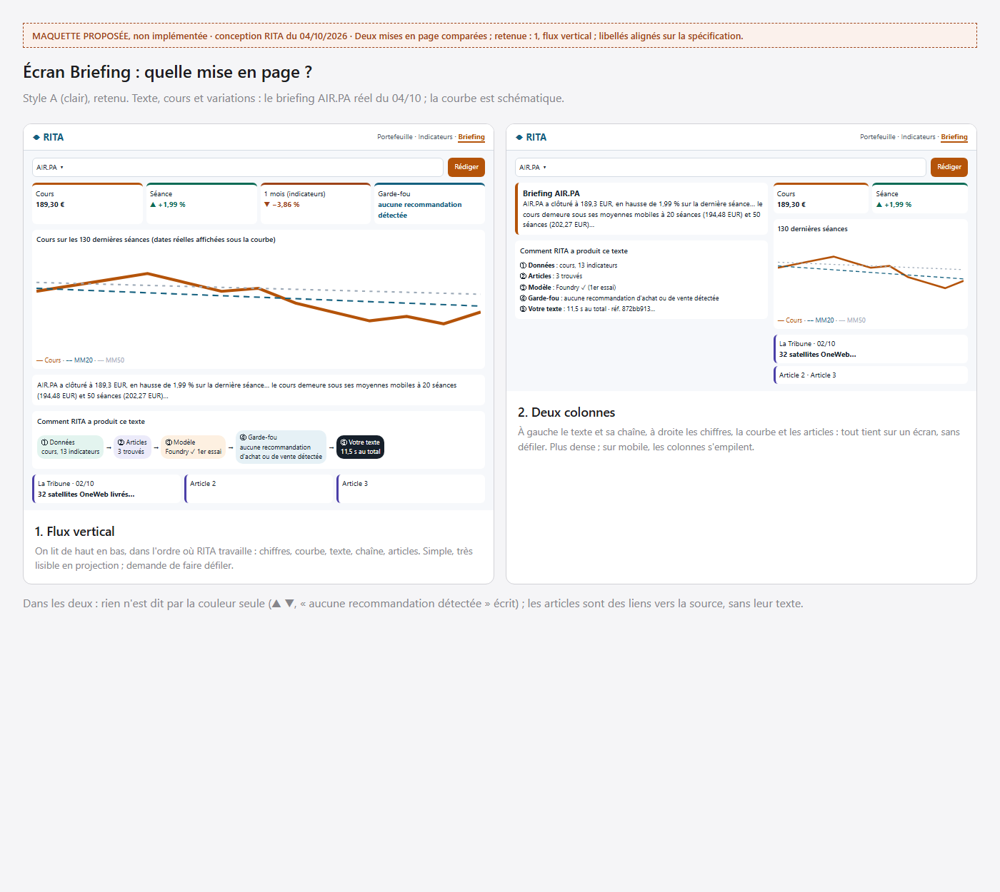
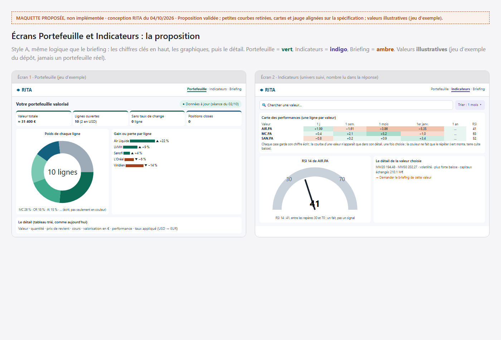

# Refonte des écrans de RITA : spécification de conception

| | |
|---|---|
| **Statut** | conception **validée par Era le 04/10/2026** ; **implémentation non planifiée** (décision A, § 10) |
| **Objet** | les trois écrans (`frontend/`) : portefeuille, indicateurs, briefing ; une évolution du point `POST /briefing` |
| **Critères visés** | C14 (spécifications avant le code), C17 (accessibilité et éco-conception mesurées avant et après), C19 (livraison) ; livrable E4 ou version ultérieure, selon la date de réalisation |
| **Ce que ce document n'est pas** | une preuve que les écrans existent : les maquettes du § 12 sont des **maquettes proposées**, non implémentées. Les écrans actuels, leurs spécifications (`evidence/C14/`) et leurs mesures du 03/10 (`evidence/C17/`) restent valables et gardent leurs limites écrites |

## 1. L'intention

Ce que veut Era : que la personne qui regarde RITA, un utilisateur ou un jury, **comprenne d'un coup d'œil** ce que RITA
montre et ce que chaque chiffre veut dire, sans explication longue. Trois écrans plus visuels, une couleur par écran, des
graphiques, et sous chaque briefing, ce qui s'est passé dans RITA pour le produire.

**Critères de réussite**
- chaque graphique dit la même chose que ses chiffres écrits, et peut se lire sans la couleur ;
- une donnée manquante, ancienne ou incomplète se voit comme telle, jamais comme un chiffre plausible ;
- le panneau « Comprendre ce résultat » dit vrai : fournisseur et modèle réellement utilisés, sources réellement
  fournies au modèle, référence de la requête ;
- l'accessibilité automatique reste à 100 et l'éco-conception est mesurée avant et après, dans les mêmes conditions.

**Rien ne change** sur le fond de RITA : aide à la lecture, jamais une recommandation d'achat ou de vente (AMF) ; la clé
d'accès n'est jamais écrite dans le code ; aucun outil de construction (HTML, CSS, JavaScript tels quels).

## 2. Ce qui existe au 04/10/2026

| Élément | État | Où |
|---|---|---|
| Trois écrans | portefeuille, indicateurs, briefing ; 1 325 lignes au total | `frontend/` |
| Tests de l'interface | 72 statiques, 7 dans un vrai navigateur (API interceptée) | `tests/test_frontend.py`, `tests/test_smoke_ui.py` |
| Mesures | Lighthouse 13.5.0 : accessibilité 100 ; EcoIndex calculé en local avec le code officiel de `cnumr/ecoindex_python` : A, A, D | `evidence/C17/preuve-eco-conception-et-accessibilite-2026-10-03.md` |
| Défauts connus touchés par la refonte | #73 (l'écran 3 mémorise la clé avant de l'avoir validée) ; #75 S6 (une panne de tous les fournisseurs donne un 500 générique) | issues du dépôt |

## 3. Les choix de conception (validés le 04/10)

| Choix | Retenu | Écarté, et pourquoi |
|---|---|---|
| Style | **A, clair et net** : fond clair, cartes blanches, une couleur par écran (portefeuille vert, indicateurs indigo, briefing ambre) | sombre (moins lisible en projection) ; éditorial |
| Mise en page du briefing | **flux vertical**, dans l'ordre où RITA travaille : chiffres, courbe, texte, « Comprendre ce résultat », sources | deux colonnes (plus dense, moins lisible en projection) |
| Graphiques | portefeuille : anneau des poids, barres de gain ou perte ; indicateurs : carte des performances, jauge du RSI, courbe de la valeur choisie ; briefing : courbe du cours avec moyennes 20 et 50 séances | une petite courbe par ligne de la carte : demanderait un appel par valeur (environ 111 aujourd'hui) ; la courbe n'apparaît que dans le détail de la valeur choisie (un appel) |
| Dessin des graphiques | **SVG construit à la main** en JavaScript, sans bibliothèque | bibliothèque par CDN (requête tierce, démonstration fragile sans réseau, `canvas` illisible par un lecteur d'écran) ; bibliothèque copiée dans le dépôt (lourde, même problème de `canvas`) |
| Ce que montre « Comprendre ce résultat » | le fournisseur et le modèle qui ont répondu, la durée totale, les essais de fournisseurs (réussi ou échoué, sans message d'erreur), la date et la fraîcheur du cours, les sources fournies au modèle, la référence de la requête | la durée de chaque étape : déjà visible dans la trace Langfuse de la même référence ; le texte des articles (droits d'auteur, lisibilité) |

## 4. Architecture et composants

| Fichier | Rôle | Nouveau ? |
|---|---|---|
| `frontend/style.css` | style A : une couleur par écran en variables, cartes, en-tête clair, focus visible, réduction des animations si le système le demande | refait |
| `frontend/graphiques.js` | fonctions **pures** qui construisent des éléments SVG (`donut`, `barres`, `courbe`, `jauge`, couleur d'une case de la carte) ; données en entrée, élément en sortie, aucun appel réseau | **nouveau** |
| `frontend/commun.js` | ce que les trois écrans partagent : en-tête et navigation, clé en `sessionStorage`, appel avec la clé, gestion du 403, badge de fraîcheur, messages d'erreur | **nouveau** |
| `frontend/app.js`, `indicateurs.js`, `briefing.js` | chaque écran : demande ses données, appelle `graphiques.js`, remplit la page | réécrits |
| les trois `.html` | la structure des maquettes validées | réécrits |

**Règle de rendu, sans exception** : les graphiques sont construits avec `document.createElementNS` ; tout texte (nom de
valeur, titre d'article, étiquette) est posé par `textContent` ; les attributs numériques sont contrôlés (nombre fini)
avant d'être écrits. Aucune chaîne HTML ou SVG n'est insérée dans la page. Un nom de valeur ou un titre d'article contenant
du HTML reste du texte inoffensif.

## 5. Les données, écran par écran

Les écrans **réutilisent les calculs du serveur** : aucun poids, aucun RSI, aucune performance n'est recalculé dans le
navigateur. Les noms de champs sont ceux de l'API, suffixes compris.

| Écran | Appels | Champs utilisés |
|---|---|---|
| Portefeuille | `GET /donnees/portefeuille`, `GET /donnees/indicateurs-portefeuille`, `GET /donnees/fraicheur`, en parallèle | cartes : `total_eur` (« non calculable » s'il vaut `null`), `nb`, `positions_sans_taux`, `positions_closes` ; par ligne : `valorisation_eur`, `investi_eur`, `performance_pct`, `date_cours` ; poids : `poids_pct`, `complet`, `exposition`. **Aucune performance globale** : l'API n'en fournit pas, et le navigateur n'en recalcule pas |
| Indicateurs | `GET /donnees/indicateurs`, `GET /donnees/indicateurs-risque` ; au choix d'une valeur, `GET /donnees/cotations?ticker=…&limite=179` | `perf_1j_pct`, `perf_1s_pct`, `perf_1m_pct`, `perf_ytd_pct`, `perf_1a_pct` ; `rsi_14`, `volatilite_annualisee_pct`, `drawdown_max_1a_pct` ; le nombre de valeurs est lu dans la réponse, jamais écrit en dur |
| Briefing | `POST /briefing?ticker=…` (un seul envoi par clic) ; après la réponse, `GET /donnees/indicateurs?ticker=…` et `GET /donnees/cotations?ticker=…&limite=179` | les champs actuels, plus `diagnostic` (§ 6) ; la carte « 1 mois » vient de `perf_1m_pct` (`/donnees/indicateurs` accepte `?ticker=`) |

**La courbe du cours et ses moyennes**
- `GET /donnees/cotations` renvoie les séances **de la plus récente à la plus ancienne** : elles sont remises dans l'ordre
  des dates avant tout calcul ;
- 179 séances permettent d'afficher les 130 dernières avec une moyenne 50 séances complète sur toute la largeur ;
- avec moins d'historique, la courbe du cours s'affiche quand même ; la moyenne 20 séances apparaît à partir de la 20e
  séance, la moyenne 50 séances à partir de la 50e, les points antérieurs restent vides ;
- 0 séance : « Aucun historique de cotation disponible » ; de 1 à 19 : la courbe seule, « moyennes indisponibles (moins
  de 20 séances) » ; de 20 à 49 : moyenne 20 et « moyenne 50 indisponible (moins de 50 séances) » ;
- la période réellement affichée est écrite (première et dernière date) : 130 séances ne font pas exactement six mois.

Le badge de l'écran portefeuille porte la fraîcheur **du jeu de données** (`/donnees/fraicheur`) ; chaque ligne garde la date de **son** cours.

**Date et fraîcheur d'un cours**, pour la valeur affichée, jamais recopiées de la fraîcheur globale du jeu :
« Cours : vendredi 2 octobre · âge : 2 jours calendaires · 0 jour de bourse écoulé depuis (calendrier Euronext) ». Le
compte vient de `jours_ouvres_ecoules()` (`monitorage/fraicheur.py:72`), dont la **convention** est écrite à côté du
chiffre : jours de bourse Euronext **strictement après** la date du cours, **jusqu'à aujourd'hui inclus**. Le lundi matin,
le lundi compte donc déjà, alors que sa clôture n'existe pas encore : ce compte dit un écart de calendrier, **pas une
cotation manquante**. Établir une cotation réellement manquante demanderait un autre calcul (heure de clôture de la place),
hors de cette refonte. Pour une valeur cotée hors Euronext (Londres, New York), seul l'âge calendaire est donné, et l'écran
le dit.

## 6. L'évolution de l'API : `diagnostic` et `503`

C'est **la seule** évolution de l'API ; les treize autres chemins ne changent pas. Elle traverse plusieurs composants :
`generer_texte()` (`src/llm.py`) ne renvoie aujourd'hui que le texte, le fournisseur et le modèle doivent donc remonter
par l'appel au modèle, le graphe, puis la réponse de l'API.

Exemple construit sur le briefing AIR.PA du 04/10/2026. **Observés** : `fournisseur`, `modele` et l'unique tentative,
lus dans la trace Langfuse de cette requête (référence `872bb913…`, trace `9d0ffddc…`, 14 h 54 UTC : une seule génération,
`llm-foundry`, modèle `gpt-5.4-2026-03-05`) ; `date_cours` et l'âge, depuis le texte servi. **Illustratifs** : `duree_ms`
(la racine de la trace mesure 11,47 s, le traitement complet de l'API n'a pas été mesuré pour cette requête) et le
détail des sources (titre et lien abrégés) :

```
"diagnostic": {
  "fournisseur": "foundry",
  "modele": "gpt-5.4-2026-03-05",
  "tentatives": [{"fournisseur": "foundry", "reussi": true}],
  "duree_ms": 11469,
  "date_cours": "2026-10-02",
  "age_calendaire_jours": 2,
  "jours_bourse_ecoules": 0,
  "calendrier": "Euronext",
  "sources": [{"titre": "…", "source": "La Tribune", "publie_le": "2026-10-02", "lien": "https://…"}]
}
```

| Champ | Définition exacte |
|---|---|
| `fournisseur`, `modele` | ceux qui ont **réellement** produit le texte, pas la préférence configurée ; `modele` vaut `null` si le fournisseur ne le renvoie pas (jamais le nom configuré à sa place) |
| `tentatives` | un élément par fournisseur essayé, dans l'ordre : nom et réussite ; **jamais de message d'erreur** (il reste dans le journal du serveur) |
| `duree_ms` | durée du **traitement complet** de la requête par l'API, pas celle du seul appel au modèle ; entier **supérieur ou égal à 0** |
| `date_cours`, `age_calendaire_jours`, `jours_bourse_ecoules`, `calendrier` | la fraîcheur du cours de cette valeur (§ 5) ; `jours_bourse_ecoules` et `calendrier` valent `null` hors Euronext |
| `sources` | les articles dont un passage a été **réellement fourni au modèle** pour ce texte, **un élément par article** (dédoublonnés par lien, dans l'ordre de pertinence) : titre, source, date, lien ; **jamais le texte de l'article** ; `[]` si aucun passage n'a été fourni ; `lien` vaut `null` si son schéma n'est pas `http` ou `https` (le lien n'est alors pas rendu cliquable) |

Ces informations appartiennent à **une requête** : aucun état partagé entre deux briefings simultanés.

**Erreur nouvelle** : quand tous les fournisseurs échouent, l'API répond **`503`** avec ce corps exact :

```
{"detail": {"code": "AUCUN_FOURNISSEUR", "message": "Aucun fournisseur de modèle n'a répondu."}}
```

et l'en-tête `X-Request-ID`, comme toute réponse. Toute autre panne imprévue reste un `500` générique, sans détail pour
le client. Ces deux comportements entrent au contrat OpenAPI.

## 7. Les états d'affichage

**Une règle** : une panne n'efface jamais ce qui fonctionne.

| Situation | Ce que montre l'écran |
|---|---|
| 403 (clé refusée) | la clé est effacée, retour au formulaire de clé, message en clair |
| un appel sur trois échoue (écrans 1 et 2) | seul ce bloc affiche « Indisponible pour le moment » ; les autres s'affichent |
| 502 (valeur absente de la base) | « Valeur introuvable : … n'est pas dans l'univers suivi » |
| 503 `AUCUN_FOURNISSEUR` | « Aucun fournisseur de modèle n'a répondu » |
| autre 500 | « Le briefing n'a pas pu être produit », avec la référence de la requête |
| aucune réponse du serveur | « Le serveur ne répond pas » ; le bouton redevient actif |
| **texte retenu par le garde-fou** (réponse 200, `conforme_amf` faux) | le message de refus, les motifs, la référence ; **le texte retenu n'est jamais affiché** ; la courbe peut rester |
| la courbe échoue **après** un briefing affiché | le briefing reste ; seule la zone du graphique affiche son message |
| la réponse d'une courbe arrive après un changement de valeur | elle est ignorée (le graphique ne montre jamais une autre valeur que celle choisie) |
| portefeuille incomplet (`complet` faux) | **pas d'anneau** : un cadre « Poids non calculables : N ligne(s) sans taux de change » (N = `positions_sans_taux`) ; le tableau détaillé reste |
| historique court | selon les seuils du § 5 |

Quatre cas se distinguent toujours à l'écran : un **zéro véritable**, une **valeur indisponible** (« – » et la raison),
un **cours ancien** (date et âge à côté du chiffre), une **valorisation incomplète**.

**Envoi du briefing** : un clic donne **un seul** `POST /briefing` ; le bouton est désactivé pendant la rédaction ;
le navigateur ne relance jamais automatiquement un appel payant. Le serveur, lui, garde sa cascade de fournisseurs et la
décrit dans `tentatives`.

**Clé d'accès** (`commun.js`) : mémorisée **seulement après une réponse réussie**, effacée sur un 403. Cela corrige #73.

## 8. Accessibilité et justesse des mots

- **Rien par la couleur seule** : chiffres signés, flèches ▲ ▼, légende de la carte des performances
  ([W3C, usage de la couleur](https://www.w3.org/WAI/WCAG22/Understanding/use-of-color.html)) ;
- chaque graphique a une **alternative en données** (tableau ou texte) qui contient les mêmes chiffres que le dessin
  ([W3C, images complexes](https://www.w3.org/WAI/tutorials/images/complex/)) ;
- clavier : tout s'atteint et s'actionne ; le focus va au résultat, ou au message d'erreur ; zoom à 200 % sans perte ;
- le RSI est décrit comme un **fait** (« RSI 14 : 41, zone neutre de 30 à 70 »), jamais comme un signal ;
- le verdict s'écrit « **Aucune recommandation d'achat ou de vente détectée** », pas « vérifié » ni « approuvé » : le
  garde-fou contrôle une forme de texte, pas l'exactitude des faits ;
- les liens d'articles s'intitulent « **Sources fournies au modèle** » : leur présence ne prouve pas que chaque phrase en
  vient.

## 9. Tests et preuves

**Test d'abord pour tout le code** : rouge, puis le code, puis vert.

| Niveau | Ce qu'il prouve | Outil |
|---|---|---|
| API | `diagnostic` présent et conforme au § 6 ; `tentatives` sans message d'erreur ; `sources` égales aux articles des passages fournis (un par article, `[]` sans passage, lien non `http(s)` mis à `null`) ; `modele` à `null` quand il n'est pas connu ; `duree_ms` supérieur ou égal à 0 ; **deux requêtes réellement simultanées** (valeurs et métadonnées différentes) ne se mélangent pas ; tous les fournisseurs en panne donnent `503` `AUCUN_FOURNISSEUR` ; autre exception : `500` sans détail ; contrat OpenAPI à jour | `pytest`, `TestClient`, fournisseurs simulés (aucun appel payant) |
| Graphiques | séries de **0, 1, 19, 20, 49, 50 et 179** séances ; dates dans le désordre, valeurs manquantes, cours constants ; moyennes comparées à des valeurs calculées indépendamment ; anneau non dessiné si les poids sont nuls ; l'alternative textuelle contient les mêmes chiffres que le dessin | Playwright (`page.evaluate`) |
| Écrans, API interceptée | **chaque état du § 7**, dont le refus du garde-fou, le portefeuille incomplet, le double clic (un seul envoi), la réponse tardive ignorée, la clé gardée seulement après une réponse réussie ; un nom ou un titre contenant du HTML reste du texte | Playwright |
| Parcours avec la vraie API | un parcours complet dans le navigateur à travers l'API réelle de l'application, fournisseurs et lectures de base remplacés par des jeux contrôlés : il prouve que l'écran comprend la vraie réponse (champs, en-têtes, formats) | Playwright, `uvicorn` |
| Configuration mixte | si seul l'écran briefing est livré : les écrans portefeuille et indicateurs actuels fonctionnent avec le `style.css` et le `commun.js` nouveaux | Playwright |
| Statique | aucune clé dans le code ; aucune insertion de chaîne HTML ; pas de forme de recommandation (formes impératives, « signal d'achat », « survendu »…), mais les phrases qui **expliquent** l'interdit restent permises (le piège est documenté dans `tests/test_frontend.py`, test du RSI) | `tests/test_frontend.py` |
| Accessibilité | Lighthouse accessibilité **100 comme seuil de non-régression**, pas comme preuve d'accessibilité complète ([le score exclut les contrôles manuels](https://developer.chrome.com/docs/lighthouse/accessibility/scoring)) ; contrôles manuels : clavier, focus après un résultat ou une erreur, zoom 200 %, alternatives des graphiques ; les essais au lecteur d'écran réellement faits sont notés, avec leurs limites | Lighthouse, manuel |
| Éco-conception | EcoIndex calculé **en local avec le code officiel** (même méthode et même nom que le 03/10, pas une analyse du site public), **avant et après**, sur un **parcours qui existe dans les deux versions** : les trois écrans chargés avec la même clé et le même jeu de données, un briefing affiché, même taille de fenêtre, même cache, mêmes versions d'outils. Les interactions **nouvelles** (courbe d'une valeur choisie, panneau « Comprendre ce résultat ») sont mesurées **à part**, sans comparaison avec l'ancienne version, qui ne les a pas ([méthode EcoIndex](https://www.ecoindex.fr/en/how-it-works/)) | outils de `evidence/C17/mesures-2026-10-03/outils/` |

**Ce que doit contenir la preuve finale** (un nouveau rapport daté dans `evidence/C17/`, celui du 03/10 est conservé tel
quel) : le commit testé, les commandes lancées, leurs sorties, **la liste des tests sautés**. Un test navigateur sauté
(Playwright absent : `tests/test_smoke_ui.py` se saute alors en silence) **ne compte pas** comme une vérification.

## 10. Calendrier et livraison

**Décision A du 04/10/2026** : la refonte **n'est pas construite avant le 25/10**. La règle écrite au plan E4
(`docs/PLAN-E4-rapport.md`, « Pas de refonte de l'application » avant le 25/10) reste entière. Les priorités du 15 au
25/10 ne changent pas : correctifs après le gel (#75, #73, #74, #76, #23, #35), déploiement de la version stable sur le
serveur tôt dans la fenêtre, rapport E4, préparation de l'oral.

- **Aucune date de début n'est fixée** : elle sera choisie autour d'E2, d'E5 (envoi le 05/11) et des répétitions de
  l'oral, pas posée automatiquement au 26/10.
- **La démonstration d'E3** (oral blanc du 29-30/10) se fait sur la **version gelée le 15/10**. Une refonte ne devient la
  démonstration principale qu'une fois testée, déployée et répétée ; ses captures, sa version et son explication orale
  doivent concorder.
- **Une version distincte** : la refonte sera livrée sous sa propre version, sans réécrire ce que décrivent les rapports
  gelés.
- **Aucune exception** : toute proposition de démarrage anticipé fera l'objet d'une décision distincte. La présente
  spécification ne prévoit aucune exception à la décision A.
- **Au moment d'écrire le plan d'implémentation**, le code est relu : des correctifs comme #73 ou #75 S6 auront peut-être
  été faits entre-temps, et ne seront pas refaits.

**Ordre de construction, le moment venu** (un pas = un commit et une chaîne verte) :

1. mesure **« avant »** des écrans actuels, sur le parcours commun du § 9 ;
2. API : `diagnostic`, `503 AUCUN_FOURNISSEUR`, contrat OpenAPI ;
3. `commun.js` : clé (#73), en-tête, erreurs, envoi unique ;
4. `graphiques.js` : fonctions et cas limites ;
5. écran briefing ;
6. écran indicateurs ;
7. écran portefeuille ;
8. mesure « après », rapport daté, documentation à jour (`docs/ARCHITECTURE.md`, `docs/EXPLOITATION.md`, rapport concerné).

**Fait veut dire** : quel que soit le périmètre livré (les huit pas, ou seulement jusqu'à l'écran briefing), les tests de
non-régression des **trois** écrans, la mesure et le rapport daté du périmètre livré, la documentation à jour, le
déploiement vérifié avec **un retour testé à la version précédente**, et une démonstration répétée, avec un enregistrement
daté de secours en cas de panne de réseau ou de fournisseur pendant l'oral. Le pas 8 ne disparaît jamais.

## 11. Limites et risques connus

- La refonte n'est pas une preuve de C14 pour les écrans actuels : elle établit « spécification avant code » **pour la
  refonte** seulement ; les spécifications des écrans 2 et 3 restent écrites après leur code, comme leur preuve le dit.
- Deux définitions de la fraîcheur coexistent dans le code (jours calendaires pour le prompt du rédacteur, jours de
  séance pour le monitorage) ; l'écran les affiche séparément, l'harmonisation du prompt est un correctif distinct.
- La date de réalisation est inconnue : rien de ce document ne doit être présenté comme fait avant ses preuves.
- Les maquettes portent des **valeurs illustratives**. Viennent du briefing réel AIR.PA du 04/10 : le texte, le cours
  (189,30), les variations sur une séance, une semaine, un mois et depuis le 1er janvier, les moyennes 20 et 50 séances
  (194,48 et 202,27), le fournisseur et le modèle (trace Langfuse de la requête). Sont **schématiques ou inventés** : les
  courbes, le RSI de 41, les autres lignes de la carte des performances, tout le portefeuille (jeu d'exemple).

## 12. Maquettes proposées (non implémentées)







Les maquettes ont été corrigées après validation pour dire la même chose que ce document : colonne des petites courbes
retirée (§ 3) ; verdict écrit « aucune recommandation d'achat ou de vente détectée » ; légende séparée Cours, MM20, MM50 ;
période en séances au lieu de « 6 mois » ; cartes du portefeuille nourries par des champs réels ; jauge du RSI neutre,
sans couleur qui suggère un « bon » RSI.

## 13. Comment cette conception a été faite

Le 04/10/2026, par étapes validées une à une par Era : intention, choix du niveau d'information (A et deux éléments de B),
jeu de graphiques, technique de dessin, maquettes (style, puis écran briefing, puis les deux autres), puis quatre sections
de conception. **Quatre relectures extérieures** ont été vérifiées point par point contre le code avant d'être intégrées ;
toutes étaient justes, une avec une nuance (le fournisseur et le modèle de l'exemple étaient bien établis, par la trace,
mais la preuve n'était pas citée). Elles ont corrigé, entre autres : l'ordre des cotations avant le calcul des moyennes, un champ mal
attribué (`positions_sans_taux`), un anneau qui aurait affiché 100 % sur un portefeuille incomplet, un `500` qui ne veut
pas toujours dire « fournisseurs en panne », une contradiction entre SVG en chaîne et `textContent`, un calendrier qui
contredisait le plan E4, des chiffres de maquette sans champ réel derrière, et un « séances manquées » que la fonction
de fraîcheur ne permet pas d'affirmer.

## 📖 Glossaire

| Terme | En clair |
|---|---|
| **SVG** | format de dessin vectoriel lu par le navigateur ; ici construit élément par élément, sans bibliothèque |
| **`createElementNS`** | fonction du navigateur qui crée un élément SVG proprement, sans passer par du texte HTML |
| **`textContent`** | pose du texte brut dans un élément : une balise éventuelle reste du texte, jamais du code |
| **Moyenne mobile (MM20, MM50)** | moyenne des 20 ou 50 dernières clôtures, recalculée à chaque séance |
| **RSI 14** | indicateur de 0 à 100 sur 14 séances, calculé par le serveur (lissage de Wilder) ; un fait, pas un signal |
| **Carte des performances** | tableau dont chaque case porte un chiffre et une couleur qui le répète |
| **Contrat OpenAPI** | description publiée des chemins, paramètres et réponses de l'API |
| **503** | code HTTP « service indisponible » ; ici, aucun fournisseur de modèle n'a répondu |
| **Configuration mixte** | un écran refait à côté de deux écrans inchangés qui partagent les mêmes fichiers communs |
| **EcoIndex** | note d'impact d'une page web (requêtes, poids, nombre d'éléments), calculée ici avec le code officiel |
| **Maquette proposée** | image de conception ; ce n'est pas un écran construit |
