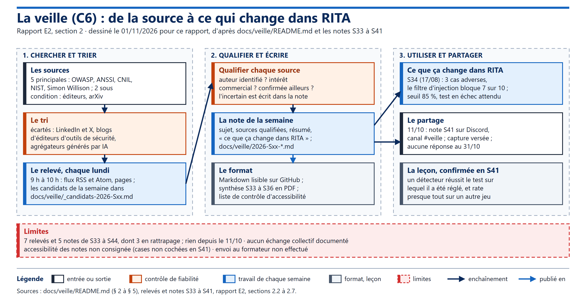
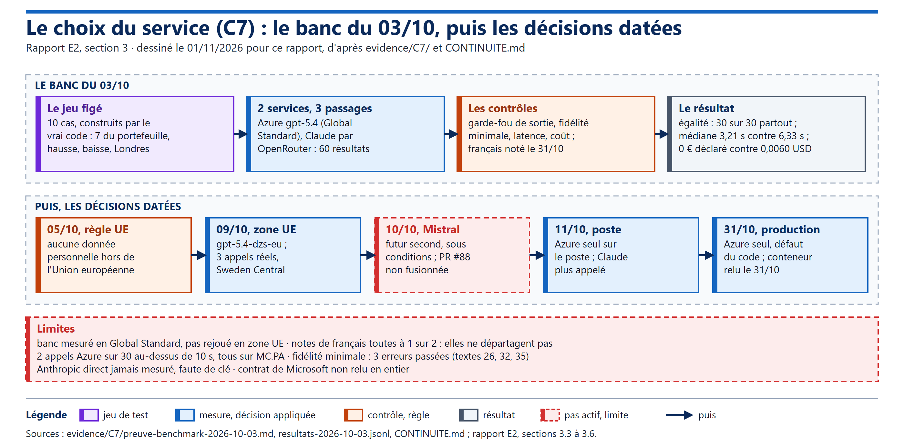
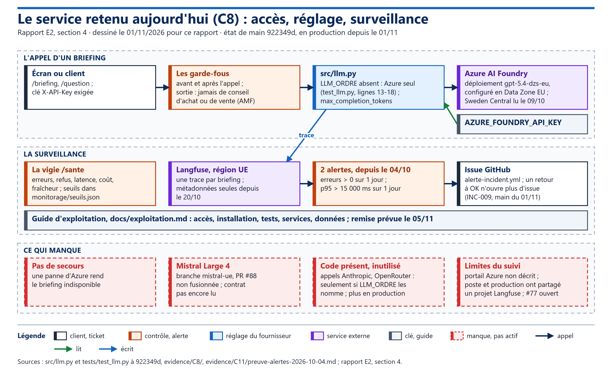

# Annexe du rapport E2 : les schémas

Projet fil rouge **RITA** · **Eramalingam Gandakumar** · Développeur en intelligence artificielle, RNCP 37827 · Simplon × Wild Code School · compétences C6 à C8 · annexe du rapport E2, version 0.7, 1er novembre 2026
{: .identite }

> Cette annexe montre trois schémas, un par compétence, chacun sur sa page et suivi de sa légende : ce qu'il montre
> pour E2, d'où viennent ses textes, et sa limite. **Ils ont été dessinés le 01/11/2026 pour ce rapport**, à partir des
> preuves que le rapport cite : ce sont des figures de synthèse, pas des documents de conception d'époque. Aucun schéma
> propre à E2 n'existait dans le dépôt, et ceux du rapport E3 disent encore « cascade, Azure d'abord », vrai au 24/10
> mais plus aujourd'hui.

## Les schémas de cette annexe {: .sommaire }

| | Schéma | Critères | Contenu | Page |
|---|---|---|---|---|
| A1 | La veille : de la source à ce qui change dans RITA | C6 | protocole de la veille et notes S33 à S41 | 2 |
| A2 | Le choix du service : le banc du 03/10, puis les décisions datées | C7 | banc du 03/10, décisions du 05/10 au 31/10 | 3 |
| A3 | Le service retenu aujourd'hui : accès, réglage, surveillance | C8 | `main` à `922349d`, en production depuis le 01/11 | 4 |

**Comment ils sont faits.** Un seul fichier décrit les trois schémas, `docs/rapports/E2/schemas/generer_schemas.py` ;
il écrit pour chacun un `.drawio`, à corriger dans draw.io, et un `.svg`, rendu en `.png` par Chrome. Il reprend le
moteur de dessin des schémas d'E3, pour garder la même charte, et refuse d'écrire une boîte dont le texte déborde.

### Les schémas en miniature

<a href="#a1">A1 · la veille · p. 2</a>
<a href="#a2">A2 · le choix du service · p. 3</a>
<a href="#a3">A3 · le service aujourd'hui · p. 4</a>

## A1. La veille, de la source à ce qui change dans RITA (C6) {: #a1 }

**Ce qu'il montre pour E2** : le trajet d'une information, des cinq sources principales et des deux sources sous
condition jusqu'à la note de la semaine, puis à ce qu'elle change dans RITA (le filtre d'injection, 7 attaques bloquées
sur 10 après la note S34) et à son partage (la note S41 sur Discord, le 11/10). La qualification de chaque source est
le contrôle central. **D'où viennent ses textes** : `docs/veille/README.md` (§ 2 à § 5), les relevés et les notes
S33 à S41, et les sections 2.2 à 2.7 du rapport. **Limites** : le rythme n'est pas tenu (7 relevés et 5 notes de S33 à
S44, rien depuis le 11/10) ; aucun échange collectif n'est documenté ; l'accessibilité des notes n'est pas consignée.

## A2. Le choix du service : le banc du 03/10, puis les décisions datées (C7) {: #a2 }

**Ce qu'il montre pour E2** : en haut, le banc du 03/10, du jeu figé de dix cas aux 60 résultats et à leurs
contrôles ; en bas, les décisions qui ont suivi, chacune à sa date, jusqu'à l'état d'aujourd'hui : Azure `gpt-5.4`
seul, sur le poste depuis le 11/10 et en production depuis le 31/10. Claude, par OpenRouter, n'apparaît qu'en haut, comme
service comparé ; il a aussi servi de secours lors d'essais locaux, et n'est plus appelé depuis le 31/10. **D'où viennent ses textes** : `evidence/C7/preuve-benchmark-2026-10-03.md`,
`evidence/C7/resultats-2026-10-03.jsonl`, `CONTINUITE.md`, et les sections 3.3 à 3.6 du rapport. **Limites** : le banc a
été mesuré sur le déploiement mondial d'Azure, pas sur celui de la zone UE ; les notes de français ne départagent pas
les services ; Mistral Large 4 reste sur une branche non fusionnée.

## A3. Le service retenu aujourd'hui : accès, réglage, surveillance (C8) {: #a3 }

**Ce qu'il montre pour E2** : l'appel d'un briefing, de l'écran au déploiement Azure configuré en zone UE, avec la clé lue dans
l'environnement et le réglage `LLM_ORDRE` ; la surveillance, des traces Langfuse aux deux alertes et à l'issue GitHub,
avec la vigie `/sante` ; le guide d'exploitation ; et, en pointillé, ce qui manque. **D'où viennent ses textes** :
`src/llm.py` et `tests/test_llm.py` à `922349d`, `evidence/C8/`, `evidence/C11/preuve-alertes-2026-10-04.md`, et la
section 4 du rapport. **Limites** : aucun secours si Azure tombe ; les fonctions d'appel d'Anthropic et d'OpenRouter
restent dans le code sans servir ; la supervision du portail Azure n'est pas décrite ; la remise du guide reste à
prouver.
