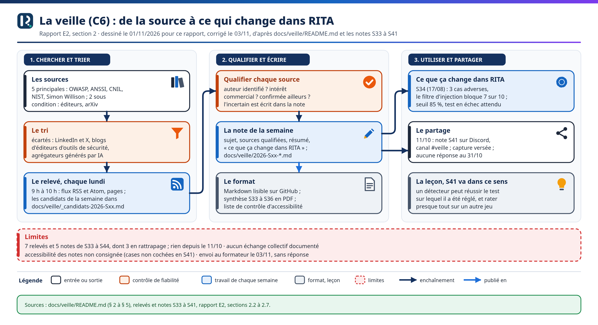

# Annexe du rapport E2 : les schémas {: .ecran }

## A1. La veille, de la source à ce qui change dans RITA (C6) {: #a1 }

**Mise en forme du 03/11**, texte identique à l'original du générateur (`schemas/E2-veille.svg`). **Ce qu'il montre pour E2** : le trajet d'une information, des cinq sources principales et des deux sources sous
condition jusqu'à la note de la semaine, puis à ce qu'elle change dans RITA (le filtre d'injection, 7 attaques bloquées
sur 10 après la note S34) et à son partage (la note S41 sur Discord, le 11/10). La qualification de chaque source est
le contrôle central. **D'où viennent ses textes** : `docs/veille/README.md` (§ 2 à § 5), les relevés et les notes
S33 à S41, et les sections 2.2 à 2.7 du rapport. **Limites** : le rythme n'est pas tenu (7 relevés et 5 notes de S33 à
S44, rien depuis le 11/10) ; aucun échange collectif n'est documenté ; l'accessibilité des notes n'est pas consignée.

**Actualisation du 04/11** : réception et accès aux liens confirmés par le formateur ; aucun échange collectif documenté.

## A2. Le choix du service : le banc du 03/10, puis les décisions datées (C7) {: #a2 }

**Mise en forme du 03/11**, texte identique à l'original du générateur (`schemas/E2-banc-decision.svg`). **Ce qu'il montre pour E2** : en haut, le banc du 03/10, du jeu figé de dix cas aux 60 résultats et à leurs
contrôles ; en bas, les décisions qui ont suivi, chacune à sa date, jusqu'à l'état d'aujourd'hui : Azure `gpt-5.4`
seul, sur le poste depuis le 11/10 et en production depuis le 31/10. Claude, par OpenRouter, n'apparaît qu'en haut, comme
service comparé ; il a aussi servi de secours lors d'essais locaux, et n'est plus appelé depuis le 31/10. **D'où viennent ses textes** : `evidence/C7/preuve-benchmark-2026-10-03.md`,
`evidence/C7/resultats-2026-10-03.jsonl`, `CONTINUITE.md`, et les sections 3.3 à 3.6 du rapport. **Limites** : le banc a
été mesuré sur le déploiement mondial d'Azure, pas sur celui de la zone UE ; les notes de français ne départagent pas
les services. **10/10 · Mistral Large 4 · briefing LVMH réussi en essai · non activé en production**
(`evidence/C8/preuve-briefing-mistral-2026-10-10.md`, branche `mistral-ue`, PR #88 non fusionnée).

## A3. Le service retenu aujourd'hui : accès, réglage, surveillance (C8) {: #a3 }

**Mise en forme du 03/11**, texte identique à l'original du générateur (`schemas/E2-service-aujourdhui.svg`). **Ce qu'il montre pour E2** : l'appel d'un briefing, de l'écran au déploiement Azure configuré en zone UE, avec la clé lue dans
l'environnement et le réglage `LLM_ORDRE` ; la surveillance, des traces Langfuse aux deux alertes et à l'issue GitHub,
avec `/sante` et la vigie ; le guide d'exploitation ; et, en pointillé, ce qui manque. **D'où viennent ses textes** :
`src/llm.py` et `tests/test_llm.py` à `922349d`, `evidence/C8/`, `evidence/C11/preuve-alertes-2026-10-04.md`, et la
section 4 du rapport. **Limites** : aucun secours si Azure tombe ; **Mistral Large 4 est le secours envisagé**, après une comparaison avec
Azure UE sur 10 cas et la lecture de son contrat, et n'est pas activé ; les fonctions d'appel d'Anthropic et d'OpenRouter
restent dans le code sans servir ; la supervision du portail Azure n'est pas décrite ; le guide a été envoyé au formateur le
03/11 (rapport, § 4.6).
