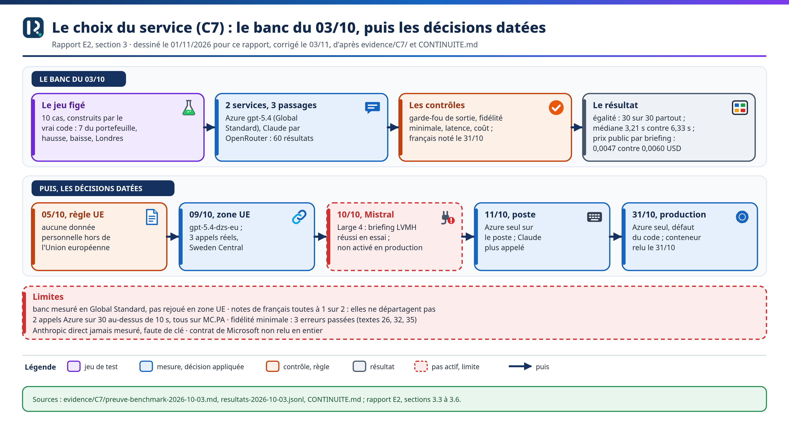
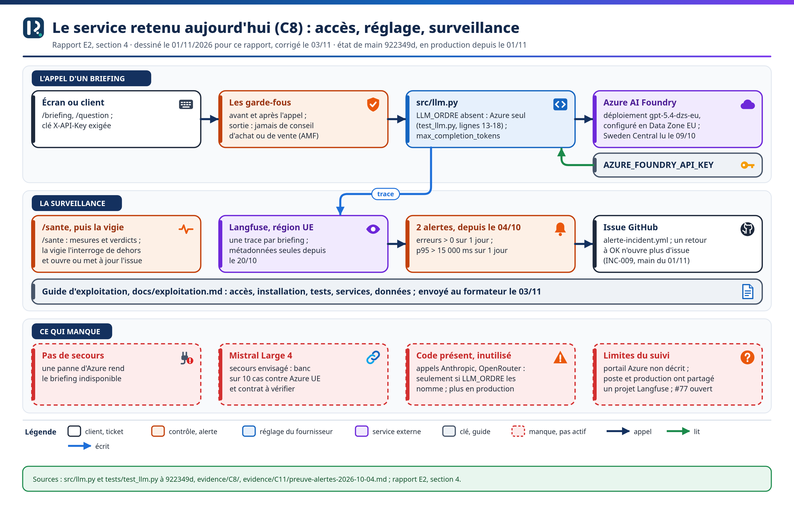
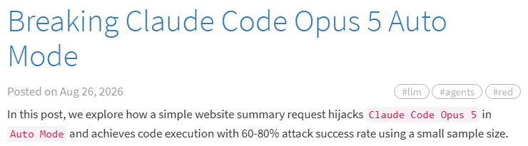
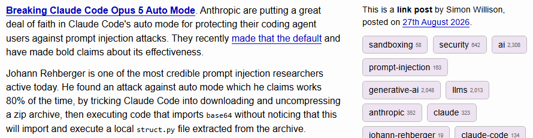
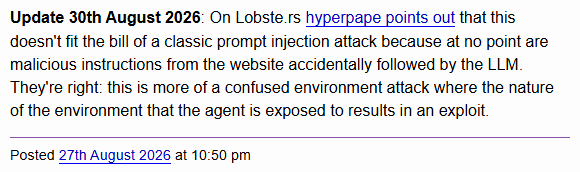
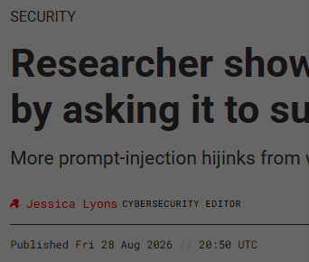
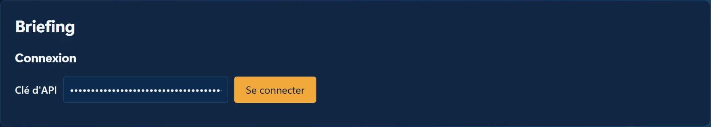
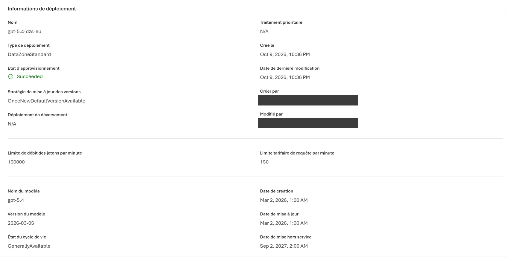
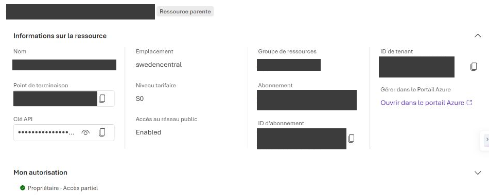
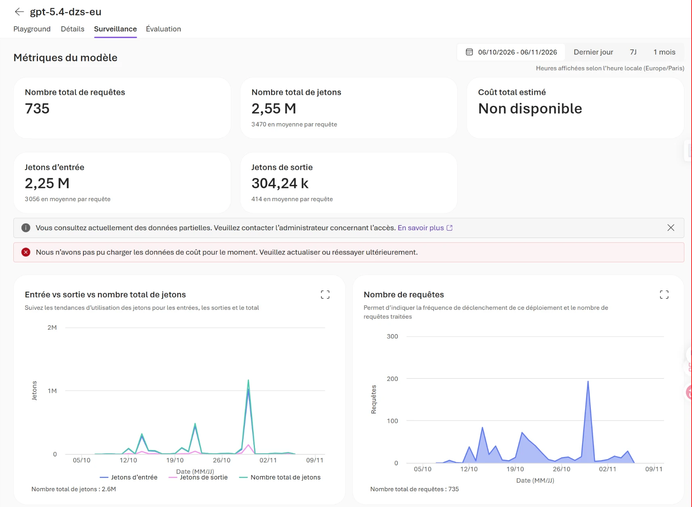

# Annexe du rapport E2 : les schémas {: .ecran }

## A1. La veille, de la source à ce qui change dans RITA (C6) {: #a1 }

**Mise en forme du 03/11**, texte identique à l'original du générateur (`schemas/E2-veille.svg`). **Ce qu'il montre pour E2** : le trajet d'une information, des cinq sources principales et des deux sources sous
condition jusqu'à la note de la semaine, puis à ce qu'elle change dans RITA (le filtre d'injection, 7 attaques bloquées
sur 10 après la note S34) et à son partage (la note S41 sur Discord, le 11/10). La qualification de chaque source est
le contrôle central. **D'où viennent ses textes** : `docs/veille/README.md` (§ 2 à § 5), les relevés et les notes
S33 à S41, et les sections 2.2 à 2.7 du rapport. **Limites** : le rythme n'est pas tenu (7 relevés et 5 notes de S33 à
S44, rien depuis le 11/10) ; aucun échange collectif n'est documenté ; l'accessibilité des notes n'est pas consignée.

**Actualisation du 04/11** : réception et accès aux liens confirmés par le formateur ; aucun échange collectif documenté.

## A2. Le choix du service : le banc du 03/10, puis les décisions datées (C7) {: #a2 }

**Mise en forme du 03/11**, texte identique à l'original du générateur (`schemas/E2-banc-decision.svg`). **Ce qu'il montre pour E2** : en haut, le banc du 03/10, du jeu figé de dix cas aux 60 résultats et à leurs
contrôles ; en bas, les décisions qui ont suivi, chacune à sa date, jusqu'à l'état du 03/11 : Azure `gpt-5.4`
seul, sur le poste depuis le 11/10 et en production depuis le 31/10. Claude, par OpenRouter, n'apparaît qu'en haut, comme
service comparé ; il a aussi servi de secours lors d'essais locaux, et n'est plus appelé depuis le 31/10. **D'où viennent ses textes** : `evidence/C7/preuve-benchmark-2026-10-03.md`,
`evidence/C7/resultats-2026-10-03.jsonl`, `CONTINUITE.md`, et les sections 3.3 à 3.6 du rapport. **Limites** : le banc a
été mesuré sur le déploiement mondial d'Azure, pas sur celui de la zone UE ; les notes de français ne départagent pas
les services. **10/10 · Mistral Large 4 · briefing LVMH réussi en essai · non activé en production**
(`evidence/C8/preuve-briefing-mistral-2026-10-10.md`, branche `mistral-ue`, PR #88 non fusionnée). **Au 07/11** : banc Azure UE contre Mistral
Large 3 fait (rapport, 3.4).

## A3. Le service retenu au 03/11 : accès, réglage, surveillance (C8) {: #a3 }

**Schéma historique : état au 03/11**, mise en forme du jour, texte identique à l'original du générateur (`schemas/E2-service-aujourdhui.svg`). **Ce qu'il montre pour E2** : l'appel d'un briefing, de l'écran au déploiement Azure configuré en zone UE, avec la clé lue dans
l'environnement et le réglage `LLM_ORDRE` ; la surveillance, des traces Langfuse aux deux alertes et à l'issue GitHub,
avec `/sante` et la vigie ; le guide d'exploitation ; et, en pointillé, ce qui manque. **D'où viennent ses textes** :
`src/llm.py` et `tests/test_llm.py` à `922349d`, `evidence/C8/`, `evidence/C11/preuve-alertes-2026-10-04.md`, et la
section 4 du rapport. **Limites** : aucun secours si Azure tombe ; **Mistral Large 4 est le secours envisagé**, après une comparaison avec
Azure UE sur 10 cas et la lecture de son contrat, et n'est pas activé ; les fonctions d'appel d'Anthropic et d'OpenRouter
restent dans le code sans servir ; la supervision du portail Azure est relevée depuis le 06/11 (rapport, § 4.4 ; annexe A6) ; le guide a été envoyé au formateur le
03/11 (rapport, § 4.6). **Au 07/11** : banc Azure UE contre Mistral Large 3 fait (rapport, 3.4) ; Azure seul actif.
**Au 14/11** : Azure refuse la clé du serveur depuis le 13/11 ; Mistral Large 3 répond en secours, Azure restant premier
(rapport, § 4.2, encadré « Depuis le 14/11 »).

## A4. Les preuves de la veille : la source S36, vérifiée le 06/11 (C6) {: #a4 }

Extraits des pages vérifiées le 06/11 pour l'exemple complet du rapport (§ 2.2) ; pages entières dans
`evidence/C6/captures-S36-2026-11-06/`.
{: .legende }

{: .cadre }

**Capture 1** : l'article, publié le 26/08/2026 (la note S36 écrit le 27/08).
{: .legende }

{: .cadre }

**Capture 2** : le billet de Simon Willison, un « link post » du 27/08, qui présente l'auteur et renvoie à l'article.
{: .legende }

{: .demi } {: .demi }

**Capture 3** : la mise à jour du 30/08, qui accepte une nuance. **Capture 4** : l'en-tête de The Register (28/08),
assombri par sa fenêtre de consentement aux cookies, non acceptée.
{: .legende }

{: .cadre }

**Capture 5** : la présentation de l'orateur sur la page de l'Ekoparty 2023, qui relie le blog à Johann Rehberger.
{: .legende }

**Le relevé d'accessibilité du 06/11.** Un script lit chaque page comme elle est servie, sans connexion (`evidence/C6/mesure-accessibilite-sources.py`, résultat daté à côté). Ce n'est pas un audit RGAA ni WCAG : le contraste, le clavier et la lecture par un lecteur d'écran ne sont pas mesurés, et les PDF ne sont pas lus.

| Source | Accès | Accessibilité relevée |
|---|---|---|
| OWASP GenAI, page du Top 10 agentique | gratuit, sans compte | langue déclarée ; 9 titres, aucun saut de niveau ; aucune image sans texte alternatif (6 images) |
| ANSSI, page du guide | gratuit, sans compte | 4 titres, aucun saut ; aucune image sans alternative (3) ; 1 lien au texte vague sur 11 |
| CNIL, note sur l'IA agentique | gratuit, sans compte | 5 titres, 1 saut de niveau ; aucune image sans alternative (9) |
| NIST, AI RMF | gratuit, sans compte | 12 titres, aucun saut ; aucune image sans alternative (11) ; 1 lien vague sur 164 |
| Simon Willison, billet S36 | gratuit, sans compte | 3 titres, aucun saut ; pas d'image |
| Johann Rehberger, article S36 | gratuit, sans compte | 25 titres, aucun saut, dont 2 de premier niveau ; aucune image sans alternative (9) |
| The Register, article S36 | gratuit, sans compte ; fenêtre de consentement aux cookies | 43 titres, 1 saut ; aucune image sans alternative (13) |
| arXiv, préprint S41 | gratuit, sans compte | 14 titres, dont 7 de premier niveau ; aucune image sans alternative (4) |
| NeurIPS, AgentDojo (S41) | gratuit, sans compte | 3 titres, 1 saut ; pas d'image |

## A5. Le détail du banc du 03/10 : par cas, et les indicateurs cités (C7) {: #a5 }

Les 60 résultats bruts : 10 cas, 2 services, 3 répétitions par cas (`evidence/C7/resultats-2026-10-03.jsonl`). Sur chaque
cas, les deux services passent les trois fois le garde-fou de sortie et le contrôle minimal de fidélité ; ce qui les
sépare, c'est la durée, en médiane et en maximum des trois appels. Les deux appels d'Azure au-dessus de 10 s portent sur
MC.PA ; la taille de la consigne ne l'explique pas (754 jetons d'entrée, contre 686 en médiane), et trois répétitions ne
permettent pas d'en établir la cause.
{: .legende }

| Cas | Pourquoi ce cas | Azure `gpt-5.4`, médiane / maximum | OpenRouter Claude, médiane / maximum |
|---|---|---|---|
| AI.PA | portefeuille | 3,20 s / 3,48 s | 5,69 s / 6,08 s |
| BNP.PA | portefeuille | 4,47 s / 6,84 s | 6,88 s / 7,20 s |
| MC.PA | portefeuille | **10,69 s / 11,86 s** | 6,42 s / 6,47 s |
| OR.PA | portefeuille | 5,57 s / 6,33 s | 6,03 s / 6,06 s |
| SAN.PA | portefeuille | 2,81 s / 2,97 s | 6,55 s / 6,58 s |
| SU.PA | portefeuille | 3,39 s / 3,49 s | 6,32 s / 7,04 s |
| VIRI.PA | portefeuille, sans article retrouvé | 2,60 s / 2,91 s | 6,34 s / 6,90 s |
| CO.PA | plus forte hausse de la séance (+9,09 %) | 2,49 s / 4,00 s | 5,29 s / 5,73 s |
| ALMKT.PA | plus forte baisse (−11,29 %), sans article | 2,57 s / 2,60 s | 6,87 s / 7,18 s |
| HSBA.L | cotée à Londres, en livres, sans article | 3,21 s / 5,60 s | 6,31 s / 7,30 s |

Ce que chaque service choisit de citer, sur les mêmes 60 textes : pour chaque indicateur, les textes où sa valeur
apparaît avec la virgule française et le même nombre de décimales que dans le prompt
(`evidence/C7/mesure-indicateurs-cites.py`). C'est une heuristique : un chiffre arrondi autrement n'est pas compté. Ce
comptage décrit une manière de résumer ; il ne dit pas si les chiffres cités sont justes, et il n'a pas pesé dans le
choix. Volatilité annualisée : amplitude des variations quotidiennes, ramenée à une année ; drawdown maximal : la plus
forte baisse entre un sommet et le creux qui le suit, sur un an.
{: .legende }

| Indicateur reçu par le modèle | Azure `gpt-5.4`, textes qui le citent (sur 30) | OpenRouter Claude (sur 30) |
|---|---|---|
| Cours de clôture | 30 | 29 |
| Variation du jour | 30 | 30 |
| Capitaux échangés en moyenne sur 20 séances | 14 | 1 |
| Performance sur 1 semaine | 29 | 20 |
| Performance sur 1 mois | 28 | 21 |
| Performance depuis le 1er janvier | 24 | 15 |
| Performance sur 1 an | 10 | 9 |
| Moyenne mobile sur 20 séances | 30 | 29 |
| Moyenne mobile sur 50 séances | 29 | 22 |
| Distance au plus haut sur 1 an | 10 | 14 |
| Volatilité annualisée | 17 | 21 |
| Drawdown maximal sur 1 an | **0** | **0** |
| RSI 14 | 29 | 28 |
| **En moyenne, par texte** | **9,3 sur 13** | **8,0 sur 13** |

## A6. Les preuves du service : accès, briefing, trace, portail Azure (C8) {: #a6 }

Le service s'essaie à <https://178-104-184-125.sslip.io/briefing.html> ; la clé est transmise à part au jury. Captures du
06/11 ; nom de la ressource Azure, adresse, identifiants, e-mail et clé publique de Langfuse masqués : aucun ne sert à
la preuve, un tag `livrable-*` ne s'efface plus, et la clé publique suffit à envoyer des scores dans le projet Langfuse.
Tout ce qui prouve le critère reste lisible ; les originaux se montrent en direct à l'oral. Captures entières dans
`evidence/C8/captures-2026-11-06/`.
{: .legende }

{: .cadre }

**Capture 6** : la connexion en production, clé masquée.
{: .legende }

{: .demi } {: .demi }

**Captures 7 et 8** : le briefing d'OR.PA en production après la correction du prompt (version `097b201`), puis sa
trace, retrouvée par le `request_id` affiché à l'écran. Les trois articles fournis au modèle datent du 14 au 17/09 :
l'écran affiche leurs dates, et ils ne sont pas récents.
{: .legende }

{: .cadre }

**Capture 9** : le déploiement, type DataZoneStandard, `gpt-5.4` version 2026-03-05, créé le 09/10 à 22:36.
{: .legende }

{: .cadre }

**Capture 10** : la ressource, emplacement `swedencentral`.
{: .legende }

{: .cadre }

**Capture 11** : la surveillance du déploiement, du 06/10 au 06/11/2026 : 735 requêtes ; Azure indique des données
partielles et n'affiche pas le coût.
{: .legende }
