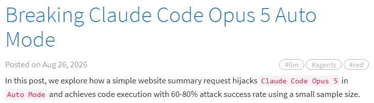
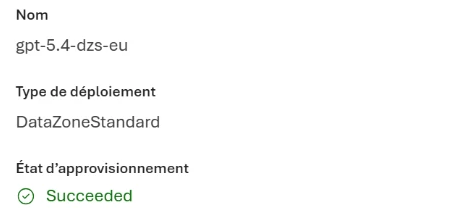
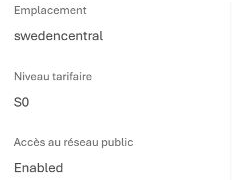
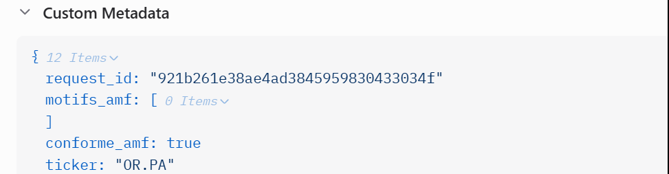

<style>
.logo{ float:right; width:15mm; margin:7pt 0 2pt 12pt; }
.identite{ color:var(--ink-soft); font-size:9.4pt; }
.sommaire{ margin:9pt 0 2pt; padding:6pt 10pt 5pt; border:.5pt solid var(--rule); border-radius:2pt; }
.sommaire-titre{ font-family:Georgia,"Times New Roman",serif; font-weight:600; font-size:11pt; margin:0 0 4pt; }
.sommaire ol{ list-style:none; padding:0; margin:0; columns:2; column-gap:22pt; }
.sommaire li{ display:flex; justify-content:space-between; gap:8pt; margin:0 0 2pt; break-inside:avoid; font-size:9.4pt; }
.sommaire li a{ color:var(--ink); }
.sommaire li span{ color:var(--accent); font-weight:600; }
p, li{ orphans:3; widows:3; }
.saut-page{ break-before:page; }
h2#criteres, h2#criteres + p{ break-after:avoid; }
/* 06/11 (retour du formateur : trop de texte sans espacement) : texte plus aéré, repère des critères en tête de
   chaque compétence, captures côte à côte. */
body{ line-height:1.45; }
p{ margin:0 0 7pt; }
li{ margin-bottom:3pt; }
td{ padding:4pt 7pt 4pt 0; }
.repere{ background:#F1F6FB; border-left:3pt solid var(--marine); padding:5pt 9pt 4pt; margin:5pt 0 11pt; font-size:9.4pt; }
img.demi{ display:inline-block; width:48.5%; margin:4pt .5% 2pt; vertical-align:top; border:.4pt solid var(--rule); }
img.cadre{ border:.4pt solid var(--rule); }
img.gauche{ display:inline-block; width:62%; vertical-align:top; border:.4pt solid var(--rule); margin:4pt 1% 2pt 0; }
img.droite{ display:inline-block; width:33%; vertical-align:top; border:.4pt solid var(--rule); margin:4pt 0 2pt 1%; }
/* 06/11, choix sur le nuancier : tableaux d'information en style A (en-tête marine, lignes zébrées) ;
   grille des critères, banc et matrice en style C (grille, bandes de compétence, couleurs des services, pastilles). */
:root{ --zebre:#F2F6FA; --sarcelle:#14607F; --ciel:#D6E6F7; --ok-fond:#DFF2E5; --ok-texte:#17633A;
  --alerte-fond:#FFF0C7; --alerte-texte:#7A4E00; --c6:#0F7A6B; --c7:#3B3FA8; --c8:#A35A00; --azure:#0B5CAD; --claude:#7A3E8F;
  --p-mesure:#DFF2E5; --p-mesure-t:#17633A; --p-observe:#D9F1F1; --p-observe-t:#0E5E63; --p-doc:#E3EAFA; --p-doc-t:#27448A;
  --p-na:#ECEEF1; --p-na-t:#4E5763; --p-essai:#FCE6D9; --p-essai-t:#8A3B12; }
table thead th{ background:var(--marine); color:#fff; padding:4pt 6pt; }
table tbody tr:nth-child(even) td{ background:var(--zebre); }
table tbody td:first-child{ font-weight:600; color:var(--marine); }
td{ padding-left:6pt; }
table.grille-c{ border:.5pt solid var(--rule); }
table.grille-c th, table.grille-c td{ border:.5pt solid var(--rule); padding:3pt 6pt; }
table.grille-c thead th{ background:var(--sarcelle); }
table.grille-c tbody tr:nth-child(even) td{ background:#F7FAFC; }
table.grille-c tbody td:first-child{ background:var(--ciel); }
table.grille-c tr.groupe th{ color:#fff; text-align:left; text-transform:none; letter-spacing:.03em; font-size:9pt; padding:2pt 6pt; }
table.grille-c tr.groupe.c6 th{ background:var(--c6); }
table.grille-c tr.groupe.c7 th{ background:var(--c7); }
table.grille-c tr.groupe.c8 th{ background:var(--c8); }
table.grille-c td.ok{ background:var(--ok-fond); color:var(--ok-texte); text-align:center; font-weight:700; }
table.grille-c td.alerte{ background:var(--alerte-fond); color:var(--alerte-texte); text-align:center; font-weight:700; }
table.grille-c thead th.azure{ background:var(--azure); }
table.grille-c thead th.claude{ background:var(--claude); }
table thead th code{ color:#fff; background:rgba(255,255,255,.16); border:none; }
table.banc td{ font-variant-numeric:tabular-nums; }
table.banc td.gagne{ font-weight:700; color:var(--ok-texte); }
table.banc td.gagne::after{ content:" ▲"; font-size:7pt; }
.note-tableau{ font-size:8.6pt; color:var(--ink-soft); margin-top:-4pt; }
.chip{ display:inline-block; font-size:7.4pt; font-weight:700; text-transform:uppercase; letter-spacing:.03em; padding:0 4pt;
  border-radius:6pt; margin-right:3pt; line-height:1.5; }
.chip.mesure{ background:var(--p-mesure); color:var(--p-mesure-t); } .chip.observe{ background:var(--p-observe); color:var(--p-observe-t); }
.chip.doc{ background:var(--p-doc); color:var(--p-doc-t); } .chip.na{ background:var(--p-na); color:var(--p-na-t); }
.chip.essai{ background:var(--p-essai); color:var(--p-essai-t); }
/* Titres (06/11, choix sur le nuancier des titres, style 3) : dégradé marine vers sarcelle, sans bande ni filet ;
   pour E2 seulement, la feuille commune (scripts/rendre_pdf.py) garde les bandeaux bleus des autres rapports. */
body h1, body h2{ background:linear-gradient(90deg, #12395E, #14607F); color:#fff; }
body h1{ padding:3pt 10pt; }
body h2{ padding:2pt 10pt; }
body h3{ background:linear-gradient(90deg, #D6E6F7, #EEF5FC); color:#12395E; padding:1pt 9pt; }
/* Code et encadrés (06/11) : le code sur fond marine foncé, comme un éditeur ; les longs passages en
   encadrés sans bordure, colorés par rôle : méthode (bleu), preuve (vert), limite (ambre), décision (indigo). */
pre{ background:#0F2A44; color:#E8EEF5; border:none; border-radius:4pt; padding:7pt 10pt; }
pre code{ color:inherit; background:none; }
code{ background:#E3F0F3; color:#0D4C5E; border-radius:2pt; }
.encadre{ border-radius:5pt; padding:6pt 11pt 4pt; margin:6pt 0 9pt; break-inside:avoid; }
.encadre p{ margin:0 0 5pt; }
.encadre ul{ margin:0 0 5pt; padding-left:14pt; }
.encadre li{ margin-bottom:2pt; }
.encadre-titre{ font-family:Georgia,"Times New Roman",serif; font-weight:700; font-size:10.4pt; }
.encadre.methode{ background:#EAF2FB; } .encadre.methode .encadre-titre{ color:#0B5CAD; }
.encadre.preuve{ background:#E6F4EC; } .encadre.preuve .encadre-titre{ color:#17633A; }
.encadre.limite{ background:#FFF4D9; } .encadre.limite .encadre-titre{ color:#7A4E00; }
.encadre.decision{ background:#ECEBFB; } .encadre.decision .encadre-titre{ color:#3B3FA8; }
.encadre.contrainte{ background:#F4F6F9; padding-bottom:6pt; } .encadre.contrainte .encadre-titre{ color:#12395E; }
.encadre .ligne{ border-radius:3pt; padding:3pt 8pt; margin:0 0 4pt; }
.encadre .ligne.prouve{ background:#E6F4EC; } .encadre .ligne.prouve b{ color:#17633A; }
.encadre .ligne.ecart{ background:#FFF4D9; } .encadre .ligne.ecart b{ color:#7A4E00; }
.encadre .ligne.choix{ background:#ECEBFB; } .encadre .ligne.choix b{ color:#3B3FA8; }
.encadre .ligne.evaluation{ background:#E9ECF0; } .encadre .ligne.evaluation b{ color:#4E5763; }
p.glossaire-suite{ break-before:page; font-family:Georgia,"Times New Roman",serif; font-weight:600; font-size:12pt; color:var(--marine); margin:0 0 6pt; }
h2#glossaire ~ table td{ padding:3pt 6pt 3pt 0; line-height:1.45; font-size:9.8pt; }  /* 07/11 : plus lisible, quitte à prendre une page de plus (20 au plus) */
/* 08/11 : mise en forme « luxe fintech » de la maquette E2 du 08/11 (formes seules, texte inchangé) : en-tête de
   tableau en bleus par colonne, cellules sur fond pâle sans zébrage, filets fins, sous-titres en bandeau uni avec barre
   marine, filets marine et sarcelle en bord de page (boîtes de marge de @page ; page 1 : sous le titre, sans filet haut). */
/* 08/11, après la maquette : bleus clairs des en-têtes assombris, texte blanc à 5:1 au moins (WCAG AA). */
table{ --rule:#C5D0DA; --rule-strong:#C5D0DA; }
table thead th:nth-child(1), table thead th.azure:nth-child(1), table thead th.claude:nth-child(1){ background:#0A2550; }
table thead th:nth-child(2), table thead th.azure:nth-child(2), table thead th.claude:nth-child(2){ background:#0066A3; }
table thead th:nth-child(3), table thead th.azure:nth-child(3), table thead th.claude:nth-child(3){ background:#007494; }
table thead th:nth-child(4), table thead th.azure:nth-child(4), table thead th.claude:nth-child(4){ background:#007B86; }
table thead th:nth-child(n+5), table thead th.azure:nth-child(n+5), table thead th.claude:nth-child(n+5){ background:#00798F; }
table thead th:nth-child(2):last-child{ background:#007494; }
p.glossaire-suite{ background:#D6E6F7; border-left:4px solid #12395E; margin-left:-7pt; padding-left:calc(7pt - 4px); }
table tbody tr td:not(.ok):not(.alerte){ background:#EEF2F6; }
table tbody tr td:first-child:not(.ok):not(.alerte){ background:#E6EEF5; }
body h3{ background:#D6E6F7; border-left:4px solid #12395E; padding-left:calc(9pt - 4px); }
@page{
  @top-left-corner{ content:""; border-left:3px solid #0B1F3A; border-top:2px solid #0B1F3A; background:linear-gradient(#1A7A8C, #1A7A8C) 0 0 / 100% 1px no-repeat, linear-gradient(#1A7A8C, #1A7A8C) 0 0 / 1px 100% no-repeat; }
  @top-center{ content:""; width:100%; height:1px; margin-bottom:auto; background:#1A7A8C; border-top:2px solid #0B1F3A; }
  @top-right-corner{ content:""; height:1px; margin-bottom:auto; background:#1A7A8C; border-top:2px solid #0B1F3A; }
  @left-top{ content:""; width:1px; margin-right:auto; background:#1A7A8C; border-left:3px solid #0B1F3A; }
  @left-middle{ content:""; width:1px; margin-right:auto; background:#1A7A8C; border-left:3px solid #0B1F3A; }
  @left-bottom{ content:""; width:1px; margin-right:auto; background:#1A7A8C; border-left:3px solid #0B1F3A; }
  @bottom-left-corner{ content:""; width:1px; margin-right:auto; background:#1A7A8C; border-left:3px solid #0B1F3A; }
}
@page :first{
  @top-left-corner{ content:none; } @top-center{ content:none; } @top-right-corner{ content:none; }
  @left-top{ border-left:0; width:4px; background:linear-gradient(#0B1F3A, #0B1F3A) 0 54.31pt / 3px 100% no-repeat, linear-gradient(#1A7A8C, #1A7A8C) 3px 54.31pt / 1px 100% no-repeat; }
}
</style>

<div></div>

# Rapport E2 : veille, choix d'un service de modèle, et son paramétrage

Projet fil rouge **RITA** · **Eramalingam Gandakumar** · Développeur en intelligence artificielle, RNCP 37827 · Simplon × Wild Code School · bloc de compétences 2, compétences C6 à C8 · version 1.6, 8 novembre 2026 · version de référence de l'application : commit `d3a4198` de `main`, en production le 27/10/2026 · code et preuves versionnés : `Ganda15/rita-agent`, version figée au tag `livrable-E2-v6`
{: .identite }

> **En une minute.** RITA rédige des briefings boursiers et répond à des questions sur les articles collectés. Elle
> aide à comprendre les données, sans être destinée à fournir des recommandations d'achat ou de vente.
>
> Le service retenu est **Azure AI Foundry, modèle GPT-5.4, configuré en zone de données UE**. Le banc du 03/10 compare
> Azure à Claude via OpenRouter : Azure est plus rapide en médiane, avec les mêmes résultats aux contrôles minimaux. Ce
> premier banc utilisait Global Standard. Le 07/11, un nouveau banc compare Azure en zone UE à Mistral Large 3, avec le
> prompt corrigé (3.4).
>
> Ce rapport présente la veille (C6), le choix du service (C7) et sa configuration avec ses preuves (C8). Azure reste le
> premier fournisseur. Depuis le 14/11, Mistral Large 3, par son adresse européenne, répond en secours quand Azure
> échoue : Azure refuse la clé du serveur depuis le 13/11, cause non établie (4.2).

<div class="sommaire" role="navigation" aria-label="Sommaire">
<p class="sommaire-titre">Sommaire</p>
<ol>
<li><a href="#lire">Lire ce rapport</a><span>p. 1</span></li>
<li><a href="#contexte">1. Le contexte, une seule fois</a><span>p. 1</span></li>
<li><a href="#c6">2. C6 : la veille technique et réglementaire</a><span>p. 2</span></li>
<li><a href="#c7">3. C7 : le choix du service de modèle</a><span>p. 6</span></li>
<li><a href="#c8">4. C8 : le service retenu, paramétré et suivi</a><span>p. 11</span></li>
<li><a href="#criteres">5. Les 20 critères, un par un</a><span>p. 15</span></li>
<li><a href="#reste">6. Ce qui n'est pas fait</a><span>p. 17</span></li>
<li><a href="#glossaire">Glossaire</a><span>p. 17</span></li>
<li><a class="vers-annexe" href="#a1">Annexe A1 : la veille (PDF avec annexe)</a><span>p. 19</span></li>
<li><a class="vers-annexe" href="#a2">Annexe A2 : le choix du service</a><span>p. 20</span></li>
<li><a class="vers-annexe" href="#a3">Annexe A3 : le service au 03/11</a><span>p. 21</span></li>
<li><a class="vers-annexe" href="#a4">Annexe A4 : les preuves de la veille</a><span>p. 22</span></li>
<li><a class="vers-annexe" href="#a5">Annexe A5 : le détail du banc</a><span>p. 26</span></li>
<li><a class="vers-annexe" href="#a6">Annexe A6 : les preuves du service</a><span>p. 28</span></li>
</ol>
</div>

## Lire ce rapport {: #lire }

Chaque section relie les critères à une décision et à ses preuves datées. Les mesures réalisées dans RITA sont
distinguées des informations documentaires et des éléments non évalués. Les annexes regroupent les schémas et les
captures complètes ; les renvois permettent de les ouvrir directement. Les corrections postérieures à la version de
référence portent leur date. Trois preuves s'ouvrent dans le dépôt, à la version `922349d` (les modalités d'accès du
jury sont transmises à part) :
[les 60 résultats du banc](https://github.com/Ganda15/rita-agent/blob/922349da2042a6f2272f9c7c0738641aa63eb1f3/evidence/C7/resultats-2026-10-03.jsonl),
[le réglage d'Azure](https://github.com/Ganda15/rita-agent/blob/922349da2042a6f2272f9c7c0738641aa63eb1f3/src/llm.py#L31-L36) et [son test](https://github.com/Ganda15/rita-agent/blob/922349da2042a6f2272f9c7c0738641aa63eb1f3/tests/test_llm.py#L13-L18),
[le guide d'exploitation](https://github.com/Ganda15/rita-agent/blob/922349da2042a6f2272f9c7c0738641aa63eb1f3/docs/exploitation.md).

---

## 1. Le contexte, une seule fois {: #contexte }

RITA rédige en français un briefing court sur une valeur boursière, à partir de données collectées (cours, taux,
séries macroéconomiques, articles de presse) et d'un modèle de langage fourni par un service extérieur ; depuis le
16/10, elle répond aussi à des questions libres sur les articles collectés. Trois contraintes tiennent tout :

- jamais de recommandation d'achat ou de vente (AMF) ;
- aucune position ni aucun prix de revient envoyé au modèle ;
- services configurés dans leurs régions de l'UE, transferts contractuels identifiés et encadrés, données limitées au
  nécessaire (règle du projet du 05/10, précisée le 06/11 ; 4.2).

Le rapport E1 décrit les données, le rapport E3 l'API, les tests, le monitorage et la livraison. Celui-ci décrit **ce qui
vient de l'extérieur** : l'état de l'art que je suis, le service que je choisis, et la façon dont je le paramètre.

---

## 2. C6 : la veille technique et réglementaire {: #c6 }

**Où lire chaque critère de C6.** C6.1 thématique : [2.1](#s2-1) · C6.2 temps planifiés : [2.2](#s2-2), [2.3](#s2-3) · C6.3 outils : [2.2](#s2-2) · C6.4 synthèses communiquées, format accessible : [2.5](#s2-5), [2.6](#s2-6) · C6.5 conformité à la thématique : [2.3](#s2-3) · C6.6 à C6.8 fiabilité des sources : l'exemple complet et l'accessibilité, [2.2](#s2-2), annexe A4 · tous les critères : [5](#criteres).
{: .repere }

### 2.1 Le sujet, et pourquoi lui {: #s2-1 }
Ma veille porte sur la **sécurité des agents de modèles de langage, et d'abord l'injection de prompt** : une instruction
placée dans un contenu que le modèle doit analyser, pour détourner son comportement. Le sujet touche RITA directement :
les titres et résumés des articles collectés par flux RSS (`sources/rss.py`) sont indexés, puis remontés par la
recherche documentaire dans le contexte du modèle, pour le briefing comme pour les questions. Un garde-fou relit ces
articles avant (`guardrails/injection.py`), et la veille sert à savoir ce qu'il vaut. Le scraping (`sources/scraper.py`)
ne collecte que des cotations : il n'alimente pas la recherche documentaire.

### 2.2 La méthode, telle qu'elle est pratiquée {: #s2-2 }
| Élément | Ce qui est fait | Où |
|---|---|---|
| Le rythme prévu | une heure par semaine, le lundi de 9 h à 10 h | `docs/veille/README.md`, § 2 |
| Le relevé | je lis les flux RSS et Atom, et les pages, des cinq sources retenues ; les nouveautés sont regroupées dans un fichier par semaine, avec la période balayée, la date du relevé, les sources balayées et le lien de chaque candidat | `docs/veille/_candidats-2026-Sxx.md` |
| La note | une note par semaine, écrite par moi : le sujet, les sources, leur fiabilité, et « ce que ça change dans RITA » | `docs/veille/2026-Sxx-*.md` |
| Les sources | cinq sources principales, chacune avec la raison de sa fiabilité et ses intérêts éventuels ; les blogs d'éditeurs d'outils de sécurité sont écartés, parce qu'ils décrivent le problème qu'ils vendent | `docs/veille/README.md`, § 3 |
| L'outil | des flux RSS relevés à la main et des fichiers de suivi versionnés dans le dépôt, sans abonnement dédié à la veille ; les flux financiers que RITA collecte ne sont pas l'outil de cette veille | `docs/veille/README.md`, § 4 |

L'assistant de développement peut aider à lire les flux pendant le relevé ; il ne choisit pas les sujets et n'écrit
pas la note.

**Un exemple complet, critère par critère : la note S36 (31/08 au 06/09).** Le formateur a demandé, le 06/11, de montrer sur une seule source chaque élément de la grille de fiabilité. La note S36 retient un article de Johann Rehberger : un assistant de code, en mode automatique, peut être détourné quand on lui demande de résumer une page piégée. C'est le geste de RITA, qui fait lire au modèle des contenus extérieurs. Vérification refaite le 06/11 sur les pages elles-mêmes.

| Ce que demande la grille | Ce que j'ai vérifié le 06/11 | Preuve (annexe A4) |
|---|---|---|
| L'auteur de la page est identifié | le blog *Embrace The Red* signe « wunderwuzzi », sans nom ; Willison et The Register l'attribuent à Johann Rehberger, et la page de l'Ekoparty 2023, l'organisateur d'une conférence de sécurité, écrit qu'il publie régulièrement sur ce blog | captures 1 et 5 |
| Les informations sur l'auteur confirment ses compétences et sa notoriété | selon l'Ekoparty (2023) : vingt ans en sécurité, une *red team* créée pour Azure chez Microsoft, directeur de la *red team* d'Electronic Arts, contributeur du Top 10 OWASP pour les modèles de langage ; exposé au 39C3 en décembre 2025 ([heise](https://heise.de/-11125687)) ; Simon Willison le présente comme l'un des chercheurs les plus crédibles du sujet ; environ 110 billets sur la sécurité des modèles depuis mars 2023 | captures 2 et 5 |
| Absence d'intérêt personnel | aucun intérêt commercial identifié lors de la vérification : l'article ne vend ni produit ni service ; il est aussi l'auteur d'un livre sur les *red teams* | capture 1 |
| L'analyse du contenu est valable : date récente, sources indiquées, langue correcte | publié le 26/08/2026 (la note S36 écrit le 27/08 : un jour d'écart, corrigé ici) ; méthode donnée étape par étape, avec captures et vidéo ; le taux de réussite annoncé, 60 à 80 %, porte sur un petit échantillon, ce que l'article dit lui-même ; signalé à Anthropic, qui a classé le rapport comme un comportement prévu ; anglais technique correct | capture 1 |
| La source est structurée | 25 titres sans saut de niveau ; texte en HTML, lisible et sélectionnable ; images avec texte alternatif, dont une qui ne décrit pas son image | relevé du 06/11, annexe A4 |
| Les sources accessibles sont privilégiées | page servie sans compte, langue déclarée, aucune image sans texte alternatif | relevé du 06/11, annexe A4 |
| L'information est confirmée par d'autres sites de confiance | Simon Willison (27/08) et The Register (28/08, Jessica Lyons, rédactrice cybersécurité) rapportent la démonstration et renvoient à l'article. Ce sont des **relais**, pas des reproductions : la source primaire reste unique. The Register a demandé l'avis d'Anthropic, sans réponse. Le 30/08, Willison accepte une nuance venue d'un lecteur : plutôt une attaque par environnement trompeur qu'une injection classique | captures 2 à 4 |
| Ce que cela change dans RITA | deux actions notées dans la note (vérifier que le garde-fou de sortie ne bloque jamais une action corrective ; documenter le choix des expressions régulières), **non faites au 06/11** ; le changement le plus net de la veille vient de la note S34 (2.4) | note S36 |

{: .cadre }

*Capture 1, extrait : l'article, publié le 26/08/2026. Les cinq captures sont en annexe A4 ; pages entières dans `evidence/C6/captures-S36-2026-11-06/`.*

<div class="encadre limite">
<p class="encadre-titre">Le contre-exemple : la note S41</p>
<p>Un préprint d'arXiv (2610.03448) que je garde comme une <b>piste</b>, pas comme une preuve (<code>docs/veille/2026-S41-mesurer-le-gardefou.md</code>) :</p>
<ul><li>auteur identifié, étudiant en master au JAIST, mais notoriété non établie ;</li><li>aucune relecture par des pairs ;</li><li>constat central recoupé par un seul autre préprint.</li></ul>
<p>Un auteur peu connu n'est pas une mauvaise source pour autant, mais il ne suffit pas seul.</p>
</div>

**Les sources, une par une.** Le protocole retient cinq sources principales et deux sous condition
(`docs/veille/README.md`, § 3) ; chaque note qualifie celles qu'elle utilise.

| Source (notes) | Pourquoi je lui fais confiance | Ce qui a été recoupé | Ce qui reste incertain |
|---|---|---|---|
| OWASP GenAI Security Project (S33, S34) | fondation à but non lucratif, aucun produit à vendre ; contributeurs nommés, dont les trois responsables du Top 10 agentique (S34) | S34 : lu dans le PDF d'origine, pas dans un résumé ; S33 : reprise par des médias spécialisés | les médias de reprise ne sont pas nommés dans la note S33 |
| ANSSI et CERT-FR (S33) | agence de l'État, source primaire officielle ; site public soumis au RGAA | source primaire officielle ; aucun recoupement complémentaire consigné | recommandations d'avril 2024 ; aucune publication sur le sujet dans la fenêtre du relevé S41 |
| CNIL et Conseil de l'IA et du Numérique (S34) | autorité administrative indépendante, aucun intérêt commercial ; site soumis au RGAA | note cosignée par deux institutions | note exploratoire de juillet 2026, pas une recommandation |
| NIST, AI Risk Management Framework (S34) | agence fédérale américaine, référence internationale ; site soumis à la Section 508 | retenu comme référence, sans autre recoupement écrit | cadre général de janvier 2023, pas propre à l'injection |
| Simon Willison (S33, S34, S36) | auteur identifié, a forgé le terme « prompt injection » en 2022 ; blog personnel, ne vend rien | S36 : son récit concorde avec ceux de Johann Rehberger et de The Register | blog sans relecture par des pairs ; aucun billet sur le sujet dans la fenêtre S41 |
| Presse et chercheurs hors liste (S36) | Johann Rehberger, chercheur reconnu (Ekoparty 2023, 39C3) ; The Register, rédaction identifiée, rien à vendre | Rehberger est la source primaire ; Willison et The Register en rendent compte et renvoient à son article, sans le reproduire | sources retenues pour un seul épisode |
| Préprints arXiv `cs.CR` (S34, S35, S36, S41) | auteurs nommés, aucun intérêt commercial repéré pour ceux retenus | S34 : résultat reproduit dans la note ; S41 : conclusions convergentes avec un autre préprint (arXiv 2610.08571) | non relus par des pairs ; S35 et S36 isolés, retenus comme signal, pas comme preuve ; S41 : auteur unique, notoriété non établie |
| Éditeurs de modèles (Anthropic, OpenAI) | expertise réelle sur leurs propres modèles | toujours croisés avec OWASP, l'ANSSI ou un travail universitaire | intérêt commercial direct : jamais source unique |

<div class="encadre preuve">
<p class="encadre-titre">L'accessibilité des sources</p>
<ul><li><i>écrite dans le protocole depuis le 14/08</i> : une colonne « Accessibilité » par source (<code>docs/veille/README.md</code>, § 3) : RGAA pour l'ANSSI et la CNIL, Section 508 pour le NIST, HTML sobre pour Willison ;</li><li><i>appliquée</i> : la note S41 cite la version HTML de l'article d'arXiv, « lisible sans ouvrir de PDF » ;</li><li><i>vérifiée le 06/11</i> : les neuf pages retenues sont libres d'accès, déclarent leur langue, sont du texte HTML, et aucune image n'y manque de texte alternatif ; trois ont un saut de niveau de titre (annexe A4).</li></ul>
<p>Ce n'est pas un audit RGAA ni WCAG, et les PDF ne sont pas lus.</p>
</div>

### 2.3 Ce qui a été produit, semaine par semaine {: #s2-3 }
| Semaine | Relevé | Note | Comment |
|---|---|---|---|
| S33 (10 au 16/08) | oui | oui | créneau tenu |
| S34 (17 au 23/08) | oui | oui | créneau tenu |
| S35 (24 au 30/08) | oui (25/08) | oui | note écrite en rattrapage le 08/09, l'en-tête le dit |
| S36 (31/08 au 06/09) | oui (31/08) | oui | note écrite en rattrapage le 08/09 |
| S37 (07 au 13/09) | oui (08/09) | non | |
| S38, S39 (14 au 27/09) | non | non | deux semaines sans séance |
| S40 (28/09 au 04/10) | oui (28/09) | non | |
| S41 (05 au 11/10) | oui (11/10) | oui | créneau du lundi non tenu ; relevé et note en rattrapage le 11/10 |
| S42 à S44 (12/10 au 01/11) | non | non | rien de conservé dans le dépôt |

Sept relevés et cinq notes de S33 à S44, dont trois notes en rattrapage ; rien de conservé depuis le 11/10. Le rythme hebdomadaire prévu n'a pas été tenu.

### 2.4 Ce que la veille a changé dans RITA {: #s2-4 }
Chaque note se termine par « ce que ça change dans RITA ». Le changement le plus net vient de la note S34 (17/08) :
le garde-fou d'injection affichait 100 %, mais ses 7 cas d'évaluation avaient été écrits à partir de ses propres motifs.
Avec trois cas adverses, il bloque 7 attaques sur 10, sans faux positif sur les 8 textes légitimes du jeu. Le seuil
reste fixé à 85 % : le test est marqué en échec attendu (`xfail`, `tests/test_evals.py`), visible dans chaque rapport
de tests sans bloquer la chaîne ; une CI verte ne veut donc pas dire que le seuil est atteint.

### 2.5 Le partage {: #s2-5 }
| Date | À qui | Canal | Note | Ce qui est prouvé |
|---|---|---|---|---|
| 16/08 | la promotion | Discord, canal général | S33 | partage consigné dans le journal ; capture absente ; aucun retour documenté |
| 11/10 | la promotion | Discord, canal #veille, 20 h 04 | S41, avec une question ouverte | partage prouvé par capture (`evidence/C6/envoi-2026-10-11-promo-discord-veille.png`) ; aucune réponse au 31/10 |
| 03/11 | le formateur | mail, 14 h 42, PDF joint | synthèse S33 à S36 | envoi prouvé (`evidence/C8/envoi-documents-formateur-2026-11-03.md`) ; réception confirmée par le formateur le 04/11 (`evidence/C8/reponse-formateur-2026-11-04.md`) |

Un message sans réponse prouve qu'on a publié, pas qu'on a animé un travail collectif (`docs/veille/_JOURNAL-DES-ENVOIS.md`) : ce qui manque, c'est un échange collectif documenté.

### 2.6 L'accessibilité {: #s2-6 }
Chaque note a une liste de contrôle d'accessibilité (`docs/veille/README.md`, § 5.4) : titres sans niveau sauté,
liens nommés, texte alternatif, tableaux avec en-tête, résumé en langage clair. Dans la note S41, ses cases ne sont pas
cochées. La synthèse S33 à S36 a été contrôlée le 01/11 : texte à 12 pt, 45 signets, liens soulignés
(`evidence/C6/controle-accessibilite-synthese-2026-11-01.md`) ; ce n'est pas un audit PDF/UA complet.

### 2.7 Les limites, dites franchement {: #s2-7 }
- **Le rythme hebdomadaire n'est pas tenu** ; rien de conservé depuis le 11/10.
- **Aucun échange collectif documenté** ; le partage du 16/08 n'a pas de capture.
- **La vérification d'accessibilité des notes n'est pas consignée.**
- **S36** : une seule source primaire, sans reproduction indépendante ; ses deux actions ne sont pas faites.

---

## 3. C7 : le choix du service de modèle {: #c7 }

**Où lire chaque critère de C7.** C7.1 besoin, objectifs, contraintes : [3.1](#s3-1) · C7.2 et C7.3 services étudiés, non étudiés, raisons : [3.2](#s3-2) · C7.4 adéquation par usage : [3.3](#s3-3) · C7.5 démarche éco-responsable et C7.6 contraintes et prérequis : [3.5](#s3-5) · C7.7 conclusions : [3.6](#s3-6) · tous les critères : [5](#criteres).
{: .repere }

### 3.1 Le besoin {: #s3-1 }
Au 03/10, date du banc, RITA demandait au modèle **une seule tâche** : rédiger en français un briefing court (600 à
900 caractères) sur une valeur, à partir de faits fournis dans le prompt et de passages d'articles. Le plan du banc,
écrit avant toute mesure (`docs/PLAN-C7-benchmark.md`, § 1), en tire des contraintes vérifiables :

| Contrainte | Comment on la mesure |
|---|---|
| Jamais de recommandation d'achat ou de vente | textes retenus par le garde-fou de sortie |
| Fidélité aux faits fournis | contrôle automatique minimal : le cours est dans le texte, et aucun signal lexical uniquement contraire à la variation |
| Un français lisible par un particulier | une note de 0 à 2 par texte, fournisseur masqué |
| Une latence acceptable | médiane et 95e centile, sans seuil fixé à l'avance |
| Le coût par briefing | jetons rapportés par le fournisseur, prix public daté |
| Pour le briefing, ni position du portefeuille, ni quantité détenue, ni prix de revient dans le prompt | par construction : le briefing ne lit que des données de marché (`agents/scout.py`), et un test vérifie que la trace du scout n'en porte aucune (`tests/test_trace_chemin.py`) ; le banc ne contrôlait pas le prompt lui-même |
| Aucune donnée personnelle hors de l'UE (règle du projet, 05/10) | type de déploiement et région renvoyée par le service |

Ce que le besoin n'exige pas : du code, de l'image, de la conversation, un long contexte (le prompt tient en moins de
1 000 jetons). Depuis le 16/10, un second usage s'ajoute : répondre à une question libre à partir des articles
(`/question`), avec Azure seul jusqu'au 13/11, Mistral en secours depuis le 14/11 (4.2), et une réponse au format
JSON imposé (registre RGPD, T8) ; le texte saisi par
l'utilisateur est alors transmis au modèle (4.3). Le banc du 03/10 ne le couvre
pas.

**Le budget qui a pesé sur le choix** (`docs/BUDGET.md`).

| | Azure AI Foundry, `gpt-5.4`, retenu | OpenRouter, `claude-sonnet-4.5`, comparé le 03/10 |
|---|---|---|
| Facturé ou payé | 0 € déclaré pour le candidat (31/10), non vérifié sur le portail de gestion des coûts | crédits prépayés, sur un compte qui sert aussi à d'autres projets : pas un coût de RITA |
| Prix public, par briefing | 0,0047 USD (2,50 USD par million de jetons d'entrée, 15,00 en sortie, relevé du 03/10) | 0,0060 USD |
| Banc du 03/10, 30 appels comparés | 0,14 USD au prix public | 0,18 USD |

Le plafond du banc était fixé avant la mesure : 5 USD (décision D2, `docs/PLAN-C7-benchmark.md`). Le coût estimé du passage comparatif au prix public est de 0,32 USD (0,14 + 0,18), sous ce plafond ; ce calcul n'est pas une facture. Si la prise en charge d'Azure cessait, l'écart ne serait que de 0,0013 USD par briefing : le choix
reposerait alors sur la latence et la règle UE (3.6).

### 3.2 Les services comparés, et ceux qui ne le sont pas {: #s3-2 }
Le périmètre du banc a été fixé le 03/10, avant toute mesure (`docs/PLAN-C7-benchmark.md`, décision D1) : les services
déjà branchés dans `src/llm.py`. Les services cités dans un brouillon de juillet (Gemini, Llama, Mistral) y avaient des
scores d'exemple, jamais mesurés : rien n'en est repris.

| Service | Place dans l'étude | Raison |
|---|---|---|
| Azure AI Foundry, `gpt-5.4` (OpenAI) | comparé sur le banc, 30 appels | branché dans `src/llm.py` ; seul service appelé aujourd'hui |
| Claude par OpenRouter | comparé sur le banc, 30 appels | branché dans `src/llm.py` le 03/10 ; plus appelé aujourd'hui (4.2) |
| Claude par l'API d'Anthropic | inclus, non mesuré | aucune clé sur le poste le 03/10 ; plus appelé aujourd'hui (4.2) |
| Mistral Large 3 et 4 | essai du 10/10 ; Large 3 au banc du 07/11 (3.4) | Large 4 sans texte à 500 jetons le 07/11 |
| Gemini | non étudié | hors du périmètre fixé par la décision D1 : il n'était pas branché dans le code |
| Un modèle local (Llama) | exclu | aucune machine du projet n'a la mémoire pour un modèle de qualité suffisante ; « local » ne veut dire ni gratuit ni plus sobre sans mesure |
| Services à carte bancaire ou nouvel abonnement | exclus | aucune nouvelle dépense hors modèle |
| Services aux conditions de traitement illisibles | exclus | impossible de savoir où vont les données |

### 3.3 La comparaison du 03/10 : GPT par Azure contre Claude par OpenRouter {: #s3-3 }

<div class="encadre methode">
<p class="encadre-titre">Le protocole du 03/10</p>
<ul><li>10 cas figés avant la mesure, construits par le code réel : les sept valeurs du portefeuille de démonstration, la plus forte hausse, la plus forte baisse, une valeur cotée à Londres ;</li><li>trois répétitions par cas, soit 60 appels, avec le même prompt que le rédacteur ;</li><li>Azure en déploiement <i>Global Standard</i> ; l'API directe d'Anthropic non mesurée, faute de clé.</li></ul>
<p>Ce banc ne mesure ni le déploiement UE actuel, ni le prompt corrigé le 06/11 : mesurés au banc du 07/11 (3.4).</p>
</div>

<table class="grille-c banc">
<thead><tr><th scope="col">Mesure</th><th scope="col" class="azure">Azure AI Foundry, <code>gpt-5.4</code> (Global Standard)</th><th scope="col" class="claude">OpenRouter, <code>claude-sonnet-4.5</code></th></tr></thead>
<tbody>
<tr><td>Disponibilité</td><td>30 sur 30</td><td>30 sur 30</td></tr>
<tr><td>Textes acceptés par le garde-fou de sortie (contrainte AMF)</td><td>30 sur 30</td><td>30 sur 30</td></tr>
<tr><td>Contrôle minimal de fidélité (cours présent, pas de signal uniquement contraire)</td><td>30 sur 30</td><td>30 sur 30</td></tr>
<tr><td>Latence, médiane</td><td class="gagne">3,21 s</td><td>6,33 s</td></tr>
<tr><td>Latence, 95e centile</td><td>10,69 s ; 2 appels sur 30 au-dessus de 10 s</td><td class="gagne">7,20 s</td></tr>
<tr><td>Coût par briefing</td><td class="gagne">0 € déclaré pour le candidat sur cette ressource ; 0,0047 USD au prix public</td><td>0,0060 USD au prix public</td></tr>
<tr><td>Qualité du français, de 0 à 2</td><td>30 textes notés 1 ; moyenne 1,00</td><td>30 textes notés 1 ; moyenne 1,00</td></tr>
</tbody>
</table>

▲ la valeur la plus favorable de la ligne, quand les deux services diffèrent.
{: .note-tableau }

Source : `evidence/C7/preuve-benchmark-2026-10-03.md`, § 9, et les 60 résultats bruts
(`evidence/C7/resultats-2026-10-03.jsonl`). Intervalles de Wilson identiques pour les deux services, de 0,89 à 1,00.

<div class="encadre methode">
<p class="encadre-titre">Le résultat</p>
<ul><li>Azure est plus rapide en médiane : 3,21 s contre 6,33 s ;</li><li>ses deux appels au-dessus de 10 s portent sur le même cas, MC.PA, sans cause établie ; Claude est plus régulier (95e centile de 7,20 s) ;</li><li>les deux services obtiennent 30 sur 30 aux contrôles automatiques et 1 sur 2 en français.</li></ul>
<p>Le détail par cas et le comptage des indicateurs cités sont en annexe A5 ; ce comptage décrit une manière de résumer, pas une justesse.</p>
</div>

<div class="encadre limite">
<p class="encadre-titre">La limite de fidélité</p>
<p>Le contrôle automatique vérifie seulement la présence du cours et l'absence d'un signal uniquement contraire à la variation (<code>evals/benchmark_fournisseurs.py</code>, lignes 101 à 113). Pour le banc du 03/10, la relecture des 60 textes, le 31/10, a trouvé trois erreurs qu'il a laissé passer :</p>
<ul><li>une période inventée (texte 26) ;</li><li>le sens d'une variation (texte 32) ;</li><li>une date erronée (texte 35).</li></ul>
<p>Le 30 sur 30 ne prouve donc pas une fidélité complète. Cette relecture est assistée par IA, puis validée par moi, fournisseur masqué jusqu'à la fin de la notation (<code>evidence/C7/notes-francais-2026-10-03-notation-2026-10-31.csv</code>) ; elle relève aussi des séances sans date et des « seuils » qui ne sont qu'une moyenne arrondie, que vise la correction du prompt (4.2).</p>
</div>

**L'adéquation au besoin, service par service et usage par usage.** RITA demande au modèle de rédiger le briefing et,
depuis le 16/10, de répondre à une question à partir des articles, avec une réponse au format JSON imposé par un schéma
(`agents/question.py`). Chaque case dit d'où vient l'information : **mesuré** dans RITA, **documentation** du
fournisseur (relue le 06/11), ou **non évalué**. La documentation établit une capacité ; elle ne dit rien de la qualité
des réponses de RITA avec ce service.

<table class="grille-c matrice">
<thead><tr><th scope="col">Service</th><th scope="col">Briefing (<code>/briefing</code>)</th><th scope="col">Question sur les articles (<code>/question</code>)</th></tr></thead>
<tbody>
<tr><td>GPT-5.4 par Azure</td><td><span class="chip mesure">mesuré</span><b>retenu</b> : le 03/10, 30 textes sur 30 passent le garde-fou de sortie et le contrôle minimal de fidélité ; médiane de 3,21 s ; français noté 1 sur 2 ; mesuré le 07/11 en zone UE : 30 appels, médiane de 2,19 s, 95e centile de 2,55 s (3.4)</td><td><span class="chip observe">observé</span><b>retenu</b> : le 16/10, sur le poste puis en production, les 8 scénarios connus donnent le résultat attendu : 4 réponses jugées fidèles aux passages cités, 1 abstention après appel au modèle, 3 refus avant tout appel</td></tr>
<tr><td>Claude par OpenRouter</td><td><span class="chip mesure">mesuré</span><b>non retenu</b> : sur le même banc, 30 sur 30 aux mêmes contrôles ; médiane de 6,33 s ; français noté 1 sur 2 ; traitement dans l'UE non garanti (3.6)</td><td><span class="chip doc">documentation</span> le format imposé par un schéma n'est pris en charge que par certains points d'accès, et son respect strict n'est pas garanti partout (<a href="https://openrouter.ai/docs/features/structured-outputs">OpenRouter</a>) ; <span class="chip na">non évalué</span> dans RITA</td></tr>
<tr><td>Claude par l'API directe d'Anthropic</td><td><span class="chip na">non mesuré</span> aucune clé sur le poste le 03/10 ; les résultats d'OpenRouter ne sont pas ceux de l'API directe</td><td><span class="chip doc">documentation</span> sorties structurées par schéma déclarées stables pour <code>claude-sonnet-4-5</code> et <code>claude-sonnet-5</code> (<a href="https://platform.claude.com/docs/en/build-with-claude/structured-outputs">Anthropic</a>) ; <span class="chip na">non évalué</span> dans RITA</td></tr>
<tr><td>Mistral Large 3 et 4</td><td><span class="chip mesure">mesuré</span>le 07/11, Large 3 : mêmes dix cas, trois répétitions, 30 sur 30 au garde-fou ; médiane de 2,80 s, 95e centile de 3,68 s ; Markdown dans les 30 textes ; absent de la production (3.4)</td><td><span class="chip doc">documentation</span> sorties structurées par schéma pour tous les modèles actuels sauf un (<a href="https://docs.mistral.ai/capabilities/structured-output/custom_structured_output/">Mistral</a>) ; <span class="chip na">non évalué</span> dans RITA</td></tr>
</tbody>
</table>

Les trois refus de Question sans appel au modèle montrent un comportement de RITA, pas une qualité du modèle. Les
verdicts sur Question sont les miens, sur un seul passage en production, avec des questions connues à l'avance
(`evidence/sprint-3/evaluation-production-2026-10-16-relecture.md`).

### 3.4 Mistral : l'essai du 10/10, le banc du 07/11 {: #s3-4 }
Le 10/10, **un briefing par modèle** (MC.PA) : Large 3 a inventé une date de séance, Large 4 non, pour un coût voisin
(0,10 contre 0,08 centime) ; preuve sur la branche `mistral-ue`, PR #88 non fusionnée : Large 4 n'a jamais été
activé. Large 3 est intégré en secours depuis le 14/11 (4.2).

**Le banc du 07/11** (`evidence/C7/banc-2026-11-07-comparaison/`) : le jeu du 03/10, le prompt du 06/11, 500 jetons,
Azure en zone UE. Lors des essais du 07/11, le réglage `none` a été refusé ; avec `low` et 500 jetons, aucun texte n'a
été obtenu ; avec 2 000 jetons, un texte a été obtenu. Large 3 (`mistral-large-2512`) a donc été retenu pour la
comparaison à 500 jetons (mon choix). Ce banc ne mesure pas la route Question.

| Mesure | Azure `gpt-5.4`, zone UE | Mistral Large 3, UE |
|---|---|---|
| Disponibles, acceptés par le garde-fou AMF, réussissant le contrôle minimal de fidélité | 30, 30 et 30 sur 30 | 30, 30 et 30 sur 30 |
| Latence, médiane et 95e centile | **2,19 s et 2,55 s** | 2,80 s et 3,68 s |
| Markdown (`**`) dans le texte | 0 sur 30 | 30 sur 30 |
| Coût d'un briefing au prix public | 0,0044 USD | **0,00072 USD** |
| Français, de 0 à 2, moyenne | 1,10 (3 textes à 2) | **1,37** (11 textes à 2) |

Coûts estimés à partir des jetons du banc : Azure au tarif Global Standard relevé le 03/10, Mistral au tarif relevé
le 10/10. Le tarif propre au déploiement Azure UE n'a pas été relevé.

Les textes ont été mélangés et présentés sans indication du fournisseur. Les notes de français ont été proposées par
une IA ; je les ai relues en les confrontant à d'autres agents d'IA, puis retenues sans modification. Certains indices de style
pouvaient suggérer le fournisseur (Mistral ouvre par un titre). Console Mistral : coût total estimé de 0,02 € pour 35 requêtes,
ni une facture ni le coût des seuls 30 appels du banc.

### 3.5 L'environnement et les prérequis techniques {: #s3-5 }
**L'environnement** (`evidence/C7/prix-et-environnement-2026-10-03.md`, relevé du 03/10). Microsoft publie des chiffres
d'entreprise vérifiés (exercice 2025 : 21,1 millions de tonnes équivalent CO2 ; électricité renouvelable directe ;
PUE 1,17). Aucun des deux éditeurs ne publie de chiffre par modèle : OpenAI donne une moyenne de 0,34 Wh par requête,
sans méthode ; Anthropic, rien. L'ordre de grandeur, de 0,3 à 18 Wh par briefing selon la source, reste une hypothèse,
pas une mesure.

**Les prérequis des deux services du banc du 03/10**, lus dans le code (`src/llm.py`) et dans les réponses des services
(`evidence/C7/prix-et-environnement-2026-10-03.md`). Pour les deux, la clé vit dans une variable d'environnement, jamais
dans le code.

| Prérequis | Azure AI Foundry, `gpt-5.4` | OpenRouter, `claude-sonnet-4.5` |
|---|---|---|
| Point d'accès | compatible OpenAI, adresse finissant par `/openai/v1` (`AZURE_FOUNDRY_ENDPOINT`) ; le nom du déploiement sert de modèle | `https://openrouter.ai/api/v1/chat/completions`, modèle `anthropic/claude-sonnet-4.5` |
| Clé | `AZURE_FOUNDRY_API_KEY` | `OPENROUTER_API_KEY`, sur un crédit prépayé |
| Paramètre de longueur | `max_completion_tokens` : les modèles GPT-5 refusent `max_tokens` (erreur 400 mesurée le 03/10) | `max_tokens` |
| Délai d'attente fixé par RITA | 60 s | 60 s |
| Limites de débit | lues dans les en-têtes : 2 500 requêtes et 250 000 jetons par fenêtre | non relevées |
| Lieu du traitement | région renvoyée par Azure ; zone de données UE depuis le 09/10 (`gpt-5.4-dzs-eu`) ; avant, le déploiement mondial pouvait traiter un appel dans n'importe quelle région | routé vers l'un de sept points de sortie (chez Anthropic, AWS, Azure ou Google Vertex) ; les 10 appels journalisés le soir du 03/10 ont tous été servis par Amazon Bedrock, région non nommée |

### 3.6 La recommandation {: #s3-6 }

<div class="encadre decision">
<p class="encadre-titre">Le choix : Azure AI Foundry, <code>gpt-5.4</code>, pour le briefing, choix maintenu</p>
<ul><li>le banc du 03/10 le comparait à Claude via OpenRouter : mêmes contrôles réussis, même français, une médiane deux fois plus courte ;</li><li>le banc du 07/11 le mesure en zone UE, avec le prompt corrigé, face à Mistral Large 3 : médiane de 2,19 s contre 2,80 s, texte sans Markdown ; Mistral obtient une meilleure note moyenne dans cette évaluation (1,37 contre 1,10) et coûte moins ;</li><li>ses frais ne sont pas facturés au candidat (déclaration du 31/10) ; les appels ont néanmoins un coût (0,0044 USD estimé par briefing au tarif Global du 03/10 ; tarif UE propre non relevé) ;</li><li>il reste le seul fournisseur actif en production, en zone de données UE.</li></ul>
<p>Le même service sert les questions : usage observé avec Azure, non comparé (3.3).</p>
</div>

| Service | Verdict | Pour | Contre |
|---|---|---|---|
| Azure AI Foundry, `gpt-5.4` (mesuré le 03/10 en Global Standard ; en zone UE depuis le 09/10) | **retenu** | 30 textes sur 30 acceptés par le garde-fou de sortie et fidèles au contrôle minimal ; 0 € déclaré pour le candidat ; médiane 3,21 s, puis 2,19 s en zone UE le 07/11 ; déploiement configuré en zone UE depuis le 09/10 | le 03/10, 2 appels sur 30 au-dessus de 10 s (aucun le 07/11) ; prise en charge des frais qui peut cesser ; DPA de Microsoft lu pour ses sections utiles (06/11), conditions des produits non vérifiées (4.2) |
| Claude par OpenRouter | **écarté** | 30 textes sur 30 acceptés par le garde-fou de sortie et fidèles au contrôle minimal ; latence régulière (95e centile 7,20 s) | payant ; traitement dans l'UE non garanti, contraire à la règle du 05/10 |
| Claude par l'API d'Anthropic | **écarté, non mesuré** | même famille Claude, version configurée différente (`claude-sonnet-5` en accès direct, `claude-sonnet-4.5` mesuré par OpenRouter) | API directe non mesurée, faute de clé ; société établie aux États-Unis, traitement dans l'UE non garanti |
| Mistral, adresse européenne | **second fournisseur, en secours depuis le 14/11 (4.2)** ; au 08/11 : futur second fournisseur, sous conditions, non actif | hébergé dans l'UE ; Large 3 au banc du 07/11 : 30 sur 30, meilleure note de français dans cette évaluation (1,37 contre 1,10), coût estimé environ six fois inférieur, aux tarifs de référence du § 3.4 | Large 4 sans texte à 500 jetons (07/11) ; Large 3 écrit du Markdown, retiré avant l'affichage depuis le 14/11 ; contrat lu le 13/11, sauf la liste de ses sous-traitants |

Du 31/10 au 13/11, la production n'appelait qu'Azure (4.2), sans fournisseur de secours. Ce qui devait faire changer
la décision : la fin de la prise en charge des frais d'Azure, ou Mistral une fois son contrat lu et son Markdown réglé.
Les deux conditions posées pour Mistral sont remplies le 14/11 : contrat lu le 13/11, marques Markdown retirées avant
l'affichage. Azure reste premier ; Mistral répond en secours depuis le 14/11 (4.2).
Sur les 30 appels Azure du 07/11, le 95e centile est de 2,55 s ; ce résultat ne garantit pas le délai des prochains appels.

### 3.7 Ce qui n'est pas fait {: #s3-7 }

- **La notation du français** : textes présentés sans le fournisseur, notes proposées par une IA, relues,
  confrontées à d'autres agents d'IA et retenues sans modification. Les
  moyennes diffèrent sur ce jeu ; cela ne prouve pas une supériorité générale, et ce n'est pas une notation humaine
  indépendante.
- **Le banc du 07/11** compare Azure UE à Mistral Large 3 sur dix cas, avec trois répétitions ; il ne mesure ni l'usage
  Question ni la variation d'un jour à l'autre. Large 4 n'a pas fait l'objet de cette comparaison complète.
- **L'API directe d'Anthropic** n'est pas mesurée.
- **Le contrat de Mistral** : lu le 13/11 (`docs/lecture-contrat-mistral-2026-11-13.md`), sauf la liste de ses
  sous-traitants, quatrième vérification de la fiche.

---

## 4. C8 : le service retenu, paramétré, surveillé, documenté {: #c8 }

**Où lire chaque critère de C8.** C8.1 service accessible, avec authentification : [4.1](#s4-1) · C8.2 configuré selon les besoins et les contraintes : [4.2](#s4-2), [4.3](#s4-3) · C8.3 monitorage opérationnel : [4.4](#s4-4) · C8.4 documentation : [4.5](#s4-5) · C8.5 documentation communiquée, format accessible : [4.6](#s4-6) · tous les critères : [5](#criteres).
{: .repere }

### 4.1 L'accès au service {: #s4-1 }

| Élément | Ce qui est en place |
|---|---|
| Le service | **Azure AI Foundry**, modèle `gpt-5.4`, sur un **déploiement** (l'instance du modèle réservée au projet) nommé `gpt-5.4-dzs-eu`, en **Data Zone Standard EU** depuis le 09/10 ; point d'accès compatible avec l'API d'OpenAI (`/openai/v1`) |
| La clé du service | lue dans l'environnement (`AZURE_FOUNDRY_API_KEY`), jamais écrite dans le code ni dans Git ; un **hook** (un contrôle automatique de l'outil de développement) refuse qu'un agent écrive dans le fichier de secrets |
| La clé de l'API de RITA | `X-API-Key`, demandée sur `/briefing`, `/question` et les routes de données |

**Essayer le service** : <https://178-104-184-125.sslip.io/briefing.html>. L'écran demande la clé de l'API, masquée à
la saisie (annexe A6, capture 6) ; pour le jury, elle sera transmise à part, après un essai d'accès fait avant l'oral.

**La configuration, relevée le 06/11 dans le portail Azure** : type DataZoneStandard, ressource en `swedencentral`. Le
09/10, trois appels réels par le code de RITA ont reçu HTTP 200, région renvoyée : Sweden Central
(`evidence/C8/preuve-deploiement-zone-eu-2026-10-09.md`). Ces écrans prouvent la configuration, pas l'absence de toute
exception contractuelle (4.2).

{: .gauche } {: .droite }

*Extraits du portail Azure du 06/11 : le déploiement (à gauche) et l'emplacement de la ressource (à droite). Captures
complètes en annexe A6 (captures 9 et 10), identifiants masqués.*

**Le parcours complet, en production** (06/11, 20 h 15, version `097b201`) : un briefing obtenu avec sa référence, puis la trace de
ce même briefing, retrouvée par cette référence (4.4).

{: .demi } {: .demi }

*Le briefing d'OR.PA (à gauche) et sa trace dans Langfuse (à droite) portent la même référence,
`921b261e38ae4ad3845959830433034f`. L'API mesure 5,8 s pour toute la requête, la trace 5,06 s pour les étapes qu'elle
suit. Captures entières en annexe A6 (captures 7 et 8).*

### 4.2 La configuration {: #s4-2 }

**Ce que le service doit faire.** Rédiger en français un briefing court sur une valeur, à partir des seuls faits
fournis, sans jamais recommander d'acheter ou de vendre (contrainte AMF). Le prompt du rédacteur porte cette consigne
(`agents/analyst.py`) ; un garde-fou d'entrée et un garde-fou de sortie la font respecter, en code testé. Les modèles
GPT-5 refusent `max_tokens` : RITA envoie `max_completion_tokens` (`src/llm.py`, lignes 71 à 73).

**Le réglage qui décide du fournisseur.** `LLM_ORDRE` liste les fournisseurs essayés dans l'ordre. Au 08/11, le code
en connaissait trois : Azure (`foundry`), Anthropic et OpenRouter ; Mistral, ajouté le 07/11 pour le banc, n'en faisait
pas partie (3.4). La règle initiale du projet (05/10, registre RGPD, § 0) a conduit à retenir Azure seul : Anthropic et
OpenRouter ne la garantissaient pas. Depuis le 14/11, Mistral fait partie de la cascade, vérifié avant son activation
(encadré « Depuis le 14/11 » ci-dessous). Azure seul reste la valeur par défaut depuis le 31/10 (fonction complète :
`src/llm.py`, lignes 31 à 36, à `922349d`) :

```python
ordre = os.getenv("LLM_ORDRE", "foundry")   # src/llm.py, ligne 35 : Azure seul si rien n'est configuré
```

Un test vérifie que, sans configuration, la liste ne contient qu'Azure (`tests/test_llm.py`, lignes 13 à 18) ; un
second, que Compose ne remplace pas cet ordre (`tests/test_docker_compose.py`, ligne 144). Le parcours Question
n'appelait qu'Azure, sans repli, jusqu'au 13/11 ; depuis le 14/11, il n'appelle que des fournisseurs de l'UE, Azure puis
Mistral si `LLM_ORDRE` le nomme, jamais Anthropic ni OpenRouter (`src/llm.py`, `FOURNISSEURS_DES_QUESTIONS` ; registre
RGPD, T8).

<div class="encadre preuve">
<p class="encadre-titre">La preuve en production</p>
<p>Le 31/10, le conteneur relu donnait <code>LLM_ORDRE=foundry</code> et <code>/health</code> annonçait <code>97b329e</code> (PR #170). Avant, la valeur par défaut gardait Anthropic et OpenRouter en repli, et la production l'utilisait : sur une panne d'Azure, elle aurait appelé Claude, hors de la règle (conteneur du 27/10, version de référence <code>d3a4198</code>).</p>
</div>

<div class="encadre preuve">
<p class="encadre-titre">La correction du prompt (option B)</p>
<p>Décidée le 11/10, prévue pour le 16/10, appliquée le 06/11 avec trois semaines de retard.</p>
<ul><li><i>avant</i> : « un point à surveiller pour la séance suivante » poussait au pronostic ; un briefing d'OR.PA du 06/11 écrivait encore « À surveiller lors de la prochaine séance » (<code>evidence/C8/captures-2026-11-06/</code>) ;</li><li><i>après</i> : « un élément observable à suivre, tiré des seules données fournies, sans présenter un cours comme un seuil » ; la séance porte sa date, lue dans les données ;</li><li><i>preuve</i> : cinq tests écrits avant le code (<code>tests/test_analyst.py</code>), PR #203 (<code>548f1f5</code>) ; en production depuis le 06/11 (<code>/health</code> annonce <code>097b201</code>) : le briefing d'OR.PA de 20 h 15 date sa séance (« Le 04/11/2026 ») et écrit « Parmi les éléments observables à suivre » (4.1, annexe A6, capture 7).</li></ul>
<p>Le banc du 03/10 reste celui de l'ancien prompt.</p>
</div>

<div class="encadre contrainte">
<p class="encadre-titre">La contrainte UE, au regard des conditions de Microsoft relues le 06/11 (<code>evidence/C8/verification-conditions-microsoft-2026-11-06.md</code>)</p>
<p class="ligne prouve"><b>Ce qui est prouvé</b> : zone de données UE, ressource en Suède, aucun repli hors de l'Union (4.1) ; les requêtes ne servent pas à entraîner les modèles ; l'échantillon gardé pour la surveillance des abus reste dans la géographie de la ressource, relu par des employés situés dans l'Espace économique européen.</p>
<p class="ligne ecart"><b>L'écart documenté</b> : Microsoft décrit des sorties rares de sa frontière européenne : l'accès à distance de son personnel, qu'il qualifie lui-même de transfert, les opérations de sécurité, l'acheminement réseau.</p>
<p class="ligne choix"><b>La décision</b> (06/11, registre § 0) : la règle est précisée. Services configurés dans leurs régions de l'UE ; plus de promesse d'absence absolue de transfert ; pour chaque sous-traitant, exceptions identifiées, garanties vérifiées, données limitées. Vérifié : DPA de Microsoft du 01/11/2026 (clauses types de 2021), Microsoft Corporation active au Data Privacy Framework sur la liste officielle (<code>evidence/C8/regle-ue-2026-11-06/README.md</code>).</p>
<p class="ligne evaluation"><b>L'évaluation</b> : la décision ne rendait pas le critère vert ; C8.2 restait à consolider tant que la consigne de l'écran Question (n'y écrire aucune donnée personnelle) n'était pas en production. Elle l'est depuis la livraison du 07/11, reliée au champ de la question, vérifiée sur le site réel (<code>evidence/C17/verification-production-2026-11-07/</code>) : C8.2 est tenu (5).</p>
</div>

<div class="encadre preuve">
<p class="encadre-titre">Depuis le 14/11 : Mistral en secours d'Azure</p>
<p>Le 13/11 vers 19 h UTC, Azure refuse la clé du serveur (HTTP 401). Le pré-test de la livraison exige un briefing et une question réels : toute mise en service est alors refusée. Cause non établie : la clé, testée seule hors de RITA, reçoit le même refus, encore le 14/11 après l'annonce du rétablissement d'une panne de Microsoft 365 (<code>evidence/C21/INC-010-azure-repond-401.md</code>).</p>
<ul><li><i>avant l'activation</i> : contrat de Mistral lu le 13/11 (<code>docs/lecture-contrat-mistral-2026-11-13.md</code>) : inférence dans l'UE et l'AELE par l'adresse européenne, conservation de 30 jours pour la modération des abus ; console vérifiée le 14/11 : données de l'API non utilisées pour l'entraînement, modèles Labs désactivés ;</li><li><i>la configuration</i> : <code>LLM_ORDRE=foundry,mistral</code> sur le serveur, Azure d'abord ; Mistral Large 3 (<code>mistral-large-2512</code>), adresse européenne écrite dans le code ; les questions ne vont qu'à Azure ou à Mistral ;</li><li><i>deux réglages demandés par Mistral</i> : la consigne des questions exige le numéro de l'extrait dans le texte (0 réponse valide sur 6 avant, 8 sur 8 après, <code>evidence/C11/citations-mistral-2026-11-14/</code>) ; les marques Markdown d'un briefing sont retirées avant l'affichage ;</li><li><i>la preuve</i> : livraison du 14/11 passée (pré-test, bascule, contrôle après bascule) ; session de test du tableau de bord, 11 requêtes servies par Mistral, aucune erreur (<code>evidence/C20/session-test-2026-11-14/</code>).</li></ul>
<p>Les mesures d'Azure de ce rapport ne deviennent pas des mesures de Mistral : pour Mistral Large 3, la mesure comparable est le banc du 07/11 (3.4).</p>
</div>

<div class="encadre limite">
<p class="encadre-titre">Ce qui reste ouvert</p>
<ul><li>au 08/11, aucun fournisseur de secours : une panne d'Azure donnait une réponse 503 claire (<code>AUCUN_FOURNISSEUR</code>, <code>tests/test_briefing_diagnostic.py</code>) ; depuis le 14/11, Mistral Large 3 répond en secours ; la cause du refus de la clé d'Azure n'est pas établie ;</li><li>la liste des sous-traitants de Mistral n'est pas lue ;</li><li>la durée de conservation de l'échantillon des abus n'est pas indiquée par Microsoft.</li></ul>
</div>

### 4.3 Ce qui est envoyé au service {: #s4-3 }
| | Briefing (registre RGPD, T6) | Question (T8) |
|---|---|---|
| Ce qui est envoyé | la valeur demandée, son cours, sa variation, les capitaux échangés en moyenne par séance sur vingt séances, la devise, la fraîcheur des données, les 13 indicateurs et des passages d'articles de presse | le texte de la question et des passages d'articles |
| Ce qui ne l'est jamais | **aucune position, aucun prix de revient, aucune quantité** | rien n'est filtré : la question peut contenir ce que l'utilisateur y écrit |
| Ce qui reste personnel | la valeur demandée et l'heure de la demande disent ce qui intéresse l'utilisateur | le texte de la question |

RITA ne conserve ni la question ni la réponse. La durée de conservation chez Microsoft n'est pas indiquée pour
l'échantillon de la surveillance des abus (4.2). Depuis le 14/11, les mêmes données peuvent partir à Mistral quand Azure
échoue ; Mistral les garde 30 jours pour la modération des abus (fiche de lecture de son contrat, 13/11).

### 4.4 Le monitorage disponible {: #s4-4 }

<div class="encadre methode">
<p class="encadre-titre">Langfuse : une trace par briefing, en région UE, en production depuis le 21/10</p>
<ul><li>une étape par nœud et par garde-fou, une génération par fournisseur essayé, avec modèle, jetons, durée et type d'erreur ;</li><li>la référence renvoyée par l'API figure dans les métadonnées de la trace (<code>request_id</code>) : c'est elle qui relie un briefing à sa trace (4.1) ;</li><li>depuis le 20/10, une trace ne garde que des <b>métadonnées</b>, ni le prompt ni la réponse (<code>src/traces.py</code> ; captures du 21/10 dans <code>evidence/sprint-4/captures/</code>).</li></ul>
</div>

**Les alertes.** Deux alertes Langfuse depuis le 04/10 : une observation en erreur sur un jour ; un 95e centile de la
durée d'appel au-delà de 15 s. Elles ouvrent une issue GitHub (`evidence/C11/preuve-alertes-2026-10-04.md`). Une panne
simulée le 23/10 a déclenché l'alerte #130 : la chaîne fonctionne de bout en bout. Ses incidents, dont un ticket ouvert
à tort le 24/10 et corrigé le 01/11, sont détaillés dans le rapport E5.

**`/sante` et la vigie.** `/sante` (`api/sante.py`) donne les mesures du service et leurs verdicts (erreurs, refus,
latence, coût estimé, fraîcheur), avec des seuils argumentés (`monitorage/seuils.json`). La vigie
(`monitorage/vigie.py`) interroge le service de dehors et peut ouvrir une alerte ; lancée à la main ou, depuis le 07/11,
toutes les trois heures par GitHub Actions (premier passage planifié réussi le 07/11 à 21 h 52 UTC, rapport E5).

**La supervision d'Azure, relevée le 06/11** (annexe A6, capture 11) : 735 requêtes du 06/10 au 06/11, 2,25 millions
de jetons d'entrée et environ 304 000 de sortie. Azure indique des données partielles et n'affiche pas le coût : ce
relevé n'est pas une facture (`docs/BUDGET.md`).

<div class="encadre limite">
<p class="encadre-titre">Limites</p>
<ul><li>l'issue #77, ouverte par la première alerte du 04/10, est toujours ouverte ;</li><li>le maintien de Langfuse comme outil de l'exploitant est consigné le 06/11, avec la règle UE précisée et ses garanties vérifiées ; ses exceptions contractuelles et les limites d'accessibilité restent documentées (<code>evidence/C11/</code>, <code>evidence/C8/regle-ue-2026-11-06/</code>).</li></ul>
</div>

### 4.5 La documentation {: #s4-5 }

Le guide d'exploitation est `docs/exploitation.md` : en tête, l'exploitation courante (déployer, diagnostiquer une panne,
revenir en arrière, réagir à chaque alerte) ; en annexes, ce que demande le critère.

| Ce que le critère demande | Où le lire dans le guide |
|---|---|
| La gestion des accès | « 2. Les clés d'accès » : la clé de l'API de RITA, les autres clés, la règle commune à toutes |
| L'installation | section 3, la voie courte, avec Docker ; section 4, la voie longue, sans Docker |
| Le test | « 5. Vérifier que tout fonctionne » : le service répond, l'accès est restreint, les tests, la couverture |
| Les dépendances et interconnexions | « 6. Les services externes dont RITA dépend » |
| Les données impliquées | « 7. Les données manipulées », données personnelles comprises |
| L'exploitation courante | en tête du guide : déployer, diagnostiquer une panne, revenir en arrière, les alertes, la vigie |

Des tests vérifient le guide contre le code : chaque action d'alerte renvoie à une section qui existe, chaque commande
citée existe (`tests/test_exploitation_doc.py`) ; ils ne remplacent pas la lecture par une autre personne. Le PDF
`docs/EXPLOITATION.pdf` a été rendu de nouveau le 31/10 depuis le guide à jour (35 pages). Reste : l'ancien chemin
`docs/EXPLOITATION.md` est encore cité par `evidence/C8/README.md` et par un message du script de déploiement.

### 4.6 La remise aux parties prenantes {: #s4-6 }

Le critère demande une documentation « communiquée aux parties prenantes dans un format qui respecte les recommandations
d'accessibilité ».

<div class="encadre preuve">
<p class="encadre-titre">La remise, prouvée</p>
<ul><li><i>envoyée</i> : au formateur le 03/11 à 14 h 42, PDF joint (<code>evidence/C8/envoi-documents-formateur-2026-11-03.md</code>) ; réception confirmée le 04/11, liens ouverts compris (<code>evidence/C8/reponse-formateur-2026-11-04.md</code>) ;</li><li><i>format contrôlé le 31/10</i> (<code>evidence/C8/controle-accessibilite-guide-2026-10-31.md</code>) : texte et tableaux à 12 pt, liens soulignés, PDF balisé, en français, 66 signets ;</li><li><i>limite</i> : pas un audit PDF/UA complet (ni outil de référence ni lecteur d'écran, contraste non mesuré) ; l'issue #43, qui suit aussi la surveillance du service, reste ouverte.</li></ul>
</div>

---

## 5. Les 20 critères, un par un {: #criteres }

Auto-évaluation du 31/10, revue le 01/11, réévaluée le 06/11 après le retour du formateur. ✅ critère satisfait, avec
preuve · 🟡 à consolider : le point qui manque est écrit · ❌ aucune preuve. Historique des statuts : `CHANGELOG.md`.

<table class="grille-c">
<thead><tr><th scope="col">Critère</th><th scope="col">État</th><th scope="col">Preuve, renvoi</th></tr></thead>
<tbody>
<tr class="groupe c6"><th colspan="3" scope="colgroup">C6 · la veille technique et réglementaire</th></tr>
<tr><td>C6.1 thématique liée au projet</td><td class="etat ok">✅</td><td>injection de prompt, mobilisée dans <code>guardrails/injection.py</code> (2.1)</td></tr>
<tr><td>C6.2 temps de veille planifiés</td><td class="etat ok">✅</td><td>créneau du lundi, 9 h à 10 h (<code>docs/veille/README.md</code>, § 2) ; exécution irrégulière, dite telle quelle (2.3)</td></tr>
<tr><td>C6.3 outils d'agrégation adaptés</td><td class="etat ok">✅</td><td>flux RSS et Atom, choix justifié, budget 0 € (README, § 4) ; relevé à la main (2.2)</td></tr>
<tr><td>C6.4 synthèses communiquées, format accessible</td><td class="etat ok">✅</td><td>synthèse S33 à S36 contrôlée le 01/11, envoyée au formateur le 03/11 (2.5, 2.6)</td></tr>
<tr><td>C6.5 informations conformes à la thématique</td><td class="etat ok">✅</td><td>les cinq notes portent sur la thématique (2.3)</td></tr>
<tr><td>C6.6 fiabilité : auteur, compétences, intérêts</td><td class="etat ok">✅</td><td>exemple complet S36 : auteur, compétences et notoriété établis hors de son blog, aucun intérêt identifié (2.2, annexe A4)</td></tr>
<tr><td>C6.7 fiabilité : contenu récent, sourcé, structuré</td><td class="etat ok">✅</td><td>sources datées et structurées, dont S36 et S41 (2.2)</td></tr>
<tr><td>C6.8 fiabilité : sources accessibles, information confirmée</td><td class="etat ok">✅</td><td>accessibilité jugée par le protocole depuis le 14/08, relevée le 06/11 ; S36 rapporté par deux sites de confiance, sans reproduction indépendante (2.2, annexe A4)</td></tr>
<tr class="groupe c7"><th colspan="3" scope="colgroup">C7 · le choix du service de modèle</th></tr>
<tr><td>C7.1 besoin reformulé, objectifs, contraintes</td><td class="etat ok">✅</td><td>contraintes mesurables, plafond fixé avant la mesure (3.1)</td></tr>
<tr><td>C7.2 services étudiés et non étudiés</td><td class="etat ok">✅</td><td>inventaire, chacun avec sa place dans l'étude (3.2)</td></tr>
<tr><td>C7.3 raisons d'écartement</td><td class="etat ok">✅</td><td>une raison par service écarté (3.2, 3.6)</td></tr>
<tr><td>C7.4 adéquation par ensemble fonctionnel</td><td class="etat ok">✅</td><td><b>fait</b> : briefing comparé sur 60 appels, question observée avec Azure, matrice par service et par usage avec la provenance de chaque information (3.3) ; <b>limites</b> : question non comparée entre fournisseurs, API directe d'Anthropic non mesurée, Mistral mesuré en Large 3 seulement (07/11), fidélité contrôlée en partie (3.7)</td></tr>
<tr><td>C7.5 démarche éco-responsable</td><td class="etat ok">✅</td><td>chiffres d'entreprise et inconnues par modèle séparés (3.5)</td></tr>
<tr><td>C7.6 contraintes techniques et prérequis</td><td class="etat ok">✅</td><td>prérequis d'Azure et d'OpenRouter côte à côte (3.5)</td></tr>
<tr><td>C7.7 conclusions</td><td class="etat ok">✅</td><td>service retenu et services écartés, avec avantages et limites (3.6)</td></tr>
<tr class="groupe c8"><th colspan="3" scope="colgroup">C8 · le service retenu, paramétré, surveillé, documenté</th></tr>
<tr><td>C8.1 service accessible, avec authentification</td><td class="etat ok">✅</td><td>accès par clé, adresse cliquable, connexion à clé masquée ; briefing et trace du 06/11, reliés par la même référence (4.1, annexe A6)</td></tr>
<tr><td>C8.2 configuré selon les besoins et les contraintes</td><td class="etat ok">✅</td><td><b>fait</b> : prompt corrigé, Azure en zone UE, ressource en Suède (4.2) ; Mistral Large 3 en secours depuis le 14/11, après lecture de son contrat (4.2) ; règle UE précisée et vérifiée le 06/11 ; consigne de l'écran Question en production depuis le 07/11, vérifiée sur le site réel (4.2)</td></tr>
<tr><td>C8.3 monitorage opérationnel</td><td class="etat ok">✅</td><td>traces reliées au briefing, alertes, vigie, supervision d'Azure (4.4)</td></tr>
<tr><td>C8.4 documentation complète</td><td class="etat ok">✅</td><td>guide d'exploitation, testé contre le code (4.5)</td></tr>
<tr><td>C8.5 documentation communiquée, format accessible</td><td class="etat ok">✅</td><td>guide envoyé au formateur le 03/11, format contrôlé (4.6)</td></tr>
</tbody>
</table>

**Décompte** : 20 ✅ · 0 🟡 · 0 ❌ sur 20.

---

## 6. Ce qui n'est pas fait, et dans quel ordre le faire {: #reste }

**Les versions.** 1.6 du 08/11 sous `livrable-E2-v5` ; 1.5 du 07/11 (C8.2 tenu, banc du 07/11) sous `livrable-E2-v4` ; 1.1 sous `livrable-E2-v3`, 1.0
sous `livrable-E2-v2`, 0.9 sous `livrable-E2-v1` ; 1.2 à 1.4 non taguées.

**Ensuite.**

1. **Reprendre la veille** (C6) : relevés et notes des semaines suivantes, un échange collectif documenté.
2. **La contrainte UE** (C8.2) : connaître la durée de conservation de l'échantillon des abus (registre, point 12).
3. **Mistral** (C7, C8) : contrat lu le 13/11 et Markdown retiré le 14/11 ; reste la liste de ses sous-traitants.
4. **Azure** (C8) : trouver la cause du refus de la clé (journal d'activité de la ressource, abonnement, authentification
   par clé), sans régénérer la clé tant que la cause n'est pas connue.

## 📖 Glossaire {: #glossaire }

| Terme | En clair |
|---|---|
| **Veille** | suivi régulier et sourcé des nouveautés d'un domaine, pour en tirer des décisions |
| **Injection de prompt** | instruction placée dans un contenu que le modèle doit analyser, pour détourner son comportement |
| **Flux RSS, Atom** | formats ouverts par lesquels un site publie la liste de ses nouveaux articles |
| **Relevé** | liste des nouveautés repérées dans les sources pendant une période |
| **Rattrapage** | note écrite après la semaine qu'elle couvre, ce que son en-tête dit |
| **Préprint** | article de recherche publié avant toute relecture par des pairs |
| **Échec attendu (`xfail`)** | test qui doit échouer tant qu'une limite connue n'est pas levée ; l'échec reste visible sans bloquer la chaîne |
| **Banc de comparaison** | mesure des mêmes cas, dans les mêmes conditions, sur plusieurs services |
| **Médiane, 95e centile** | la durée sous laquelle tombent la moitié, et 95 %, des appels |
| **Intervalle de Wilson** | fourchette de confiance autour d'une proportion mesurée sur un petit échantillon |
| **Jeton** | unité de texte comptée et facturée par le fournisseur du modèle |
| **Zone de données UE (Data Zone Standard EU)** | déploiement Azure configuré pour traiter les appels dans la zone de données de l'Union européenne |
| **PUE** | indicateur d'efficacité énergétique d'un centre de données (1 serait parfait) |
| **Évaluation assistée par IA** | un outil d'IA propose les notes et les remarques ; une personne les relit, les corrige si nécessaire et les valide. Au banc du 07/11 : 60 notes de français proposées par une IA, relues avant d'être retenues |
| **Déploiement** | l'instance d'un modèle réservée à un projet chez le fournisseur, avec son nom et sa zone |
| **Hook** | contrôle automatique lancé par l'outil de développement avant une action, qui peut la refuser |
| **Trace, métadonnées** | le relevé d'un appel (étapes, durée, modèle, jetons) ; les métadonnées décrivent l'appel sans son contenu |
| **Vigie** | le programme `monitorage/vigie.py`, qui interroge le service de dehors et peut ouvrir ou mettre à jour une alerte (une issue GitHub) ; les mesures et leurs verdicts viennent de la route `/sante` |
| **Remise (handover)** | donner la documentation à quelqu'un qui peut faire tourner le service sans vous, et en garder la preuve |

<p class="glossaire-suite">Glossaire (suite)</p>

| Terme | En clair |
|---|---|
| **Red team** | équipe qui attaque un système comme le ferait un adversaire, pour en trouver les failles avant lui |
| **Relais** | site qui rapporte l'information d'une autre source et y renvoie, sans la reproduire lui-même |
| **Sorties structurées (schéma JSON)** | réponse du modèle contrainte à un format décrit à l'avance |
| **Transfert (au sens du RGPD)** | mise à disposition de données personnelles à une autre entité située hors de l'Espace économique européen, notamment par accès à distance |
| **DPA** | l'avenant de protection des données du contrat de Microsoft |
| **RGAA, WCAG** | les référentiels d'accessibilité numérique, français et international |
