

# Annexe du rapport E4 : les schémas

Projet fil rouge **RITA** · **Eramalingam Gandakumar** · Développeur en intelligence artificielle, RNCP 37827 · Simplon × Wild Code School · compétences C14 à C19 · annexe du rapport E4, version 1.5, 5 novembre 2026
{: .identite }

> Cette annexe montre les schémas que le rapport cite, chacun sur sa page,
> suivi de sa légende : ce qu'il montre pour E4, la date de son contenu et sa limite, reprise du rapport. Version de référence de
> l'application : commit `174b0c1` (02/11/2026) ; interface refaite en production le 04/11 (`8ecc5a7`), maquettes et écrans
> livrés en A7.

## Les schémas de cette annexe, aux pages du PDF complet {: .sommaire }

| | Schéma | Critères | Contenu daté du | Version présentée | Page |
|---|---|---|---|---|---|
| A1 | Modèle conceptuel des données, formalisme Merise | C14 | 02/11/2026 (revu ; celui du 01/08 gardé) | mise en forme du 03/11, texte inchangé | 22 |
| A2 | Wireframes historiques, avant la refonte : Portefeuille, Indicateurs, Briefing | C14, C17 | 18/08 et 03/10/2026 | originaux du dépôt, agrandis | 23 à 25 |
| A3 | Architecture de l'application : deux chemins vers le modèle | C15 | 24/10/2026 | mise en forme du 03/11, texte inchangé | 26 |
| A4 | Flux de données, des sources à l'écran | C15 | 02/11/2026 (celui du 18/08 gardé) | mise en forme du 03/11, texte inchangé | 27 |
| A5 | Chaîne d'intégration et de livraison | C18, C19 | 24/10/2026 | mise en forme du 03/11, texte inchangé | 28 |
| A6 | Parcours des écrans Question et Tableau de bord | C14 | 02/11/2026 | mise en forme du 03/11, texte inchangé | 29 et 30 |
| A7 | Maquettes de la refonte et écrans livrés, comparés | C14, C17 | maquettes du 04/10, écrans du 04/11 | maquettes recadrées, captures de production | 31 à 34 |

**Mise en forme du 03/11.** A1, A3, A4, A5 et A6 sont présentés au style des schémas du livret E1 ; leur texte est
identique mot pour mot aux originaux du dépôt, cités dans chaque légende (A3 et A5 avaient déjà reçu une mise en forme
le 31/10, avec l'aide d'une IA). Aucun contenu n'a été modifié ou mis à
jour pour cette annexe. Le 04/11, des légendes datées corrigent ce qui promettait trop ou a vieilli, sans retoucher les
images ; les maquettes d'A7 sont recadrées pour la page.

**Ce que l'annexe ne contient pas, et pourquoi.** Les écrans Question et Tableau de bord n'ont pas de maquette
préalable (rapport, critère C17.2) : leurs parcours (A6) et le diagramme de flux (A4) sont relevés sur l'existant le
02/11, et le disent. Ils décrivent l'application ; ils n'ont pas guidé sa construction. Les écrans livrés le 04/11 sont
comparés à leurs maquettes en A7, sur des captures de production.

### Les schémas en miniature

<a href="#a1">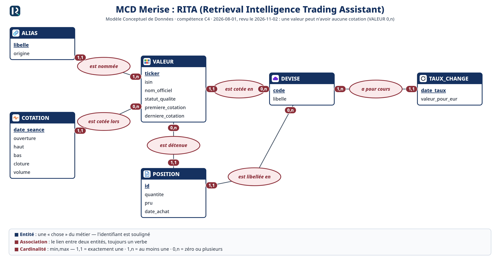A1 · données · p. 22</a>
<a href="#a2">A2 · wireframes · p. 23</a>
<a href="#a3">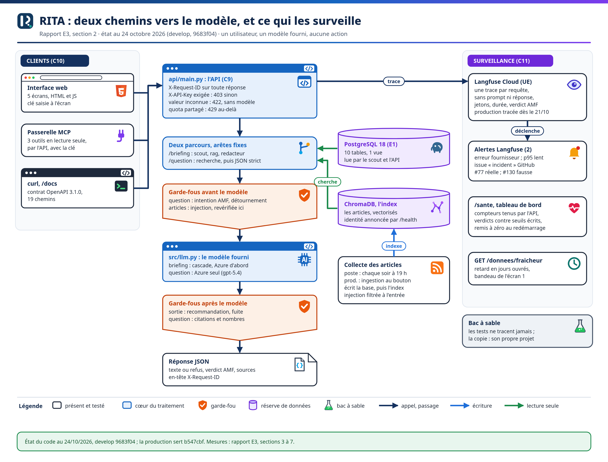A3 · architecture · p. 26</a>
<a href="#a4">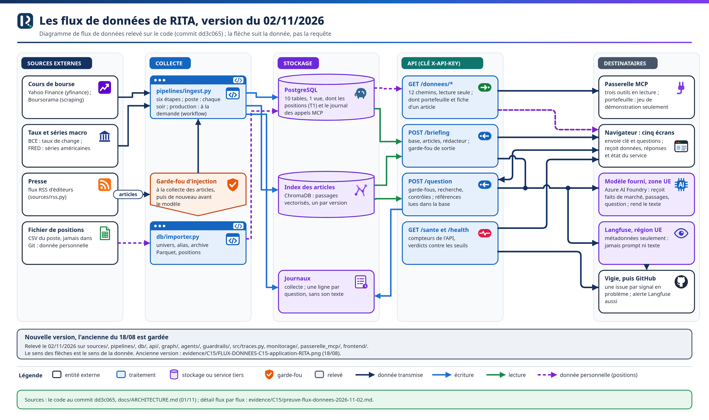A4 · flux · p. 27</a>
<a href="#a5">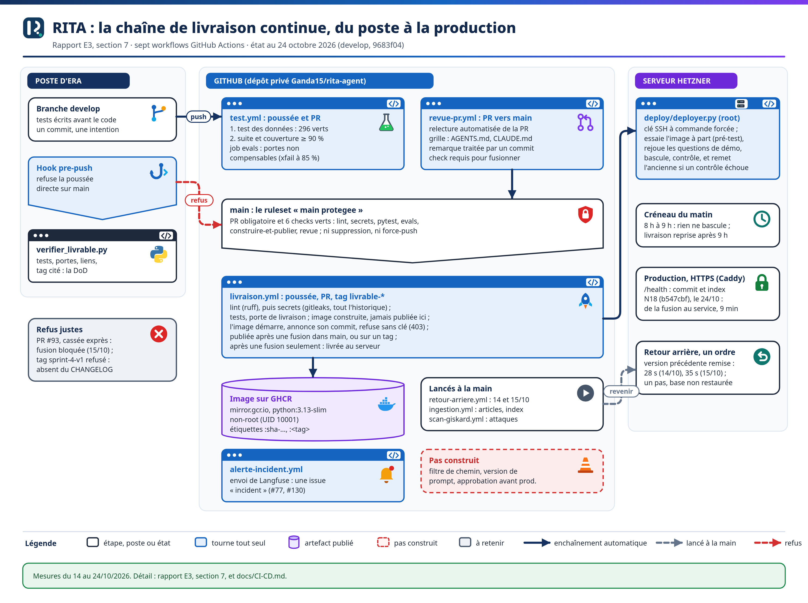A5 · livraison · p. 28</a>
<a href="#a6">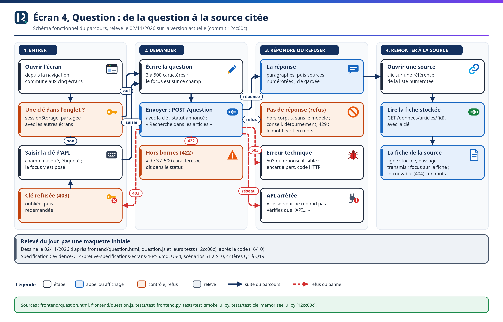A6 · parcours · p. 29</a>
<a href="#a7">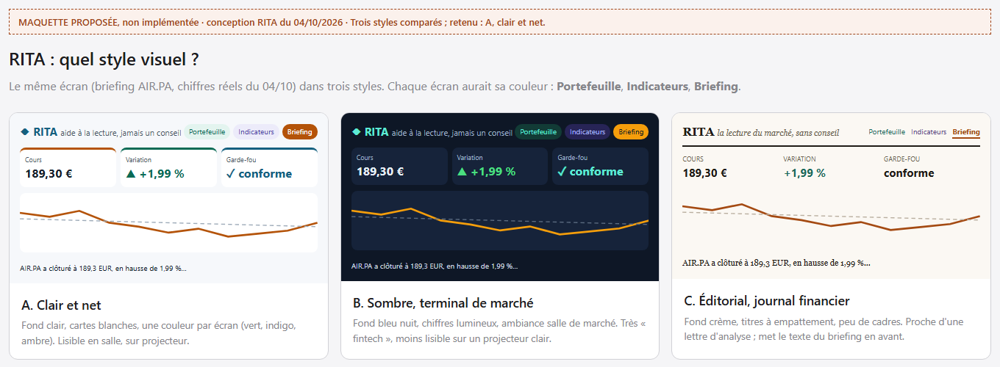A7 · maquettes · p. 31</a>

## A1. Le modèle conceptuel des données (C14) {: #a1 }

**MCD au formalisme Merise**, revu le 02/11/2026, mise en forme du 03/11, texte inchangé (original : [`evidence/C4/MCD-MERISE-RITA-2026-11-02.png`](https://github.com/Ganda15/rita-agent/blob/livrable-E4-v5/evidence/C4/MCD-MERISE-RITA-2026-11-02.png)) : 6 entités et 6
associations, le même modèle que dans le livret E1 v6. Une valeur peut exister sans cotation (`VALEUR 0,n`), comme
dans la base ; un test le vérifie ([`tests/test_mcd_c4.py`](https://github.com/Ganda15/rita-agent/blob/livrable-E4-v5/tests/test_mcd_c4.py)). Celui du 01/08 est gardé ([`evidence/C4/MCD-MERISE-RITA.png`](https://github.com/Ganda15/rita-agent/blob/livrable-E4-v5/evidence/C4/MCD-MERISE-RITA.png)). **Limite** : la table `article`, qui porte les
données de l'écran Question, n'y figure pas (choix du 11/08 ; rapport, § 1.4 et critère C14.1). Le schéma conserve son
intitulé historique ; dans l'application livrée, RITA signifie « Retrieval Intelligence pour le Tracking et l'Analyse ».

## A2. Les wireframes historiques des trois premiers écrans, avant la refonte (C14, C17) {: #a2 }

{: .presque }

**Écran Portefeuille, 18/08/2026** ([`evidence/C14/WIREFRAMES-C14-ecran-portefeuille.svg`](https://github.com/Ganda15/rita-agent/blob/livrable-E4-v5/evidence/C14/WIREFRAMES-C14-ecran-portefeuille.svg)), avant la refonte. **Correctif du 04/11** :
`autocomplete="off"` demande au navigateur de ne pas mémoriser la clé, sans le garantir ([MDN](https://developer.mozilla.org/en-US/docs/Web/HTML/Reference/Attributes/autocomplete)). Limites : page 25.

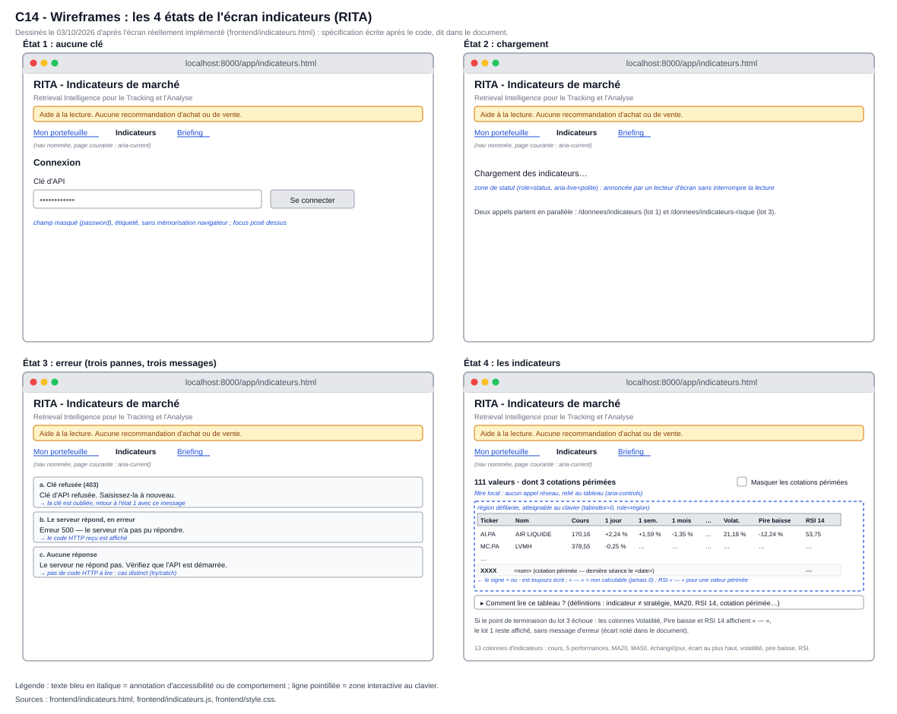{: .grand }

**Écran Indicateurs, 03/10/2026** ([`evidence/C14/WIREFRAMES-C14-ecran-indicateurs.svg`](https://github.com/Ganda15/rita-agent/blob/livrable-E4-v5/evidence/C14/WIREFRAMES-C14-ecran-indicateurs.svg)), avant la refonte.
**Correctif du 04/11** : « sans mémorisation navigateur » appelle la même réserve que `autocomplete="off"` (page 23).

{: .moyen }

**Écran Briefing, 03/10/2026** ([`evidence/C14/WIREFRAMES-C14-ecran-briefing.svg`](https://github.com/Ganda15/rita-agent/blob/livrable-E4-v5/evidence/C14/WIREFRAMES-C14-ecran-briefing.svg)), avant la refonte. **Correctifs du 04/11** :
« une recommandation d'achat ou de vente est retenue, jamais diffusée » promet trop : un texte détecté et refusé par le
garde-fou n'est pas affiché, mais la détection n'est pas exhaustive ; « sans mémorisation navigateur » : même réserve
qu'en page 23 ; l'état d (« aucun modèle », 500) n'existe plus : depuis le 04/11, l'API répond 503 `AUCUN_FOURNISSEUR`
(spécification 001, R4). **Limites des trois wireframes** : chacun a été dessiné après l'écran d'avant la refonte ; il ne
prouve pas qu'une maquette a guidé cet écran. Les écrans livrés le 04/11 ont été construits d'après les maquettes d'A7.
Les écrans Question et Tableau de bord n'ont pas de maquette (rapport, § 4.3 et critère C17.2).

## A3. L'architecture de l'application (C15) {: #a3 }

**Architecture de l'application, état du code au 24/10/2026** (commit `9683f04`), mise en forme du 03/11, texte inchangé
(original : [`docs/rapports/E3/schemas/E3-architecture.svg`](https://github.com/Ganda15/rita-agent/blob/livrable-E4-v5/docs/rapports/E3/schemas/E3-architecture.svg)). **Ce qu'il montre pour E4** : les clients, dont les cinq
écrans de l'interface ; l'API et ses refus (403, 422, 429) ; les deux chemins vers le modèle, le briefing (scout,
recherche documentaire, rédacteur) et la question (recherche, puis réponse JSON stricte) ; les garde-fous avant et après
le modèle ; les données lues (PostgreSQL, index des articles) ; la surveillance (traces, alertes, `/sante`).
**Limites** : la vigie n'y figure pas (rapport, § 2.1 et critère C15.1) ; il montre l'état du 24/10, « briefing :
cascade, Azure d'abord » ; depuis le 31/10, et donc dans la version de référence, Azure est seul par défaut.

## A4. Le diagramme de flux de données (C15) {: #a4 }

**Diagramme de flux de données, relevé sur le code flux par flux le 02/11/2026**, mise en forme du 03/11, texte inchangé (original : [`evidence/C15/flux/`](https://github.com/Ganda15/rita-agent/tree/livrable-E4-v5/evidence/C15/flux), généré par
[`generer_flux.py`](https://github.com/Ganda15/rita-agent/blob/livrable-E4-v5/evidence/C15/flux/generer_flux.py) ; preuve : [`evidence/C15/preuve-flux-donnees-2026-11-02.md`](https://github.com/Ganda15/rita-agent/blob/livrable-E4-v5/evidence/C15/preuve-flux-donnees-2026-11-02.md)). Il se lit dans le sens de la donnée ;
seules les positions (T1) y sont marquées comme données personnelles, pas le texte des questions (T8) ; la purge
RGPD n'y figure pas. Celui du 18/08 est gardé ([`evidence/C15/FLUX-DONNEES-C15-application-RITA.png`](https://github.com/Ganda15/rita-agent/blob/livrable-E4-v5/evidence/C15/FLUX-DONNEES-C15-application-RITA.png)).
**Limite** : relevé après le code, il décrit l'existant ; il n'a pas guidé la construction. **Correctif du 04/11** :
« production : à la demande (workflow) » ne vaut que pour les articles : l'ordre `ingerer` lance les étapes `rss` et
`indexation` ([`deploy/deployer.py`](https://github.com/Ganda15/rita-agent/blob/livrable-E4-v5/deploy/deployer.py)). Les cotations et les taux de production ont été rattrapés à
la main, le 27/10 puis le 04/11 ; aucune collecte n'est planifiée sur le serveur.

## A5. La chaîne d'intégration et de livraison (C18, C19) {: #a5 }

**Chaîne d'intégration et de livraison, état au 24/10/2026** (commit `9683f04`), mise en forme du 03/11, texte inchangé
(original : [`docs/rapports/E3/schemas/E3-chaine-livraison.svg`](https://github.com/Ganda15/rita-agent/blob/livrable-E4-v5/docs/rapports/E3/schemas/E3-chaine-livraison.svg) ; cette mise en forme n'existe qu'en image, pas en
vectoriel). **Ce qu'il montre pour E4** : du poste à la production, les contrôles de chaque étape, la protection de
`main`, la livraison au serveur avec pré-test et retour arrière (rapport, sections 5 et 6). **Limite** : l'installation
à la main d'un fichier Compose modifié, qui conditionne une livraison, n'y figure pas (§ 6.1). Le créneau « 8 h à 9 h » est celui où
le serveur refuse toute bascule ; GitHub commence à attendre 30 minutes plus tôt, pour qu'une livraison ne démarre pas
son pré-test juste avant 8 h, d'où les « 7 h 30 à 9 h » du rapport ([`deploy/deployer.py`](https://github.com/Ganda15/rita-agent/blob/livrable-E4-v5/deploy/deployer.py), `secondes_avant_livraison`).
**Correctif du 04/11** : le schéma montre six contrôles exigés pour `main` ; depuis le 01/11, il y en a sept, avec `base`,
les tests sur une base PostgreSQL jetable (rapport, § 5.3 et 6.3). L'original du 24/10 n'est pas retouché.

## A6. Les parcours des écrans Question et Tableau de bord (C14) {: #a6 }

**Écran Question, relevé le 02/11/2026**, mise en forme du 03/11, texte inchangé (original : [`evidence/C14/parcours/PARCOURS-C14-ecran-question.svg`](https://github.com/Ganda15/rita-agent/blob/livrable-E4-v5/evidence/C14/parcours/PARCOURS-C14-ecran-question.svg)) : chaque étape,
chaque refus et chaque panne des scénarios de la spécification ([`evidence/C14/preuve-specifications-ecrans-4-et-5.md`](https://github.com/Ganda15/rita-agent/blob/livrable-E4-v5/evidence/C14/preuve-specifications-ecrans-4-et-5.md)).

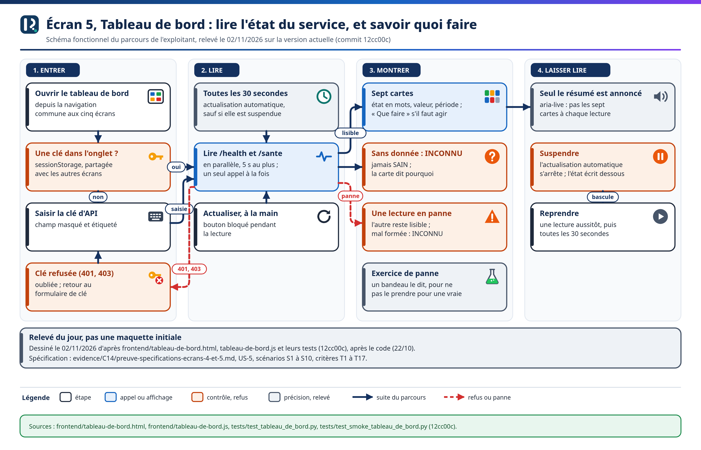

**Écran Tableau de bord, relevé le 02/11/2026**, mise en forme du 03/11, texte inchangé (original : [`evidence/C14/parcours/PARCOURS-C14-ecran-tableau-de-bord.svg`](https://github.com/Ganda15/rita-agent/blob/livrable-E4-v5/evidence/C14/parcours/PARCOURS-C14-ecran-tableau-de-bord.svg)).
**Limite des deux schémas** : relevés le 02/11 sur le commit `12cc00c`, avant la refonte (« version actuelle », dans leur
sous-titre, veut dire celle du 02/11) ; ce sont des parcours fonctionnels relevés après le développement, pas des
maquettes de la nouvelle interface.

## A7. Les maquettes de la refonte et les écrans livrés (C14, C17) {: #a7 }

Ces maquettes, à la différence des wireframes d'A2, ont précédé le code : conçues et validées le 04/10
([`docs/conception/frontend/refonte-2026-10.md`](https://github.com/Ganda15/rita-agent/blob/livrable-E4-v5/docs/conception/frontend/refonte-2026-10.md), § 12), reprises par la
spécification 001, validée le 04/11 ([`specs/001-refonte-interface/spec.md`](https://github.com/Ganda15/rita-agent/blob/livrable-E4-v5/specs/001-refonte-interface/spec.md)), puis
codées et livrées le 04/11 (`8ecc5a7`). **Chronologie du style** : le 04/10, le style A, clair, est retenu ; le 04/11, je
choisis le style B, sombre, par défaut, et je garde le A comme thème clair au choix (spécification 001, § 7). Les écrans
livrés sont donc sombres, les maquettes claires. **Méthode** : maquette, écran livré, différences expliquées, sur la seule
partie capturée. Une capture ne prouve pas à elle seule la conformité ; le critère C17.2 reste à consolider (rapport, § 4.3).

**Maquette 1, les trois styles comparés le 04/10**, recadrée (original : [`maquette-1-style-visuel.png`](https://github.com/Ganda15/rita-agent/blob/livrable-E4-v5/docs/conception/frontend/maquettes/maquette-1-style-visuel.png)).
Retenu le 04/10 : A ; changé le 04/11 : B par défaut, A en thème clair.

**Les trois pages suivantes**, une par écran : la maquette et l'écran livré côte à côte, puis les différences, chacune
avec son explication. **Limites d'A7** : comparaison visuelle, sur des captures de production du 04/11 ; aucune mesure ;
Question et Tableau de bord n'ont pas de maquette.
**Deux défauts de l'écran Briefing livré** sont relevés page 34 : une aide qui promet trop, des astérisques affichés ; ils
sont à corriger à part, test d'abord.

### L'écran Portefeuille

<figure>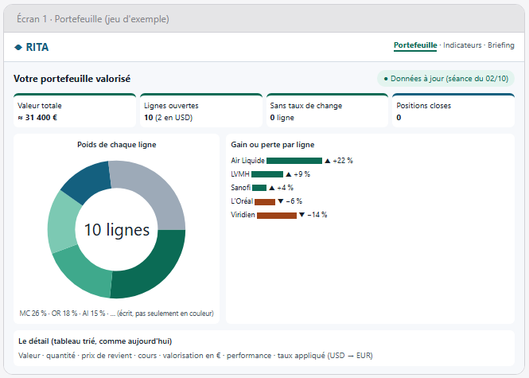<figcaption>Maquette du 04/10, recadrée de la maquette 3</figcaption></figure>
<figure>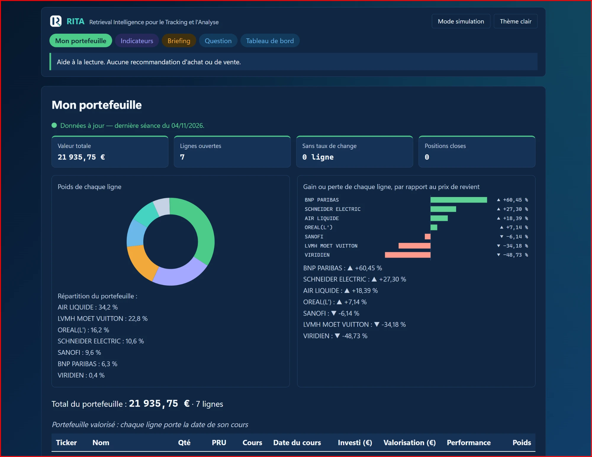<figcaption>Écran livré, en production, capture d'Era du 04/11 au soir ; page entière et aide dépliée : captures 4 et 5 de <a href="https://github.com/Ganda15/rita-agent/tree/livrable-E4-v5/evidence/C17/refonte-ecrans-livres-2026-11-04">evidence/C17/refonte-ecrans-livres-2026-11-04/</a></figcaption></figure>

| Élément | Constat | Explication |
|---|---|---|
| Thème | maquette claire, écran sombre | choix du 04/11 ; le thème clair reste au choix (bouton « Thème clair ») |
| Chiffres clés, anneau, barres, fraîcheur, détail | présents, dans le même ordre ; le signe ▲ ou ▼ est écrit à côté de chaque barre | conforme sur la partie capturée |
| Centre de l'anneau | « 10 lignes » sur la maquette, rien à l'écran | écart constaté ; le nombre de lignes reste dans la carte « Lignes ouvertes » et dans le titre de l'anneau lu par un lecteur d'écran |
| Répartition écrite | une ligne sous l'anneau sur la maquette ; une liste à l'écran, et une seconde liste sous les barres | même règle, rien n'est dit par la seule couleur ; présentation en liste |
| Navigation | trois liens sur la maquette ; cinq onglets, le mode simulation et le thème à l'écran | Question (16/10) et Tableau de bord (22/10) sont venus après la maquette ; le mode simulation date du 04/11 |
| Colonnes du détail | « taux appliqué (USD → EUR) » sur la maquette ; à l'écran, pas de colonne de taux, mais la date du cours et le poids, puis une section « Exposition par devise » | toutes les lignes du jeu de démonstration sont en euros (EUR 100 %) ; l'aide de la page dit la conversion : « converti en euros au dernier taux BCE connu » (capture 5) |
| Valeurs | illustratives sur la maquette ; données de production du 04/11 à l'écran | voulu |

### L'écran Indicateurs

<figure>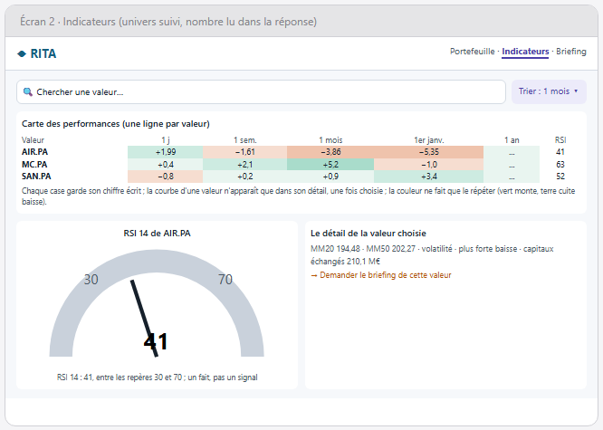<figcaption>Maquette du 04/10, recadrée de la maquette 3</figcaption></figure>
<figure>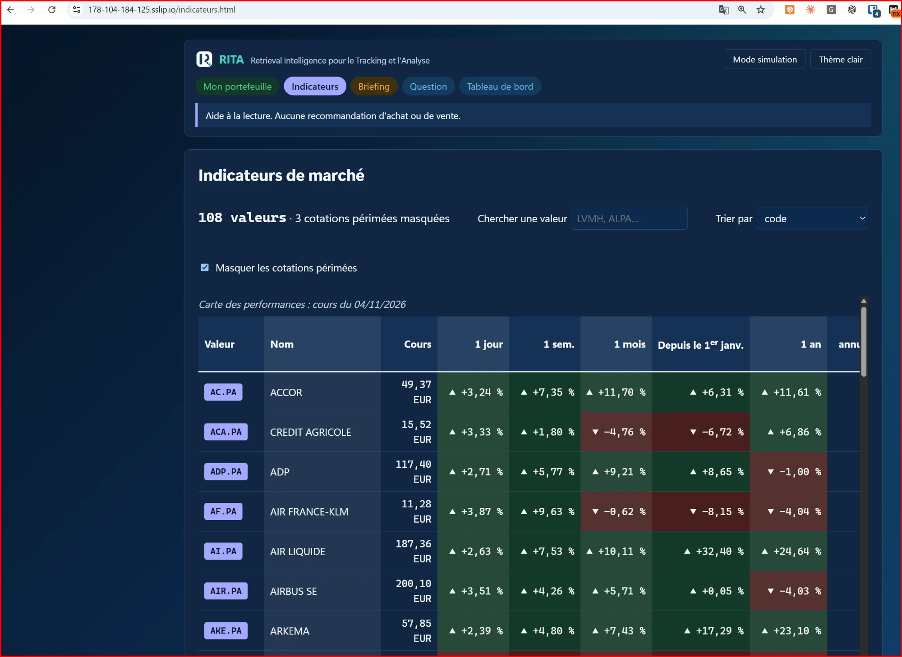<figcaption>Écran livré, en production, capture d'Era du 04/11 au soir ; carte, colonnes de droite, aide et détail : captures 2, 3, 6 et 7 de <a href="https://github.com/Ganda15/rita-agent/tree/livrable-E4-v5/evidence/C17/refonte-ecrans-livres-2026-11-04">evidence/C17/refonte-ecrans-livres-2026-11-04/</a></figcaption></figure>

| Élément | Constat | Explication |
|---|---|---|
| Thème | maquette claire, écran sombre | choix du 04/11 |
| Recherche, tri, carte des performances | présents ; chaque case garde son chiffre et son signe écrits, la couleur ne fait que les répéter | conforme sur la partie capturée |
| Compte des valeurs, filtre des cotations périmées | absents de la maquette ; à l'écran : 108 valeurs, 3 cotations périmées masquées | gardés de l'écran d'avant (A2, état 4) |
| Colonnes Nom et Cours de la carte | absentes de la maquette, présentes à l'écran | gardées de l'écran d'avant (A2, état 4) |
| Détail de la valeur choisie | jauge du RSI avec les repères 30 et 70, sa valeur écrite ; moyennes, échangé par jour, volatilité, pire baisse ; lien vers le briefing (capture 6, AC.PA) | conforme ; la courbe et ses deux moyennes y figurent aussi, comme l'annonçait la maquette |
| Phrase de la jauge | « entre les repères 30 et 70 ; un fait, pas un signal » sur la maquette ; « RSI 14 : 66,4, zone neutre de 30 à 70 » à l'écran | l'écran suit la spécification 001 (R2) et la conception (§ 7), qui fixent « zone neutre de 30 à 70 » ; c'est l'image de la maquette qui disait autrement |
| Colonnes de droite de la carte | RSI en dernière colonne sur la maquette ; à l'écran aussi, après la volatilité annualisée et la pire baisse ; agrandissement d'une ligne de la capture 7 : 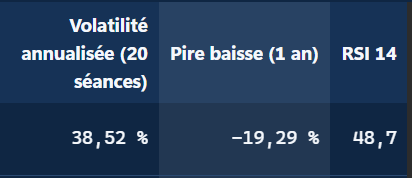 | conforme pour le RSI ; écart de lecture : la carte défile en largeur et le code de la valeur sort alors du champ |
| Aide « Comment lire ce tableau ? » | une phrase sur la maquette ; à l'écran, une définition par indicateur (RSI 14 : « un fait mesuré », cotation périmée, tiret) | gardée et complétée de l'écran d'avant (A2, état 4) |

### L'écran Briefing

<figure>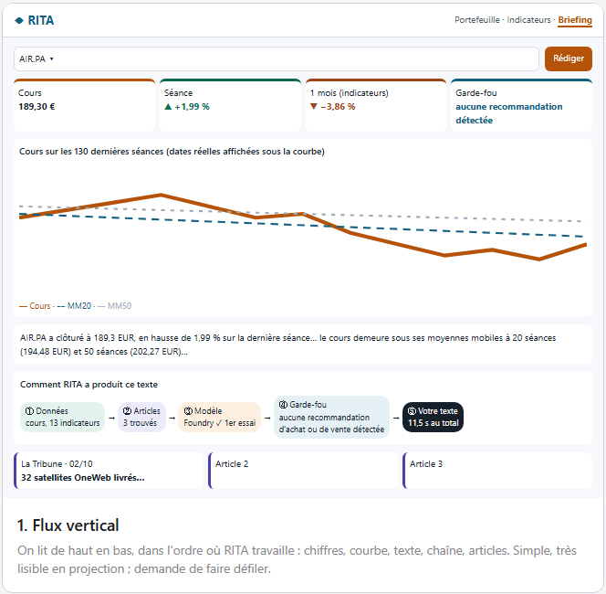<figcaption>Maquette du 04/10, mise en page retenue (flux vertical), recadrée de la <a href="https://github.com/Ganda15/rita-agent/blob/livrable-E4-v5/docs/conception/frontend/maquettes/maquette-2-ecran-briefing.png">maquette 2</a></figcaption></figure>
<figure>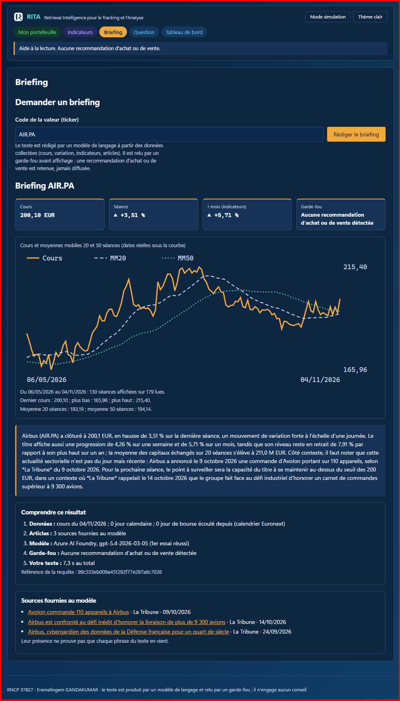<figcaption>Écran livré, en production, briefing AIR.PA, capture d'Era du 04/11 au soir (capture 1 de <a href="https://github.com/Ganda15/rita-agent/tree/livrable-E4-v5/evidence/C17/refonte-ecrans-livres-2026-11-04">evidence/C17/refonte-ecrans-livres-2026-11-04/</a>)</figcaption></figure>

| Élément | Constat | Explication |
|---|---|---|
| Thème | maquette claire, écran sombre | choix du 04/11 |
| Demande | liste « AIR.PA ▾ » et « Rédiger » sur la maquette ; à l'écran, un champ avec les suggestions de l'univers suivi et « Rédiger le briefing » | même geste ; le champ accepte aussi un code tapé ([`frontend/briefing.html`](https://github.com/Ganda15/rita-agent/blob/livrable-E4-v5/frontend/briefing.html), ligne 51) |
| Quatre chiffres | cours, séance, 1 mois, garde-fou, dans le même ordre, signe écrit | conforme sur la capture |
| Courbe | cours, MM20 et MM50 sur 130 séances, dates réelles sous la courbe | conforme ; l'écran écrit en plus la période, le plus bas, le plus haut et les deux moyennes |
| Texte du briefing | présent sous la courbe | conforme ; **défaut constaté** : les astérisques de mise en forme du modèle s'affichent tels quels (« \*La Tribune\* ») |
| Chaîne de production | « Comment RITA a produit ce texte », cinq étapes en pastilles | « Comprendre ce résultat » : les cinq mêmes étapes en liste numérotée, plus la référence de la requête (R4) |
| Articles | trois cartes de source | « Sources fournies au modèle » : trois liens, source et date, et la limite « Leur présence ne prouve pas que chaque phrase du texte en vient » |
| Aide sous le champ | absente de la maquette | **défaut constaté** : « une recommandation d'achat ou de vente est retenue, jamais diffusée », la promesse trop forte corrigée en A2 (page 25), est encore à l'écran ([`frontend/briefing.html`](https://github.com/Ganda15/rita-agent/blob/livrable-E4-v5/frontend/briefing.html), ligne 57) |
