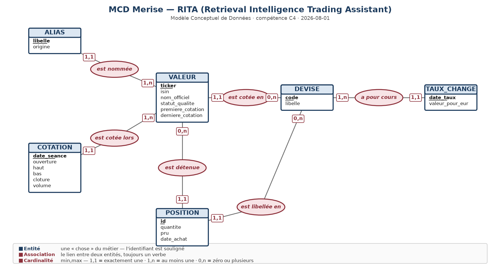
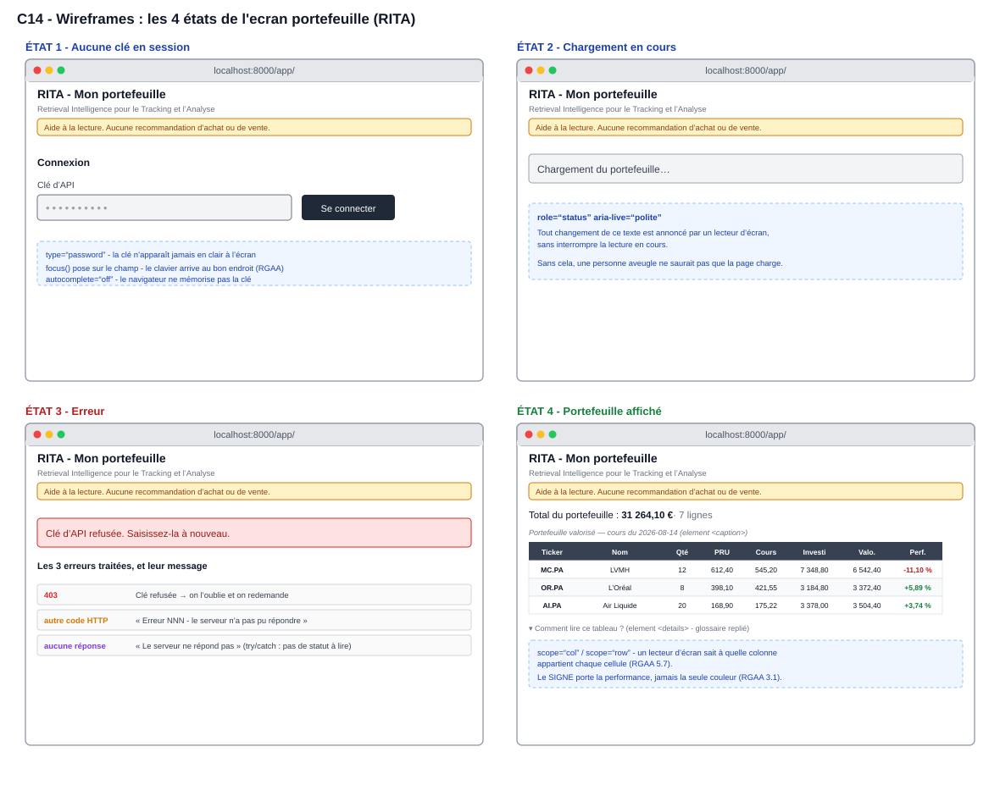
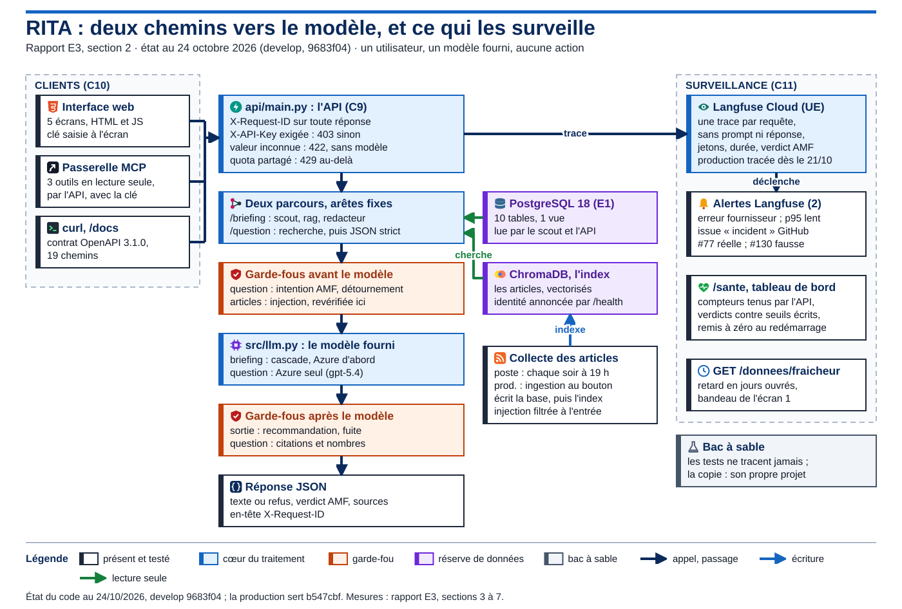
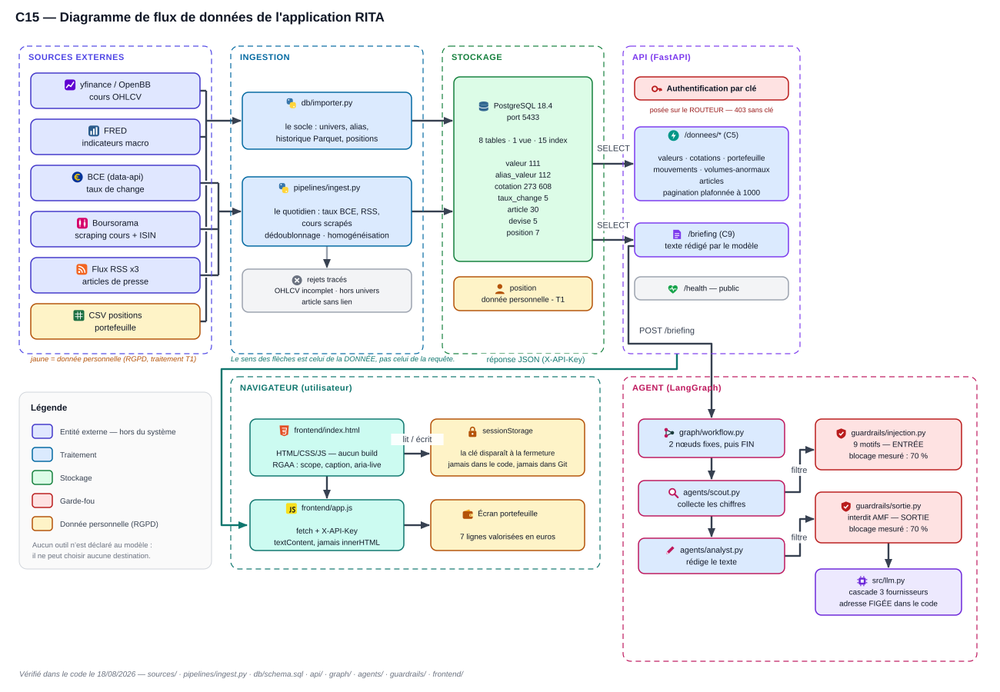
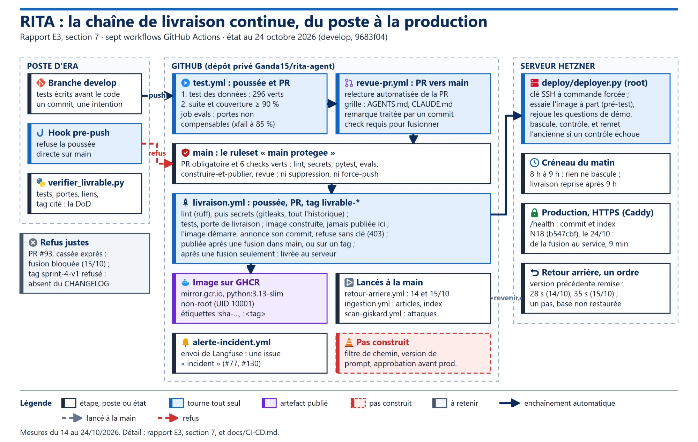
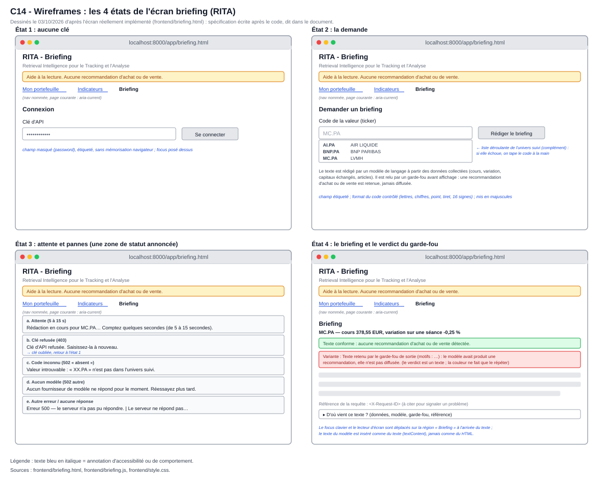

# Annexe du rapport E4 : les schémas

Projet fil rouge **RITA** · **Eramalingam Gandakumar** · Développeur en intelligence artificielle, RNCP 37827 · Simplon × Wild Code School · compétences C14 à C19 · annexe du rapport E4, version 0.8, 31 octobre 2026
{: .identite }

> Cette annexe montre les schémas que le rapport cite, chacun sur sa page (A4 en deux vues),
> suivi de sa légende : ce qu'il montre pour E4, la date de son contenu et sa limite, reprise du rapport. Version de référence de
> l'application : commit `d3a4198` (27/10/2026).

## Les schémas de cette annexe {: .sommaire }

| | Schéma | Critères | Contenu daté du | Version présentée | Page |
|---|---|---|---|---|---|
| A1 | Modèle conceptuel des données, formalisme Merise | C14 | 01/08/2026 | original du dépôt | 2 |
| A2 | Wireframes d'état : Portefeuille, Indicateurs, Briefing | C14, C17 | 18/08 et 03/10/2026 | originaux du dépôt, agrandis | 3 à 5 |
| A3 | Architecture de l'application : deux chemins vers le modèle | C15 | 24/10/2026 | mise en forme du 31/10, texte inchangé | 6 |
| A4 | Flux de données, des sources à l'écran, avec un erratum | C15 | 18/08/2026 | mise en forme du 31/10, texte inchangé, en deux vues | 7 et 8 |
| A5 | Chaîne d'intégration et de livraison | C18, C19 | 24/10/2026 | mise en forme du 31/10, texte inchangé | 9 |

**Mise en forme du 31/10.** A3, A4 et A5 ont reçu de nouvelles icônes et des flèches, avec l'aide d'une IA ; leur texte
est identique mot pour mot aux originaux du dépôt, cités dans chaque légende. Aucun contenu n'a été modifié ou mis à
jour pour cette annexe.

**Ce que l'annexe ne contient pas, et pourquoi.** Les écrans Question et Tableau de bord n'ont pas de maquette
(rapport, critère C14.2). Le diagramme de flux n'a pas été refait pour les cinq écrans : celui du 18/08 est montré avec
ses limites (A4, critère C15.3). Les dessiner maintenant produirait une documentation après coup.

### Les schémas en miniature

<a href="#a1">A1 · modèle des données · p. 2</a>
<a href="#a2">A2 · wireframes · p. 3 à 5</a>
<a href="#a3">A3 · architecture · p. 6</a>
<a href="#a4">A4 · flux de données · p. 7 et 8</a>
<a href="#a5">A5 · chaîne de livraison · p. 9</a>

## A1. Le modèle conceptuel des données (C14) {: #a1 }

**MCD au formalisme Merise**, dessiné le 01/08/2026 et versé dans le dépôt le 11/08 (`evidence/C4/MCD-MERISE-RITA.png`) :
6 entités et 6 associations, le même modèle que dans le rapport E1. **Limite** : la table `article`, qui porte les
données de l'écran Question, n'y figure pas (choix du 11/08 ; rapport, § 1.4 et critère C14.1).

## A2. Les wireframes d'état des trois premiers écrans (C14, C17) {: #a2 }

{: .grand }

**Écran Portefeuille, 18/08/2026** (`evidence/C14/WIREFRAMES-C14-ecran-portefeuille.svg`). Limites des trois
wireframes : sous le troisième, page 5.

{: .grand }

**Écran Indicateurs, 03/10/2026** (`evidence/C14/WIREFRAMES-C14-ecran-indicateurs.svg`).

{: .grand }

**Écran Briefing, 03/10/2026** (`evidence/C14/WIREFRAMES-C14-ecran-briefing.svg`). **Limites des trois
wireframes** : chacun a été dessiné après son écran ; il ne prouve ni qu'une maquette a guidé le développement, ni que
l'écran actuel lui est conforme. Les écrans Question et Tableau de bord n'ont pas de maquette (rapport, § 4.3 et
critère C14.2).

## A3. L'architecture de l'application (C15) {: #a3 }

**Architecture de l'application, état du code au 24/10/2026** (commit `9683f04`), mise en forme du 31/10, texte inchangé
(original : `docs/rapports/E3/schemas/E3-architecture.svg`). **Ce qu'il montre pour E4** : les clients, dont les cinq
écrans de l'interface ; l'API et ses refus (403, 422, 429) ; les deux chemins vers le modèle, le briefing (scout,
recherche documentaire, rédacteur) et la question (recherche, puis réponse JSON stricte) ; les garde-fous avant et après
le modèle ; les données lues (PostgreSQL, index des articles) ; la surveillance (traces, alertes, `/sante`).
**Limites** : la vigie n'y figure pas (rapport, § 2.1 et critère C15.1) ; il montre l'état du 24/10, « briefing :
cascade, Azure d'abord » ; depuis le 31/10, après la version de référence, Azure est seul par défaut.

## A4. Le diagramme de flux de données (C15) {: #a4 }

**Vue 1 sur 2 : des sources externes à l'API**, haut du schéma agrandi. **Diagramme de flux de données, contenu
vérifié dans le code le 18/08/2026**, mise en forme du 31/10, texte inchangé (original :
`evidence/C15/FLUX-DONNEES-C15-application-RITA.svg`). Il se lit dans le sens de la donnée : sources externes,
ingestion, stockage, API, puis navigateur et agent ; le jaune marque les données personnelles. Les deux vues découpent
le même fichier pour qu'il reste lisible ; une bande commune garde les flèches qui descendent de l'API vers le
navigateur et vers l'agent.

**Vue 2 sur 2 : le navigateur et l'agent**, bas du schéma agrandi.

**Erratum de lecture** : l'ordre représenté entre l'appel au modèle et le garde-fou de sortie est incorrect. Le
modèle produit d'abord le texte ; le garde-fou le contrôle ensuite, avant son affichage (`api/main.py`, ligne 303,
`generer_briefing_complet`, puis ligne 320, `verifier_sortie`).

**Limites** : son contenu est en retard sur l'application livrée le 27/10 (rapport, § 2.4 et critère C15.3). Il compte
8 tables au lieu de 10 ; il montre deux nœuds au lieu de trois (scout, recherche documentaire, rédacteur) ; il ne
montre ni le chemin des questions, ni la vigie et les traces ; il ne montre que l'écran Portefeuille ; les fournisseurs
du modèle y sont ceux que le code prévoit, pas la configuration active.

## A5. La chaîne d'intégration et de livraison (C18, C19) {: #a5 }

**Chaîne d'intégration et de livraison, état au 24/10/2026** (commit `9683f04`), mise en forme du 31/10, texte inchangé
(original : `docs/rapports/E3/schemas/E3-chaine-livraison.svg` ; cette mise en forme n'existe qu'en image, pas en
vectoriel). **Ce qu'il montre pour E4** : du poste à la production, les contrôles de chaque étape, la protection de
`main`, la livraison au serveur avec pré-test et retour arrière (rapport, sections 5 et 6). **Limite** : l'installation
à la main d'un fichier Compose modifié, qui conditionne une livraison, n'y figure pas (§ 6.1). Le créneau « 8 h à 9 h » est celui où
le serveur refuse toute bascule ; GitHub commence à attendre 30 minutes plus tôt, pour qu'une livraison ne démarre pas
son pré-test juste avant 8 h, d'où les « 7 h 30 à 9 h » du rapport (`deploy/deployer.py`, `secondes_avant_livraison`).
