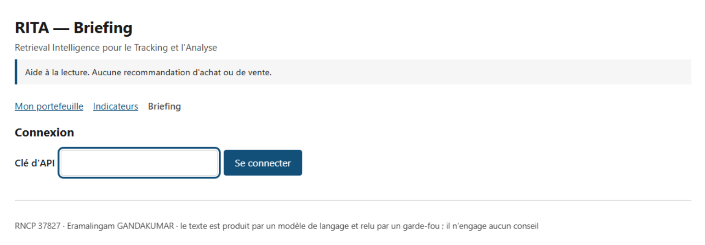
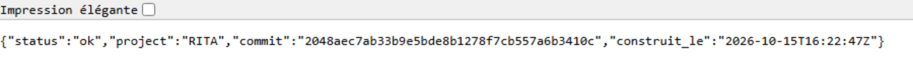
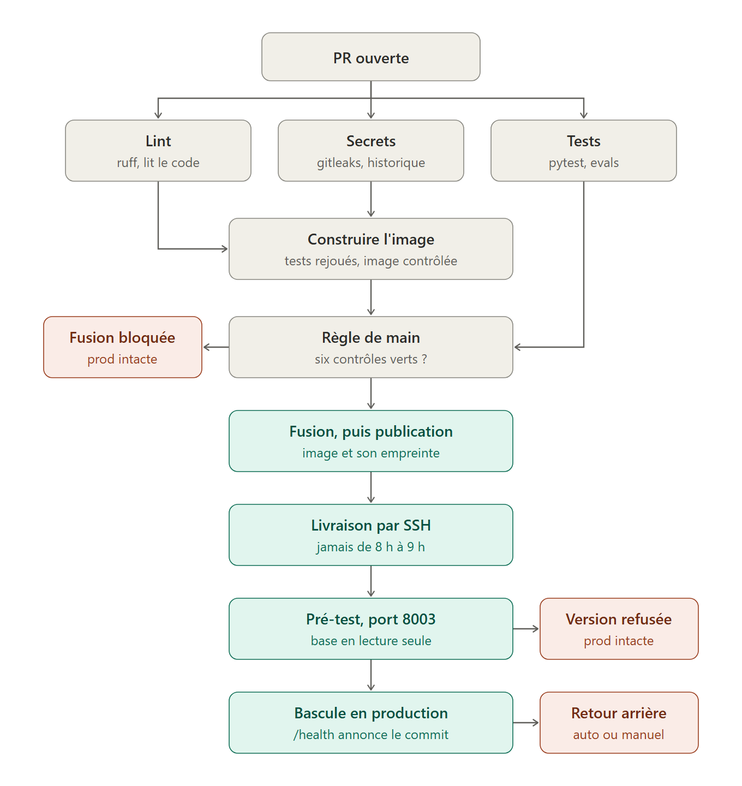

# Sprint 2 : le socle et la chaîne

> RITA, fil rouge de la phase 6 : un squelette en production, livré par une chaîne CI/CD bloquante (version 2)

## Sommaire

## 1. En bref

RITA rédige en français un briefing sur une valeur cotée, sans jamais recommander d'acheter ou de vendre. Au sprint 2,
le squelette (une route API, un écran, un appel au modèle de langage) tourne sur un serveur Hetzner, et il y arrive
uniquement par la chaîne : une fusion dans `main` est testée, construite, publiée, essayée en préproduction, puis mise
en service, sans aucune action sur le serveur.

| Mesure | Valeur | Preuve |
|---|---|---|
| Version en production (15/10, 18 h 30) | commit `2048aec` (N2), annoncé par `/health` | section 6.1 |
| De la fusion à la production | 9 min 24 s (N1), 8 min 53 s (N2), sans intervention | section 6.2 |
| Livraisons réussies par la chaîne | 5 (N0, N1, deux relivraisons de N1, puis N2) | sections 6.2 et 6.6 |
| Versions refusées avant la bascule | 2, production intacte | section 6.6 |
| Commit cassé | bloqué : 2 tests en échec, fusion refusée, livraison jamais lancée | section 6.3 |
| Retour arrière en une opération | 28 s, puis 35 s (deux répétitions) | section 6.4 |
| Secrets dans le dépôt | aucun : recherche sur tout l'historique à chaque passage | section 6.5 |
| Reconstruction depuis le dépôt | base, données de démonstration et index en moins de deux minutes | section 6.5 |

Production : <https://178-104-184-125.sslip.io> · dépôt au tag de remise :
<https://github.com/Ganda15/rita-agent/tree/livrable-sprint-2-v2>

## 2. Les livrables demandés, et où les trouver

Le brief demande : « Le squelette en production, livré par la chaîne ; la preuve du blocage sur échec et du rollback
(captures ou journal de chaîne versionnés). »

| Livrable demandé | Où le trouver |
|---|---|
| Le squelette en production | <https://178-104-184-125.sslip.io/briefing.html> (écran) et <https://178-104-184-125.sslip.io/health> (version servie) |
| Livré par la chaîne | [`.github/workflows/livraison.yml`](https://github.com/Ganda15/rita-agent/blob/livrable-sprint-2-v2/.github/workflows/livraison.yml) ; journal de la livraison N1 : [`evidence/sprint-2/journaux/livraison-N1.txt`](https://github.com/Ganda15/rita-agent/blob/livrable-sprint-2-v2/evidence/sprint-2/journaux/livraison-N1.txt) |
| La preuve du blocage sur échec | [`evidence/sprint-2/journaux/pr-93-commit-casse.txt`](https://github.com/Ganda15/rita-agent/blob/livrable-sprint-2-v2/evidence/sprint-2/journaux/pr-93-commit-casse.txt) ; la PR elle-même : <https://github.com/Ganda15/rita-agent/pull/93> |
| La preuve du rollback | [`evidence/sprint-2/journaux/retours-arriere.txt`](https://github.com/Ganda15/rita-agent/blob/livrable-sprint-2-v2/evidence/sprint-2/journaux/retours-arriere.txt) ; mesures : [`evidence/sprint-2/N1-retour-arriere-2026-10-14.md`](https://github.com/Ganda15/rita-agent/blob/livrable-sprint-2-v2/evidence/sprint-2/N1-retour-arriere-2026-10-14.md) |
| Captures | [`evidence/sprint-2/captures/`](https://github.com/Ganda15/rita-agent/tree/livrable-sprint-2-v2/evidence/sprint-2/captures) |

Index de toutes les preuves du sprint :
[`evidence/sprint-2/README.md`](https://github.com/Ganda15/rita-agent/blob/livrable-sprint-2-v2/evidence/sprint-2/README.md).
Document d'entrée du sprint : [`docs/sprint-2/README.md`](https://github.com/Ganda15/rita-agent/blob/livrable-sprint-2-v2/docs/sprint-2/README.md).

**Accès aux liens.** Le dépôt est privé : les liens vers GitHub ne s'ouvrent qu'avec un compte qui a accès au dépôt
(le formateur y est collaborateur). Sans cet accès, GitHub répond « page introuvable ». Ce document se lit donc sans
ouvrir aucun lien : les preuves sont reprises au § 6, et les journaux de chaîne, la règle de protection de `main` et le
journal du serveur sont recopiés en entier en annexe (§ 11). Les liens vers la production et vers la grille du brief
sont publics.

## 3. Le travail attendu, point par point

| Travail attendu (brief) | Mise en œuvre | Preuve |
|---|---|---|
| « Monter le repo propre : structure, environnements reproductibles (Docker), secrets hors du dépôt. » | `Dockerfile` en deux étapes, utilisateur sans droits ; `docker-compose.yml` (API et PostgreSQL) ; jeu de démonstration `data/demo/` et surcharge `docker-compose.demo.yml` ; `.env` exclu de Git et de l'image | 6.5 |
| « Développer le squelette : une route API, une interface minimale, un appel au LLM qui répond. » | FastAPI : `POST /briefing`, `GET /health` ; écran `frontend/briefing.html` ; modèle Azure (zone UE) par `src/llm.py`, texte relu par un garde-fou de sortie | 6.1 |
| « Construire la chaîne : lint → tests → build → déploiement automatique sur merge/ PR, à travers les environnements. » | `livraison.yml` : lint, secrets, construction contrôlée, publication sous empreinte, livraison par SSH ; sur le serveur, préproduction (port 8003, base en lecture seule) puis production | 6.2 |
| « Rendre les tests bloquants et le prouver : un commit volontairement cassé doit être arrêté par la chaîne. » | règle de protection de `main` : six contrôles exigés, aucune exception ; PR #93 cassée exprès | 6.3 |
| « Mettre en place et répéter le rollback : revenir à la version précédente en une opération. » | `retour-arriere.yml` (*Run workflow*, nom et motif obligatoires) ; chaque version garde sa configuration et son index | 6.4 |

## 4. L'évaluation par le pair : chaque critère et sa preuve

| Critère (brief) | Ce qui le prouve |
|---|---|
| « Le squelette tourne ailleurs que sur la machine du présenté : l'évaluateur le constate sur l'URL de production. » | un briefing demandé sur l'adresse de production ; `/health` annonce le commit servi (6.1) |
| « Une fusion déclenche la livraison sans action manuelle : démontré en live ou journal de chaîne à l'appui. » | passage `38636271353`, déclenché par la fusion de la PR #92 (6.2) |
| « Un commit cassé est bloqué : démontré en live. » | PR #93 ouverte pendant l'atelier : `pytest` en échec, fusion bloquée (6.3) |
| « Le rollback est montré. » | passages `38637911060` et `38707804718`, et le journal du serveur (6.4) |
| « Les secrets ne sont pas dans le dépôt ; l'environnement se reconstruit depuis le repo. » | travail `secrets` (gitleaks) ; `git ls-files` ; reconstruction sur le port 8011 (6.5) |
| « Journal des retours : les retours sur l'atelier n°1 ont été traité, reporté ou écarté. » | section 7 |

## 5. La chaîne

Chaque PR passe trois contrôles : le lint, la recherche de secrets dans tout l'historique, et les tests (`pytest` avec
au moins 90 % de couverture, et les évaluations des garde-fous). La construction de l'image rejoue les tests, puis
démarre l'image et la contrôle. La règle de protection de `main` exige les six contrôles ; sans eux, la fusion est
impossible et rien ne part.

Après la fusion, l'image est publiée sous son empreinte `sha256`, et le serveur reçoit exactement cette image. La clé
SSH de GitHub ne peut lancer qu'un seul programme sur le serveur. Ce programme essaie la nouvelle version à côté de la
production (port 8003, compte PostgreSQL en lecture seule, index d'articles neuf) : version annoncée, refus sans clé,
briefing conforme appuyé sur au moins un article. Seulement si tout est vert, il remplace l'API de production, puis
refait les mêmes contrôles. Si la nouvelle version échoue après la bascule, la version du début revient seule. Aucune
livraison n'a lieu entre 8 h et 9 h, heure de Paris : elle est reportée à 9 h. Le retour arrière, lui, est permis à
toute heure. Le schéma de la chaîne est en dernière page (figure 1).

## 6. Les preuves

### 6.1 Le squelette tourne en production

L'écran de briefing et la version servie, relevés le 15/10/2026 depuis un navigateur sans connexion au dépôt :

<div style="border: 1px solid #ddd; margin: 6pt 0;"></div>

<div style="border: 1px solid #ddd; margin: 6pt 0;"></div>

`/health` annonce le commit `2048aec7ab33…` (N2, la fusion de la PR #95) et sa date de construction : la version
servie est la dernière fusion dans `main`. Avant elle, la même adresse annonçait `e06cd17` (N1), puis `4819627` pendant
les retours arrière (§ 6.4). Un briefing réel sur `OR.PA` a été produit sur cette adresse le 15/10. À chaque livraison,
le serveur exige aussi un briefing conforme avant de mettre une version en service.

### 6.2 Une fusion livre sans action manuelle

La fusion de la PR #92 dans `main` a lancé le passage `38636271353` (extrait de
`evidence/sprint-2/journaux/livraison-N1.txt`) :

| Travail | Résultat | Début et fin (UTC, 14/10) |
|---|---|---|
| `secrets` | succès | 20:56:28 à 20:57:00 |
| `lint` | succès | 20:56:28 à 20:56:42 |
| `construire-et-publier` | succès | 20:57:03 à 21:01:46 |
| `attendre-creneau` | succès | 21:01:49 à 21:01:57 |
| `deployer` | succès | 21:01:59 à 21:05:52 |

```
script du serveur identique au depot (85c460468dfbb16fe84d3d345c2cc74e08b76e983cad754e221dd21e210a5b6e)
ARGUMENT: ghcr.io/ganda15/rita-api@sha256:75cbf7894c00815a3df2df66e51e7fccb53d10bb1f8e2401df83f5113f31581b
code rendu par le serveur : 0
```

De la fusion (20:56:26) à la production (21:05:50) : 9 min 24 s ; 225 s côté serveur, préproduction comprise.

La fusion suivante, la PR #95 (qui apportait la version 1 de ce livrable), a été livrée de la même façon, sans
intervention : passage `38768035437`, de la fusion (16:19:31 UTC, 15/10) au code 0 du serveur (16:28:24) en 8 min 53 s,
dont 220 s côté serveur. C'est N2, la version servie aujourd'hui (journal complet en annexe, § 11.2).

### 6.3 Un commit cassé est bloqué

La branche `demo/commit-casse` change une seule ligne : `/health` annonce `RITX` au lieu de `RITA`. La PR #93 vers
`main` a été ouverte pendant l'atelier (extrait de `evidence/sprint-2/journaux/pr-93-commit-casse.txt`) :

```
etat : OPEN
fusion : BLOCKED
construire-et-publier   fail       2m22s
pytest                  fail       2m32s
revue                   pass       41s
deployer                skipping   0
evals                   pass       1m32s
lint                    pass       7s
secrets                 pass       55s
FAILED tests/test_api_donnees.py::test_health_reste_public - AssertionError: assert 'RITX' == 'RITA'
FAILED tests/test_health.py::test_health_returns_project_name - AssertionError: assert 'RITX' == 'RITA'
===== 2 failed, 1033 passed, 29 skipped, 2 xfailed, 12 warnings in 33.18s ======
```

Deux contrôles l'arrêtent : `pytest`, et la construction, qui rejoue les tests avant de construire l'image. La règle de
protection de `main` exige les six contrôles et n'admet aucune exception, même pour l'administrateur : la fusion est
refusée, la livraison n'est jamais lancée, et la production servait toujours `e06cd17` pendant l'atelier. La PR est
fermée sans fusion.

### 6.4 Le retour arrière en une opération

Une seule commande, avec le nom et le motif, équivalente au bouton *Run workflow* :

```
gh workflow run retour-arriere.yml --repo Ganda15/rita-agent --ref main -f acteur=Era -f "motif=..."
```

| Passage | Date | De bout en bout | Côté serveur | Ancienne version servie après |
|---|---|---|---|---|
| `38637911060` | 14/10, 23 h 08 | 28 s | 16 s | 19 s |
| `38707804718` | 15/10, 10 h 44 | 35 s | 20 s | 25 s |

Le serveur remet la version précédente validée avec sa configuration et son index d'articles, gardés depuis sa
livraison, puis la contrôle avec sa propre clé. Le nom et le motif restent dans GitHub ; le journal du serveur garde le
numéro du passage :

```
{"date": "2026-10-14T23:09:02+02:00", "operation": "revenir", "passage": "38637911060",
 "de": "...@sha256:75cbf789...", "vers": "...@sha256:d181f9ad...", "resultat": "retour arriere"}
```

Après chaque retour, N1 a été relivrée par la relance du travail `deployer` (223 s et 218 s côté serveur). Un second
retour d'affilée est refusé : après un retour, la version précédente est vidée, et seule une nouvelle livraison en
fournit une autre.

### 6.5 Secrets hors du dépôt, environnement reconstruit

**Secrets.** Le travail `secrets` lance gitleaks sur tout l'historique à chaque passage, et vérifie que le `Dockerfile`
ne déclare aucune valeur sensible. Le dépôt ne suit que `.env.example` (le modèle, sans valeur) et
`tests/donnees/env-fictif` (des valeurs inventées pour les tests). Sur le serveur, le `.env` est lisible par root seul,
et GitHub ne détient que trois secrets de livraison (adresse, empreinte et clé SSH dédiée). Ce contrôle a trouvé deux
anciennes clés Mistral dans l'historique d'une branche : elles ont été révoquées chez le fournisseur, et l'incident est
documenté (`evidence/C21/INC-008-cles-mistral-dans-l-historique.md`).

**Reconstruction.** Un projet Docker Compose neuf, sur le port 8011, à côté de l'installation habituelle, part d'une
base vide et du jeu de démonstration versionné (`data/demo/` : trois valeurs, leurs cours, six articles synthétiques
marqués comme tels, trois positions inventées). Répétition du 15/10 :

```
Container rita-postgres-demo-20261015-atelier   Healthy   6.4s
Container rita-api-demo-20261015-atelier        Started   6.5s
{'valeurs': 3, 'cotations': 222, 'articles': 6, 'positions': 3}
indexation   lues 6 | ecrites 6 | rejetees 0     Duree : 9.4 s
```

`http://localhost:8011/health` répond, puis `down -v` efface conteneurs, réseau et volumes. Le premier essai complet,
le 14/10, a pris 117 s, construction de l'image comprise. La procédure est dans `docs/EXPLOITATION.md`, § 3 ter.

### 6.6 La première livraison : deux refus avant la réussite

La première livraison (N0, commit `4819627`) a été refusée deux fois sans toucher à la production. Au premier essai,
l'empreinte du serveur enregistrée dans GitHub était vide : SSH a refusé de se connecter. Au deuxième, l'adresse du
modèle était recopiée deux fois dans le `.env` du serveur : le pré-test a refusé la version, faute de briefing, et a
supprimé son index. Après correction, le troisième essai a livré en 221 s. Détail :
`evidence/sprint-2/N0-premiere-livraison-2026-10-14.md`.

## 7. Journal des retours de l'atelier n°1

| Retour reçu le 13/10 | Suite |
|---|---|
| Conseil prioritaire : « Bien clarifier le rôle de MCP et où se trouve le serveur. » | traité : § 5 du dossier de cadrage, la passerelle MCP tourne sur le poste de l'utilisateur, sans port réseau, avec trois outils en lecture seule |
| « Beaucoup de mal à communiquer » | traité à l'oral : phrases courtes, chaque point montré à l'écran |
| « Je ne sais pas » (hors-périmètre) | écarté sur le fond : le hors-périmètre était écrit (`docs/CADRAGE-V1.md`, § 1) ; montré à l'oral |
| « Un LLM simple mais ça fonctionne » | traité : § 3 du dossier, pourquoi un graphe à étapes fixes |
| « LangGraph pour un LLM ? » | traité : § 4 du dossier, une raison par outil, avec sa limite |
| « Pas de test pour vérifier ?? » | traité : § 6 du dossier, la preuve de chaque critère |

La grille de l'atelier n°1 et sa colonne « Suite donnée » sont dans `eval/ateliers/sprint-1-grille.md`. La grille de
l'atelier n°2 est préparée dans `eval/ateliers/sprint-2-grille.md` ; les cotations de l'évaluateur y sont recopiées mot
pour mot, avec la suite donnée à chaque remarque.

## 8. Ce qui n'est pas fait

- **Bascule sans coupure** : pendant une bascule, la production répond 502 quelques secondes, le temps de remplacer le
  conteneur de l'API (mesuré toutes les 2 s : environ 7 et 10 s pendant les retours, 5 s pendant une relivraison).
- **Journal du serveur** : il nomme le contrôle en échec sans son code HTTP, et le conteneur du pré-test est supprimé
  avec ses journaux ; un refus demande une enquête.
- **Reconstruction automatique dans la chaîne** : un travail qui reconstruit l'environnement à chaque PR est reporté ;
  la reconstruction est prouvée sur le poste.
- **Jamais déclenchés en conditions réelles** : le retour automatique après une bascule ratée, et le report de 8 h
  suivi de la reprise de 9 h. Ils sont prouvés par des tests seulement.
- **Retour arrière sans GitHub** : prévu dans la conception, mais la procédure n'est pas encore écrite dans
  `docs/EXPLOITATION.md`, et elle n'a jamais été exercée.
- **Données de production** : les cours datent d'août et les articles ont été copiés une fois ; la collecte en
  production n'entre pas dans ce sprint. Le briefing le signale lui-même.
- **Traçage Langfuse** : non branché en production (aucune clé sur le serveur) ; la traçabilité passe par le journal de
  l'API, qui garde l'identifiant de chaque briefing.
- **Ménage** : les anciennes images et les anciens index se suppriment à la main.
- **Méthode** : la PR #92 est allée directement de la branche du sprint vers `main`, sans passer par `develop`. Elle
  a laissé à `develop` et `main` deux ancêtres communs ; GitHub a vu un conflit sur la PR #95, levé en fusionnant
  `main` dans `develop` (contenu inchangé).
- **Captures de GitHub** : le dépôt étant privé, ses pages ne se capturent pas sans compte ; elles sont remplacées par
  les journaux de chaîne extraits avec `gh` et recopiés en annexe.

## 9. Glossaire

- **CI/CD** : intégration et livraison continues ; chaque modification est contrôlée, puis livrée par une chaîne automatique.
- **PR** (*pull request*) : une demande de fusion d'une branche dans une autre, sur laquelle la chaîne lance ses contrôles.
- **Règle de protection** : réglage GitHub qui interdit une fusion dans `main` tant que les contrôles exigés ne sont pas verts.
- **Empreinte d'image** (`sha256`) : l'identifiant exact d'une image Docker ; la même empreinte désigne toujours le même contenu.
- **Préproduction, pré-test** : l'essai de la nouvelle version sur le serveur, à côté de la production, avant sa mise en service.
- **Bascule** : le remplacement de l'API de production par la nouvelle version.
- **Retour arrière** (*rollback*) : la remise en service de la version précédente validée.
- **Journal de chaîne** : l'historique d'un passage de la chaîne sur GitHub, travail par travail.
- **gitleaks** : outil qui cherche des secrets dans le code et dans tout l'historique Git.
- **Lint** : lecture automatique du code, sans l'exécuter, pour y trouver des erreurs.
- **502** : réponse du serveur web quand l'API derrière lui ne répond pas encore.

## 10. Sources et liens

- Grille de l'atelier croisé n°2 (Simplonline, ressource du brief) :
  [grille-atelier-2-socle-chaine.pdf](https://simplonline-v3-prod.s3.eu-west-3.amazonaws.com/media/file/pdf/grille-atelier-2-socle-chaine-6acc929e15319714116731.pdf)
- Production : <https://178-104-184-125.sslip.io/health>
- Dépôt au tag de remise : <https://github.com/Ganda15/rita-agent/tree/livrable-sprint-2-v2>
- Conception de la chaîne : [`docs/CHAINE-V1.md`](https://github.com/Ganda15/rita-agent/blob/livrable-sprint-2-v2/docs/CHAINE-V1.md)
- Passages GitHub : [livraison N1](https://github.com/Ganda15/rita-agent/actions/runs/38636271353),
  [retour arrière du 14/10](https://github.com/Ganda15/rita-agent/actions/runs/38637911060),
  [retour arrière du 15/10](https://github.com/Ganda15/rita-agent/actions/runs/38707804718),
  [PR #93](https://github.com/Ganda15/rita-agent/pull/93)

## 11. Annexe : les preuves recopiées

Contenu exact des fichiers versionnés au tag de remise, pour un lecteur qui ne peut pas ouvrir les liens GitHub.

### 11.1 Le commit cassé (PR #93)

Fichier `evidence/sprint-2/journaux/pr-93-commit-casse.txt` :

```
# PR 93 : commit volontairement casse (releve du 15/10/2026 17:42, heure de Paris)

$ gh pr view 93 --repo Ganda15/rita-agent
numero : 93
titre : DEMO sprint 2 : commit volontairement casse, ne pas fusionner
etat : OPEN
fusion : BLOCKED
branches : demo/commit-casse -> main
creee : 2026-10-15T13:51:56Z
adresse : https://github.com/Ganda15/rita-agent/pull/93

$ gh pr checks 93 --repo Ganda15/rita-agent
construire-et-publier	fail	2m22s
pytest	fail	2m32s
revue	pass	41s
attendre-creneau	skipping	0
attendre-reprise	skipping	0
deployer	skipping	0
deployer-reprise	skipping	0
evals	pass	1m32s
lint	pass	7s
secrets	pass	55s

$ gh run view 38746359644 --repo Ganda15/rita-agent --log-failed  (workflow Tests, extrait)
2026-10-15T13:53:57.5956786Z 271 passed, 3 skipped in 4.77s
2026-10-15T13:54:04.0466255Z tests/test_api_donnees.py::test_health_reste_public FAILED               [  4%]
2026-10-15T13:54:12.8332199Z tests/test_health.py::test_health_returns_project_name FAILED            [ 44%]
2026-10-15T13:54:31.9241281Z >       assert r.json()["project"] == "RITA"
2026-10-15T13:54:31.9241674Z E       AssertionError: assert 'RITX' == 'RITA'
2026-10-15T13:54:31.9243627Z tests/test_api_donnees.py:74: AssertionError
2026-10-15T13:54:31.9245554Z >       assert response.json()["project"] == "RITA"
2026-10-15T13:54:31.9245953Z E       AssertionError: assert 'RITX' == 'RITA'
2026-10-15T13:54:31.9248041Z tests/test_health.py:20: AssertionError
2026-10-15T13:54:32.4329700Z FAILED tests/test_api_donnees.py::test_health_reste_public - AssertionError: assert 'RITX' == 'RITA'
2026-10-15T13:54:32.4332032Z FAILED tests/test_health.py::test_health_returns_project_name - AssertionError: assert 'RITX' == 'RITA'
2026-10-15T13:54:32.4333799Z ===== 2 failed, 1033 passed, 29 skipped, 2 xfailed, 12 warnings in 33.18s ======

$ gh run view 38746359366 --repo Ganda15/rita-agent --log-failed  (workflow Livraison, extrait)
2026-10-15T13:55:21.2424984Z | ❌ | Tests + couverture ≥ 90 % (.coveragerc) | 2 failed, 1021 passed, 35 skipped, 2 xfailed in 36.21s |
2026-10-15T13:55:21.2426043Z | ✅ | Portes d'évaluation des garde-fous (tests/test_evals.py) | 7 passed, 2 xfailed in 0.07s |
2026-10-15T13:55:21.2518136Z ##[error]Process completed with exit code 1.
```

### 11.2 Les livraisons N1 et N2

Fichiers `evidence/sprint-2/journaux/livraison-N1.txt` et `livraison-N2.txt` :

```
# Livraison N1 : passage 38636271353 (releve du 15/10/2026 17:42, heure de Paris)

titre : Merge pull request #92 from Ganda15/sprint-2-socle-chaine
evenement : push sur main
commit : e06cd17ef9b8d25635d311939ec6ded7880a66a4
cree : 2026-10-14T20:56:26Z

Tentative 1 (fusion de la PR 92) :
  secrets : success (2026-10-14T20:56:28Z -> 2026-10-14T20:57:00Z)
  lint : success (2026-10-14T20:56:28Z -> 2026-10-14T20:56:42Z)
  construire-et-publier : success (2026-10-14T20:57:03Z -> 2026-10-14T21:01:46Z)
  attendre-creneau : success (2026-10-14T21:01:49Z -> 2026-10-14T21:01:57Z)
  deployer : success (2026-10-14T21:01:59Z -> 2026-10-14T21:05:52Z)
  attendre-reprise : skipped (2026-10-14T21:05:53Z -> 2026-10-14T21:05:52Z)
  deployer-reprise : skipped (2026-10-14T21:05:53Z -> 2026-10-14T21:05:52Z)

Travail deployer, tentative 1 (extrait) :
2026-10-14T21:02:05.5636058Z script du serveur identique au depot (85c460468dfbb16fe84d3d345c2cc74e08b76e983cad754e221dd21e210a5b6e)
2026-10-14T21:02:05.5767856Z   ARGUMENT: ghcr.io/ganda15/rita-api@sha256:75cbf7894c00815a3df2df66e51e7fccb53d10bb1f8e2401df83f5113f31581b
2026-10-14T21:05:50.3518899Z code rendu par le serveur : 0

Tentative 2 (relivraison apres le retour arriere du 14/10) :
  deployer : success (2026-10-14T21:10:32Z -> 2026-10-14T21:14:22Z)
  deployer-reprise : skipped (2026-10-14T21:14:23Z -> 2026-10-14T21:14:23Z)
Tentative 3 (relivraison apres le retour arriere du 15/10) :
  deployer : success (2026-10-15T08:45:00Z -> 2026-10-15T08:48:45Z)
  deployer-reprise : skipped (2026-10-15T08:48:46Z -> 2026-10-15T08:48:46Z)
```

```
# Livraison N2 : passage 38768035437 (releve du 15/10/2026 18:53, heure de Paris)

titre : Merge pull request #95 from Ganda15/develop
evenement : push sur main
commit : 2048aec7ab33b9e5bde8b1278f7cb557a6b3410c
cree : 2026-10-15T16:19:34Z

  secrets : success (2026-10-15T16:19:37Z -> 2026-10-15T16:20:24Z)
  lint : success (2026-10-15T16:19:36Z -> 2026-10-15T16:19:44Z)
  construire-et-publier : success (2026-10-15T16:20:27Z -> 2026-10-15T16:24:25Z)
  attendre-creneau : success (2026-10-15T16:24:27Z -> 2026-10-15T16:24:34Z)
  deployer : success (2026-10-15T16:24:37Z -> 2026-10-15T16:28:26Z)
  attendre-reprise : skipped (2026-10-15T16:28:27Z -> 2026-10-15T16:28:27Z)
  deployer-reprise : skipped (2026-10-15T16:28:27Z -> 2026-10-15T16:28:27Z)

Travail deployer (extrait) :
2026-10-15T16:24:44.4834441Z script du serveur identique au depot (85c460468dfbb16fe84d3d345c2cc74e08b76e983cad754e221dd21e210a5b6e)
2026-10-15T16:24:44.4956989Z   ARGUMENT: ghcr.io/ganda15/rita-api@sha256:3373612c5fd7062f86b0221200ff565e606c905132e5578cdb38fd6d77c12e7a
2026-10-15T16:28:24.4816842Z code rendu par le serveur : 0
```

### 11.3 Les retours arrière

Fichier `evidence/sprint-2/journaux/retours-arriere.txt` :

```
# Retours arriere (releve du 15/10/2026 17:42, heure de Paris)

passage 38637911060 : Retour arrière, workflow_dispatch, success, de 2026-10-14T21:08:37Z a 2026-10-14T21:09:05Z
2026-10-14T21:08:43.9307980Z   ACTEUR: Era
2026-10-14T21:08:43.9309486Z   MOTIF: Repetition du retour arriere N1 vers N0 (sprint 2)
2026-10-14T21:08:46.1516193Z script du serveur identique au depot (85c460468dfbb16fe84d3d345c2cc74e08b76e983cad754e221dd21e210a5b6e)
2026-10-14T21:08:46.1647790Z   ORDRE: revenir
2026-10-14T21:08:46.1648078Z   ARGUMENT: 38637911060
2026-10-14T21:09:02.7699144Z code rendu par le serveur : 0

passage 38707804718 : Retour arrière, workflow_dispatch, success, de 2026-10-15T08:44:18Z a 2026-10-15T08:44:53Z
2026-10-15T08:44:27.7649880Z   ACTEUR: Era
2026-10-15T08:44:27.7651086Z   MOTIF: Repetition du 15/10 avant l'atelier
2026-10-15T08:44:30.3553520Z script du serveur identique au depot (85c460468dfbb16fe84d3d345c2cc74e08b76e983cad754e221dd21e210a5b6e)
2026-10-15T08:44:30.3672762Z   ORDRE: revenir
2026-10-15T08:44:30.3673071Z   ARGUMENT: 38707804718
2026-10-15T08:44:50.1869853Z code rendu par le serveur : 0
```

### 11.4 La règle de protection de main

Relevée par l'API GitHub le 14/10 (`evidence/C19/ruleset-main-2026-10-14.json`) et relue le 15/10 (aucun contournement) :

```
nom : main protegee : PR relue, tests et evals verts, ni suppression ni force-push
etat : active
branche protegee : refs/heads/main
contournements autorises : 0
regle : deletion
regle : non_fast_forward
regle : pull_request
controles exiges : lint, pytest, evals, revue, secrets, construire-et-publier
```

### 11.5 Le journal et l'état du script du serveur

Quatre dernières lignes de `/root/rita-deploy/journal.jsonl` au 14/10, 23 h 14 (aucun secret, par construction) :

```
{"date": "2026-10-14T22:37:31+02:00", "operation": "livrer", "vers": "ghcr.io/ganda15/rita-api@sha256:d181f9ad9402cd732fb9badfd8f5bd755470a07876849d9e4671c9772c8ee284", "de": null, "resultat": "livree"}
{"date": "2026-10-14T23:05:50+02:00", "operation": "livrer", "vers": "ghcr.io/ganda15/rita-api@sha256:75cbf7894c00815a3df2df66e51e7fccb53d10bb1f8e2401df83f5113f31581b", "de": "ghcr.io/ganda15/rita-api@sha256:d181f9ad9402cd732fb9badfd8f5bd755470a07876849d9e4671c9772c8ee284", "resultat": "livree"}
{"date": "2026-10-14T23:09:02+02:00", "operation": "revenir", "passage": "38637911060", "de": "ghcr.io/ganda15/rita-api@sha256:75cbf7894c00815a3df2df66e51e7fccb53d10bb1f8e2401df83f5113f31581b", "vers": "ghcr.io/ganda15/rita-api@sha256:d181f9ad9402cd732fb9badfd8f5bd755470a07876849d9e4671c9772c8ee284", "resultat": "retour arriere"}
{"date": "2026-10-14T23:14:20+02:00", "operation": "livrer", "vers": "ghcr.io/ganda15/rita-api@sha256:75cbf7894c00815a3df2df66e51e7fccb53d10bb1f8e2401df83f5113f31581b", "de": "ghcr.io/ganda15/rita-api@sha256:d181f9ad9402cd732fb9badfd8f5bd755470a07876849d9e4671c9772c8ee284", "resultat": "livree"}
```

État connu du script après la relivraison de N1 (`/root/rita-deploy/etat.json`) :

```
{
  "active": {
    "image": "ghcr.io/ganda15/rita-api@sha256:75cbf7894c00815a3df2df66e51e7fccb53d10bb1f8e2401df83f5113f31581b",
    "config": "/root/rita-deploy/configs/20261014-231039-75cbf7894c00",
    "profil": "complet",
    "index": "rita-index-20261014-231039-75cbf7894c00"
  },
  "precedente": {
    "image": "ghcr.io/ganda15/rita-api@sha256:d181f9ad9402cd732fb9badfd8f5bd755470a07876849d9e4671c9772c8ee284",
    "config": "/root/rita-deploy/configs/20261014-223353-d181f9ad9402",
    "profil": "complet",
    "index": "rita-index-20261014-223353-d181f9ad9402"
  },
  "observee": "ghcr.io/ganda15/rita-api@sha256:75cbf7894c00815a3df2df66e51e7fccb53d10bb1f8e2401df83f5113f31581b",
  "sante": "sain"
}
```


