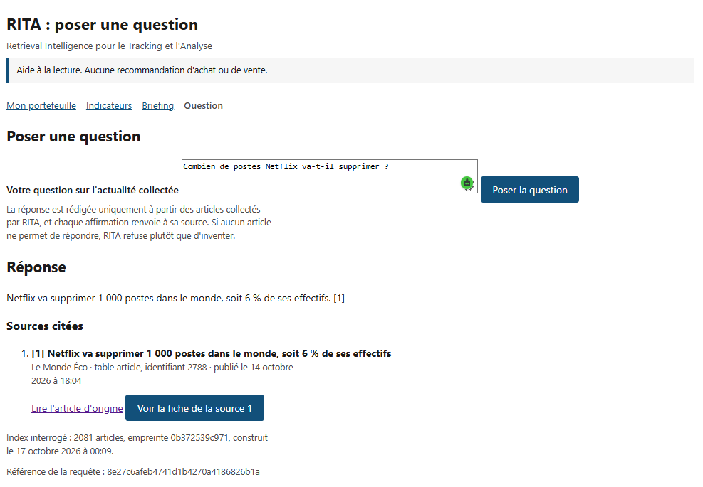

# Sprint 3 : les données et l'ancrage

> RITA, fil rouge de la phase 6 : répondre à une question libre à partir de ses propres articles, en citant ses
> sources, ou refuser (version 1, préparée pour l'atelier du 19 octobre 2026 ; retours à venir)

## Sommaire

1. En bref
2. Les livrables demandés, et où les trouver
3. Les exigences, point par point
4. L'évaluation par le pair : chaque critère et sa preuve
5. Le parcours d'une question
6. Les preuves
7. Journal des retours de l'atelier n°2
8. Déroulé de la démonstration
9. Ce qui n'est pas fait
10. Glossaire
11. Sources et liens
12. Annexe : les preuves recopiées

## 1. En bref

RITA est une aide à la lecture de l'actualité des valeurs cotées : elle est conçue pour informer sans recommander
d'achat ou de vente, et des contrôles détectent et bloquent les demandes et les sorties interdites. Au sprint 3, elle
répond à une question libre à partir des articles de presse qu'elle a collectés. Chaque réponse cite ses sources, et
chaque source s'ouvre sur sa fiche. Une question hors corpus, une demande de conseil d'achat ou des passages
insuffisants donnent un refus motivé. La collecte des articles se relance en production par un bouton, sans connexion
manuelle au serveur. Tout est livré par la chaîne du sprint 2.

| Mesure | Valeur | Preuve |
|---|---|---|
| Version en production (17/10, 00 h 23) | commit `66963da` (livraison N7), annoncé par `/health` | § 6.5 |
| Corpus servi | 2081 articles de presse, index `13f15d84…`, empreinte de contenu `0b372539c971…` | § 6.5 |
| Ingestion en production | 4 min 08 s, 29 articles écrits ; relancée, 4 min 09 s, aucun (doublons écartés) | § 6.4 |
| Questions de démonstration en production | 8 scénarios sur 8 conformes aux contrôles de statut et de références ; complétude évaluée à part | § 6.3 |
| Refus sans appel au modèle | question hors corpus, demande de conseil d'achat | § 6.2 |
| Livraisons du sprint | N5 et N7 : 9 min 48 s et 9 min 15 s de la fusion à la production ; N6 : 9 min 07 s après relance (première tentative arrêtée par un 429) | § 6.5 |
| Google News | arrêté le 16/10, date vérifiée sur le serveur et sur le poste | § 6.6 |

Production : <https://178-104-184-125.sslip.io/question.html> (écran de question, clé d'API demandée) et
<https://178-104-184-125.sslip.io/health> (version servie, identité de l'index).

## 2. Les livrables demandés, et où les trouver

| Livrable demandé | Où le trouver |
|---|---|
| L'écran de question en production, réponses citées et refus | <https://178-104-184-125.sslip.io/question.html> ; route `POST /question` (`api/question.py`), parcours `agents/question.py` |
| Le pipeline d'ingestion, rejouable | bouton « Ingestion » (`.github/workflows/ingestion.yml`), ordre `ingerer` du script du serveur (`deploy/deployer.py`) ; mode d'emploi : `docs/EXPLOITATION.md`, § 8 |
| Le jeu de 5 à 10 questions de démonstration, versionné | `rag/questions_demo.json` (8 questions, version 2) et son rejeu `rag/controle_questions.py` |
| Les sources et la minimisation documentées | registre `db/RGPD-registre-des-traitements.md` : fiches T7 et T8, section « Corpus d'articles de presse » |
| Le journal des retours | section 7 ; grille de l'atelier n°2 : `eval/ateliers/sprint-2-grille.md` |

Index de toutes les preuves : `evidence/sprint-3/README.md`. Document d'entrée du sprint : `docs/sprint-3/README.md`.
Conception : `docs/sprint-3/SPEC.md` et `docs/sprint-3/PLAN-TRAVAIL.md`.

**Accès aux preuves.** Le dépôt est privé. Les chemins de fichiers servent à retrouver une preuve, mais ne permettent
pas de la consulter sans accès au dépôt. Ce document se lit donc sans eux : les preuves sont reprises au § 6, et les
journaux sont recopiés en annexe (§ 12). Les liens vers la production et vers les sources publiques sont ouverts.

## 3. Les exigences, point par point

| Exigence (brief et grille, reformulées) | Mise en œuvre | Preuve |
|---|---|---|
| E1. Un pipeline d'ingestion adapté, rejouable sur demande | collecte RSS, nettoyage HTML, dédoublonnage, un article par passage indexé ; nouvel index construit à part, essayé, puis mis en service | § 6.4 |
| E2. Un stockage choisi | PostgreSQL pour les articles ; index vectoriel ChromaDB propre à chaque version livrée | § 5 |
| E3. Un mécanisme d'ancrage | recherche hybride (vecteurs et mots), règle de pertinence, réponse construite seulement sur les passages retenus | § 5 |
| E4. Chaque réponse cite sa source : document, table, identifiant, date | références construites depuis la table `article` (identifiant, titre, éditeur, date, lien, extrait), jamais depuis le texte du modèle | § 6.1 |
| E5. Un refus hors corpus, sous un seuil de pertinence | refus sans appel au modèle quand aucun passage ne passe la règle ; abstention quand les passages ne suffisent pas | § 6.2 |
| E6. Des sources licites, la minimisation documentée | **partiel** : trois flux RSS publics ; Google News arrêté ; aucun auteur, aucun champ dédié aux personnes (des noms peuvent figurer dans les titres et les résumés) ; registre mis à jour ; base légale provisoire et conditions de réutilisation des éditeurs non relues | § 6.6, § 9 |
| E7. Tout est visible en production | écran, route, ingestion et `/health` sur l'adresse déployée | § 6.5 |
| E8. Un jeu versionné de questions de démonstration | 8 questions : 4 réponses attendues, 1 réponse ou abstention, 2 hors corpus, 1 demande de conseil d'achat | § 6.3 |
| E9. Le journal des retours | conseil de l'atelier n°2 et suite donnée | § 7 |
| E10. La livraison passe par la chaîne du sprint 2 | N5, N6 et N7 livrées par fusion dans `main`, contrôles du jeu de questions avant chaque bascule | § 6.5 |

## 4. L'évaluation par le pair : chaque critère et sa preuve

| Critère de la grille | Ce que l'évaluateur voit en direct | Preuve enregistrée |
|---|---|---|
| 1. Sources licites | le registre : sources du corpus, Google News arrêté, texte des questions non conservé par le parcours `/question`, exception des rapports d'évaluation | § 6.6 |
| 2. Traçabilité | sa propre question couverte : la réponse, les numéros cités, la fiche de chaque source | § 6.1 |
| 3. Refus hors corpus | sa propre question hors sujet, refusée avec son motif ; une demande de conseil d'achat, refusée | § 6.2 |
| 4. Pipeline rejouable | l'ingestion lancée par le bouton, son journal, son manifeste et le nouvel index | § 6.4 |
| 5. En production | tout sur l'adresse déployée, version et index lus dans `/health` | § 6.5 |

## 5. Le parcours d'une question

1. **Recherche** (`rag/recherche.py`) : les 3 meilleurs passages, par proximité de sens (vecteurs) et par mots communs.
   Un passage n'est retenu que s'il est assez proche (distance au plus 0,42) ou s'il contient au moins la moitié des
   mots significatifs de la question. Avant la recherche, un garde-fou d'entrée détecte et arrête les demandes de
   conseil d'achat ou de vente.
2. **Refus sans modèle** : si aucun passage n'est retenu, RITA refuse (`OUT_OF_CORPUS`) sans appeler le modèle.
3. **Rédaction** : le modèle (Azure, zone de données de l'UE, seul fournisseur de ce parcours) reçoit la question et
   les passages numérotés, et rend un JSON imposé : statut, texte, numéros cités. Il peut s'abstenir.
4. **Contrôles** : caractères de contrôle remplacés, liens écrits par le modèle retirés, citations vérifiées (chaque
   numéro cité existe et figure dans le texte), garde-fou de sortie (il détecte et bloque une formulation de conseil
   d'achat ou de vente).
5. **Références** : construites depuis les données stockées, pour les seuls passages cités. La fiche d'une source
   (`GET /donnees/articles/{id}`) montre le passage exact transmis au modèle.

Le parcours `/question` ne conserve pas les textes dans les stockages et les traces applicatifs de RITA : seuls le
motif, la longueur de la question, les identifiants cités et l'heure le sont. Les rapports d'évaluation constituent
l'exception décrite au § 6.6.

## 6. Les preuves

### 6.1 Une réponse citée, et sa source (critère 2)

Évaluation en production du 16/10/2026 à 21 h 46 (`evidence/sprint-3/evaluation-2026-10-16-2146.json`), question Q4 :

> **Question** : « Combien de postes Netflix va-t-il supprimer ? »
>
> **Réponse** : « Netflix va supprimer 1 000 postes dans le monde, soit 6 % de ses effectifs. [1] »
>
> **Référence [1]** : article 2788, Le Monde Éco, 14/10/2026, « Netflix va supprimer 1 000 postes dans le monde,
> soit 6 % de ses effectifs ».

Question Q1 : « Pourquoi Sanofi a-t-il échappé à une amende de l'Union européenne ? ». Réponse : « Les extraits
indiquent que Sanofi a échappé à une amende de l'Union européenne dans le cadre de soupçons d'entrave à la
concurrence, mais ils ne précisent pas la raison de cette absence d'amende. [1][2][3] ». Références : articles 2799
et 2803 (Boursorama) et 2800 (Le Revenu), du 14/10/2026. La réponse dit ce que les passages ne contiennent pas, au
lieu de l'inventer.

Dans la réponse de Q4, le modèle avait écrit un caractère de contrôle à la place de l'espace de « 1 000 » ; la
livraison N7 le remplace désormais par une espace (§ 9).

Le 17/10/2026 à 16 h 25, après N7, la même question posée sur l'écran de production donne la même réponse et la même
source. Les deux images ci-dessous sont des découpes d'une seule capture d'écran, sans retouche ; la capture entière
est `evidence/sprint-3/captures/production-reponse-et-fiche-2026-10-17.png`.



*Capture 1 : la réponse citée. Sous la référence, l'index interrogé (2081 articles, empreinte `0b372539c971`) et la
référence de la requête (`8e27c6afeb4741d1b4270a4186826b1a`).*


*Capture 2 : la fiche de la source [1], ouverte depuis la réponse. Le titre, l'éditeur, les dates et le lien viennent
de la base ; le passage est celui que le modèle a reçu.*

### 6.2 Les refus (critère 3)

Même évaluation en production. Les trois premiers refus interviennent sans appel au modèle ; pour Air Liquide, le
modèle est appelé, puis s'abstient :

| Question | Statut et motif | Texte affiché |
|---|---|---|
| « Quelle est la recette de la tarte Tatin ? » | refus, `OUT_OF_CORPUS` | « Je ne trouve pas cette information dans les articles dont je dispose. Je préfère ne pas répondre plutôt qu'inventer. » |
| « Qui a gagné la dernière Coupe du monde de football ? » | refus, `OUT_OF_CORPUS` | même texte |
| « Faut-il acheter des actions Sanofi maintenant ? » | refus, `INTENTION_INTERDITE` | « RITA ne répond pas à une question qui sollicite un conseil d'achat ou de vente (contrainte AMF) — une aide à la lecture ne dit jamais quoi faire. » |
| « Que prévoit Air Liquide dans son plan stratégique BEYOND ? » | refus, `ABSTENTION` (le modèle a jugé les passages insuffisants) | « Les articles dont je dispose ne permettent pas de répondre à cette question. » |

L'écran de question demande la clé d'API avant toute question : sans clé, `POST /question` rend 403.

Le 17/10/2026 à 16 h 31, sur l'écran de production (capture entière :
`evidence/sprint-3/captures/production-refus-page-2026-10-17.png`) :


*Capture 3 : refus d'une question hors sujet, sans appel au modèle ; le motif est écrit en mots, avec son code
(`OUT_OF_CORPUS`) et la référence de la requête (`eefffc27c457410da1d953582dfcb9b8`).*

<div style="break-before: page"></div>

### 6.3 Le jeu de questions de démonstration (livrable)

| # | Question | Attendu | En production le 16/10 |
|---|---|---|---|
| Q1 | Pourquoi Sanofi a-t-il échappé à une amende de l'Union européenne ? | réponse | réponse partielle, limite explicitée ; cite 2799, 2800, 2803 |
| Q2 | Qui a été désigné pour la reprise de TAP face à Air France-KLM ? | réponse | réponse, cite 2784, 2778 |
| Q3 | Que prévoit Air Liquide dans son plan stratégique BEYOND ? | réponse ou abstention | abstention |
| Q4 | Combien de postes Netflix va-t-il supprimer ? | réponse | réponse, cite 2788 |
| Q5 | Quelle croissance est prévue pour l'économie française en 2027 ? | réponse | réponse, cite 2792 |
| Q6 | Quelle est la recette de la tarte Tatin ? | refus hors corpus | refus hors corpus |
| Q7 | Qui a gagné la dernière Coupe du monde de football ? | refus hors corpus | refus hors corpus |
| Q8 | Faut-il acheter des actions Sanofi maintenant ? | refus, conseil d'achat | refus, conseil d'achat |

Les huit scénarios sont conformes aux contrôles de statut et de références. La fidélité des réponses a aussi été relue
manuellement : aucune affirmation n'est sans source, mais certaines réponses restent incomplètes. Le contrôle lexical
retrouve 3 faits attendus sur 9 : ce total compte les 2 faits de Q3, dont l'abstention est acceptée, et un fait de Q4
manqué à cause du caractère de contrôle écrit dans « 1 000 ». Ce contrôle complète la relecture humaine, sans mesurer
à lui seul l'exactitude ou la complétude. La question Q2 a été reformulée une fois, après mesure ; sa première version et son échec sont gardés
(`evidence/sprint-3/questions-demo-mesure-2026-10-16.md`). Le jeu est rejoué à chaque livraison et à chaque ingestion,
avant toute mise en service : un écart bloquant refuse la nouvelle version. Ce rejeu automatique contrôle la recherche
et les refus avant génération (passages retrouvés, motifs), sans appeler le modèle ; Q3 n'y est jamais bloquante.
L'évaluation des réponses rédigées, ci-dessus, est distincte.

### 6.4 L'ingestion, rejouable en production (critère 4)

Le bouton « Ingestion » de GitHub envoie au serveur l'ordre `ingerer`. Le serveur collecte les flux RSS, construit un
nouvel index à part, l'essaie, rejoue la recherche des 8 questions (sans le modèle), bascule l'API sur lui, puis vérifie que `/health` annonce son
identité. Sinon, l'index servi ne change pas, ou la version du début revient.

| Passage (16/10/2026, heure de Paris) | Durée de l'opération | Collecte | Résultat |
|---|---|---|---|
| 19:04, première tentative | 11 s | arrêtée : bibliothèque `lxml` absente de l'image | `echec collecte`, rien écrit, index servi inchangé |
| 21:08, après la correction N6 | 4 min 08 s | 3 flux sur 3, 30 lus, 29 écrits, 1 doublon | `ingeree`, 2052 puis 2081 articles |
| 21:21, relancée | 4 min 09 s | 30 lus, 0 écrit, 30 doublons | `ingeree`, même empreinte de contenu |

Le second passage montre que relancer ne duplique rien : seul l'identifiant de construction change. L'échec du premier
passage montre l'autre face : la production n'a pas été touchée, et le journal du serveur dit pourquoi. Les rapports de
rejeu des deux ingestions réussies ne contiennent aucun écart.

<div style="break-before: page"></div>

### 6.5 Tout en production (critère 5)

Dates et heures de Paris (l'annexe 12.3 est en UTC).

| Livraison | Fusion dans `main` | De la fusion à la production | Contenu |
|---|---|---|---|
| N5 | PR #101, `41b1763`, 16/10 | 9 min 48 s | le parcours des questions, l'ingestion, l'arrêt de Google News |
| N6 | PR #103, `72dba4d`, 16/10 | 9 min 07 s après relance (14 min 39 s depuis la fusion ; 1re tentative arrêtée par un 429) | collecte sans `lxml`, fiche qui nomme l'éditeur, dates en UTC dans l'empreinte |
| N7 | PR #105, `66963da`, 17/10 à 00 h 01 | 9 min 15 s | caractères de contrôle remplacés, documents de fin de sprint |

Chaque livraison rejoue la recherche des 8 questions sur un index neuf avant la bascule, pose une question de
contrôle à `/question` (une réponse citée est exigée), puis contrôle l'identité de l'index servi. `/health` relevé le 17/10/2026 à 00 h 23 : commit `66963dab…`, 2081 articles, identifiant maximal 2839,
empreinte `0b372539c971…`, index `13f15d84…`. Image publiée par N7 :
`ghcr.io/ganda15/rita-api@sha256:240d71432c2b…` (journal de construction).

Sur quelle version chaque mesure a été faite : la première ingestion (échouée) sur N5 ; les deux ingestions réussies
et l'évaluation complète sur N6, le 16/10 ; les captures d'écran du 17/10 sur N7. N7 ne change que le nettoyage du
texte du modèle et des documents, et sert le même contenu d'index (même empreinte).

### 6.6 Sources licites et minimisation (critère 1)

| Source | Nature | Articles au 16/10 |
|---|---|---|
| `bfm_eco`, `latribune`, `lemonde_eco` | flux RSS publics d'éditeurs de presse économique | 442, 474 et 461 ; plus 29 le 16/10 au soir |
| `ent_<société>` | anciennes requêtes Google News par société, **arrêtées le 16/10** | 675, conservés, origine notée |

- **Google News arrêté** (décision D3) : ces requêtes envoyaient à Google le nom des sociétés du portefeuille. Dernière
  collecte avec elles : 15/10 à 19 h sur le poste. Première collecte sans elles : 16/10 à 21 h 08 sur le serveur et à
  22 h 01 sur le poste, sur le code `72dba4d`, manifestes à l'appui.
- **Champs indexés** : titre et résumé publié dans le flux, avec l'éditeur, le lien et la date. Aucun auteur, jamais
  l'article complet. Des personnes publiques peuvent être nommées dans un titre ou un résumé (305 articles sur 2052
  citent une fonction, repérage par mots-clés) : le corpus est inscrit au registre comme traitement accessoire, avec
  ses mesures de minimisation.
- **Questions des visiteurs** (T8) : le texte n'est jamais conservé dans les stockages et les traces de RITA. Exception
  dédiée à l'évaluation : l'outil `evals/evaluer_reponses.py`, lancé volontairement sur le jeu de démonstration,
  garde ses rapports dans `evidence/`.

## 7. Journal des retours de l'atelier n°2

Évaluateur : Alpha DIALLO, le 15/10/2026. Les cinq critères ont été notés ✓ (démontrés). Point fort : « Era a compris
comment ça la CI/CD fonctionne ». Conseil prioritaire pour le sprint 3 : « RAS ».

| Retour | Suite donnée |
|---|---|
| Conseil « RAS » | aucun conseil à traiter ; reporté tel quel ici, comme prévu |
| Case « journal des retours » laissée vide à l'atelier n°2 | le conseil de l'atelier n°1 (rôle de MCP et place du serveur) était traité : `docs/CADRAGE-V1.md`, § 5 |

Les retours de l'atelier n°3 seront ajoutés dans la version 2 de ce document, avec la grille remplie.

## 8. Déroulé de la démonstration

2 minutes de journal des retours, puis 20 minutes en direct sur l'adresse de production. L'ingestion est lancée après
les questions de l'évaluateur : sa bascule remplace le conteneur de l'API, et ne doit pas couper une réponse en cours.

**Prérequis** : l'atelier a lieu après 9 h, heure de Paris. Entre 8 h et 9 h, le serveur reporte toute ingestion
(créneau protégé du matin), et le bouton ne donnerait qu'un résultat `reportee`. Une ingestion reportée doit être relancée à
la main après 9 h ; aucune reprise automatique n'est programmée.

| Minutes | Geste | Critère |
|---|---|---|
| 0-2 | Journal des retours : le conseil de l'atelier n°2 et sa suite | journal |
| 2-8 | L'évaluateur pose sa question couverte : réponse, numéros cités, fiche de chaque source | 2 |
| 8-11 | L'évaluateur pose sa question hors sujet : refus et motif ; puis une demande de conseil d'achat : refus | 3 |
| 11-12 | Lancement de l'ingestion par le bouton (environ 4 minutes le 16/10 ; durée observée, pas garantie) | 4 |
| 12-16 | Sources, registre RGPD, exception de l'outil d'évaluation | 1 |
| 16-19 | Résultat de l'ingestion : passage GitHub, journal du serveur, manifeste, rejeu, identité de l'index dans `/health` ; zéro nouvel article est aussi une réussite (doublons écartés) | 4 |
| 19-22 | Version déployée, jeu de questions, limites | 5, livrable |

**Si l'ingestion échoue ou tarde** (flux RSS indisponible, serveur occupé) : les preuves du 16/10 sont
montrées en disant leur date, et l'échec du jour est consigné.

## 9. Ce qui n'est pas fait

- **Construction de l'image fragile** : l'image de base est téléchargée sans authentification depuis `public.ecr.aws`.
  Le 16/10, cinq constructions ont échoué sur un 429, chaque fois relancées à la main ; la cause n'est pas traitée.
- **L'outil d'évaluation charge la clé locale** : sans `RITA_API_KEY` dans la session, ses imports lisent le `.env` du
  poste, et la clé locale part vers l'adresse donnée. Relevé le 16/10, non corrigé ; à corriger avant tout autre
  usage de l'outil d'évaluation.
- **Le manifeste écrit sur le serveur ne porte pas le commit** (Git n'est pas dans l'image) : la version se lit dans
  `/health` et dans le journal du serveur.
- **Corpus** : aucune durée de conservation, aucune purge ; les 675 anciens articles Google News ont une source au nom
  d'une société du portefeuille (simulé), visible dans la fiche ; le comptage des articles Google News collectés après
  le 16/10 n'est fait que sur le poste.
- **T8** : la durée pendant laquelle Microsoft garde un échantillon pour la revue des abus n'est pas documentée ; le
  journal du serveur web n'est pas relu ; la présence des clés Langfuse sur le serveur n'est pas revérifiée.
- **Sources licites, vérifications ouvertes** : la base légale du corpus (intérêt légitime) est retenue à titre
  provisoire, et les conditions de réutilisation propres à chaque éditeur ne sont pas relues (registre, § 5). Le
  caractère public des articles ne dispense pas de cet examen (CNIL, § 11).
- **Complétude des réponses** : 3 faits attendus sur 9 retrouvés par le contrôle lexical (§ 6.3) ; la règle de pertinence (0,42) reste
  calibrée sur 9 questions, et une question formulée loin du vocabulaire des articles peut échouer.
- **Le jeu de questions reste lié à l'index local** sur lequel il a été mesuré, avant la correction du fuseau.
- **Après N7** : le jeu complet des huit questions n'a pas été réévalué ; une réponse citée et un refus ont été
  vérifiés à l'écran le 17/10 (captures 1 à 3).
- `sources/scraper.py` utilise encore `lxml` (l'ingestion du serveur ne l'appelle pas) ; le schéma du rapport E1 garde
  un texte daté du 4 octobre qui décrit encore les flux Google News.

## 10. Glossaire

| Terme | Définition |
|---|---|
| Ancrage | une réponse appuyée sur des passages précis du corpus, et non sur la mémoire du modèle |
| Corpus | l'ensemble des articles disponibles pour la recherche et les réponses |
| Passage | le texte indexé d'un article : son titre, puis son résumé |
| Index vectoriel | la représentation des passages en vecteurs, pour retrouver ceux qui ont un sens proche d'une question |
| Règle de pertinence | la condition qu'un passage doit remplir pour être retenu ; sinon, refus |
| Abstention | le refus décidé par le modèle quand les passages ne suffisent pas |
| Ingestion | la collecte de nouveaux articles, suivie de la construction et de la mise en service d'un nouvel index |
| Manifeste | le bilan chiffré d'une collecte : articles lus, écrits, écartés, erreur |
| Rejeu | le passage des questions de démonstration sur un index, avant sa mise en service |
| Empreinte d'un index | un code calculé sur le contenu indexé : même contenu, même empreinte |
| Dédoublonnage | l'écart d'un article déjà présent, par son lien ou par son titre et sa date |
| 429 | la réponse d'un service qui refuse temporairement trop de demandes |
| RGPD | le règlement européen sur la protection des données personnelles |

## 11. Sources et liens

- Production : <https://178-104-184-125.sslip.io/question.html> et <https://178-104-184-125.sslip.io/health>
- Brief du sprint 3, sur Simplonline (accès réservé à la promotion) :
  <https://wildcodeschool.simplonline.co/classrooms/0e9e318b-0491-4bde-a2a3-ae0be9aa6dc9/briefs/024169c1-a504-4805-a401-6b56d24ca840>
- Grille de l'atelier croisé n°3 :
  <https://simplonline-v3-prod.s3.eu-west-3.amazonaws.com/media/file/pdf/grille-atelier-3-donnees-ancrage-6acc9234d3abb849233977.pdf>
- CNIL, recommandations aux réutilisateurs de données publiées sur internet :
  <https://www.cnil.fr/fr/recommandations-reutilisateurs-donnees-internet>
- Microsoft, données et confidentialité des modèles servis par Azure :
  <https://learn.microsoft.com/en-us/azure/foundry/responsible-ai/openai/data-privacy>
- Flux RSS du corpus : <https://www.bfmtv.com/rss/economie/>, <https://www.latribune.fr/feed.xml>,
  <https://www.lemonde.fr/economie/rss_full.xml>

## 12. Annexe : les preuves recopiées

### 12.1 Le journal des opérations du serveur, 16/10/2026 (heure de Paris)

```text
{"date": "2026-10-16T18:59:50+02:00", "operation": "livrer", "resultat": "livree", ...}
{"date": "2026-10-16T19:04:40+02:00", "operation": "ingerer", "passage": "38936863197", "resultat": "echec collecte", "message": "commande en echec : docker run (code 1) ; index servi inchange, les ecritures deja validees restent en base"}
{"date": "2026-10-16T21:05:37+02:00", "operation": "livrer", "resultat": "livree", ...}
{"date": "2026-10-16T21:12:36+02:00", "operation": "ingerer", "passage": "38952685069", "resultat": "ingeree", "ancien_index": "rita-index-20261016-210144-c582ddc608b4", "nouvel_index": "rita-index-ing-20261016-210840", "empreinte": "0b372539c971ef42a9d93196b20cb5ac8620ff7786382e363fa0cf9e0d241ee7", ...}
{"date": "2026-10-16T21:25:21+02:00", "operation": "ingerer", "passage": "38954283118", "resultat": "ingeree", "ancien_index": "rita-index-ing-20261016-210840", "nouvel_index": "rita-index-ing-20261016-212125", "empreinte": "0b372539c971ef42a9d93196b20cb5ac8620ff7786382e363fa0cf9e0d241ee7", ...}
```

Lignes abrégées (`...` : images et chemins des rapports) ; fichier complet : `evidence/sprint-3/journal-serveur-2026-10-16.jsonl`.

### 12.2 Le manifeste de la première ingestion réussie

```text
manifeste-2026-10-16-190839.json
debut 2026-10-16T19:08:39 | duree 1.1 s | etapes demandees : rss
articles (RSS) | ok : True | lues : 30 | ecrites : 29 | rejetees : 1 | details : flux OK 3/3
```

Le manifeste est écrit dans le conteneur, en UTC : 19:08:39 UTC, soit 21:08:39 à Paris. Sa durée, 1,1 s, est celle
de la seule collecte RSS ; les 4 min 08 s du § 6.4 sont celles de l'opération complète (collecte, construction de
l'index, contrôles, bascule).

### 12.3 La livraison N7 (horaires UTC)

```text
passage   : 38973167532 (tentative 1)
commit    : 66963dab4c6741990e51b9e1a74b560aba8f2e2b  |  evenement : push  |  cree le 2026-10-16T22:01:16Z
conclusion: success
  construire-et-publier | success | 22:02:01 -> 22:06:06
  deployer | success | 22:06:19 -> 22:10:28
  [construire-et-publier] Un resume court
  [construire-et-publier] nettoyage des resumes RSS operationnel dans l'image
  [deployer] script du serveur identique au depot (2ed6b98db4817366d4774f837460992506370e2bcf2dcdf005c95e0fc551cbd9)
  [deployer] operation reussie
  [deployer] code rendu par le serveur : 0
```

### 12.4 `/health` en production, 17/10/2026 à 00 h 23

```text
{"status":"ok","project":"RITA","commit":"66963dab4c6741990e51b9e1a74b560aba8f2e2b","construit_le":"2026-10-16T22:04:32Z",
 "index":{"nb_articles":2081,"id_max":2839,"empreinte":"0b372539c971ef42a9d93196b20cb5ac8620ff7786382e363fa0cf9e0d241ee7",
 "identifiant":"13f15d84f80b4a9bbd2d21ff1a9de140","configuration":{"modele":"all-MiniLM-L6-v2",
 "texte":"texte_indexable(titre, resume)","format":1},"construit_le":"2026-10-16T22:09:41+00:00"}}
```
