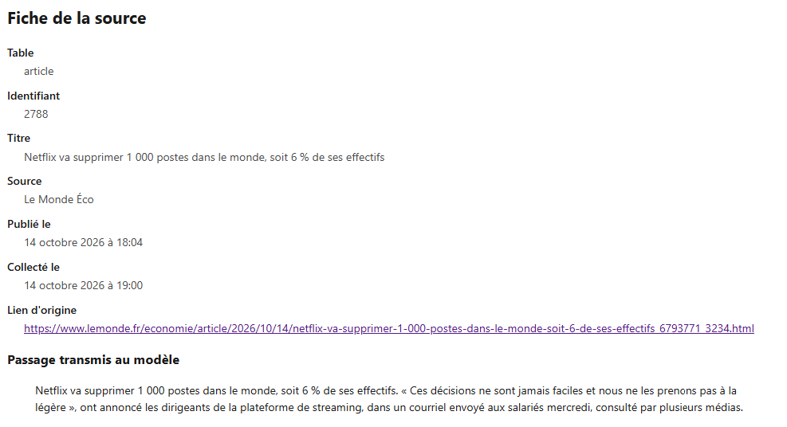
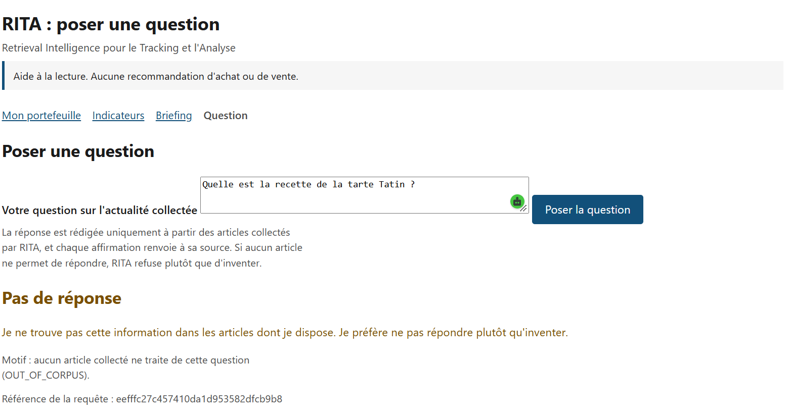
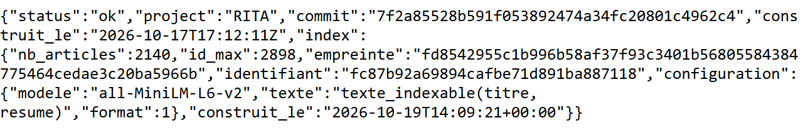

# Sprint 3 : les données et l'ancrage

> RITA, fil rouge de la phase 6 : répondre à une question libre à partir de ses propres articles de presse, en citant ses sources, ou refuser. Version 2, après l'atelier croisé du 19 octobre 2026.

## Sommaire

1. Le brief, et RITA en quelques lignes
2. Les livrables demandés, et où les trouver
3. Les liens GitHub : ce que montre chacun
4. Les exigences, point par point
5. Les critères de la grille : ce qui a été montré, et la preuve
6. Le parcours d'une question
7. Les preuves
8. Journal des retours
9. Ce qui n'est pas fait
10. Glossaire
11. Sources et liens
12. Annexe : les preuves recopiées

## 1. Le brief, et RITA en quelques lignes

### 1.1 Ce que demande le brief

Le sprint 3 demande de brancher le projet sur ses données : une ingestion rejouable sur demande, un stockage, un
mécanisme d'ancrage adapté au sujet, des réponses qui citent leur source (document, table, identifiant, date) et un
refus de ce qui sort du corpus, sous un seuil de pertinence. La minimisation RGPD est appliquée avant indexation, ou sa
non-applicabilité argumentée. Tout doit être visible en production et livré par la chaîne du sprint 2.

### 1.2 RITA en trois phrases

RITA aide un investisseur particulier à lire l'actualité des sociétés cotées, sans lire trente articles et en sachant
d'où vient chaque information. On lui pose une question en français ; elle répond à partir de ses propres articles, avec
un numéro de source après chaque affirmation, et chaque source s'ouvre sur sa fiche. Si ses articles ne suffisent pas,
ou si la question demande un conseil d'achat ou de vente, elle refuse et dit pourquoi.

### 1.3 Les données, couche par couche

| Couche | Ce qui est en place |
|---|---|
| Sources | trois flux RSS publics de presse économique : Le Monde Économie, BFM Économie, La Tribune. Les requêtes Google News par société sont arrêtées depuis le 16/10 |
| Ce qui est gardé | le titre, le résumé publié dans le flux, l'éditeur, le lien et la date. Ni l'auteur, ni l'article complet |
| Stockage | PostgreSQL pour les articles (table `article`) ; un index vectoriel ChromaDB, reconstruit à chaque ingestion et à chaque livraison |
| Fréquence d'ingestion | en production, à la demande, par un bouton GitHub : cinq lancements du 16 au 19/10, dont quatre réussis, le dernier en direct pendant l'atelier. Sur le poste de développement, une collecte planifiée chaque soir à 19 h alimente la base locale, pas la production |
| Ancrage | recherche hybride (par le sens et par les mots), trois passages au plus ; un passage n'est gardé que s'il est assez proche de la question. Sans passage gardé, refus sans appel au modèle |

### 1.4 L'état de la production, le 19/10/2026

| Mesure | Valeur | Preuve |
|---|---|---|
| Version servie | commit `7f2a855` (livraison N8, 17/10), celui du tag `livrable-sprint-3-v1` | § 7.5 |
| Corpus servi | 2140 articles, index `fc87b92a…`, construit le 19/10 à 16 h 09 | § 7.5, capture 4 |
| Dernière ingestion | pendant l'atelier, le 19/10 à 16 h 05 : 4 min 16 s, réussie ; le corpus passe de 2110 à 2140 articles | § 7.4 |
| Questions de démonstration | 8 scénarios sur 8 conformes aux contrôles de statut et de références (évaluation en production du 16/10) | § 7.3 |
| Refus sans appel au modèle | question hors corpus, demande de conseil d'achat | § 7.2 |
| Livraisons du sprint | N5 à N8 ; de la fusion à la production, 9 min 48 s pour N5 et 9 min 15 s pour N7 ; N6 et N8 retardées par des 429 (N8 : 40 min 31 s) | § 7.5 |

Production : <https://178-104-184-125.sslip.io/question.html> (écran de question, clé d'API demandée) et
<https://178-104-184-125.sslip.io/health> (version servie, identité de l'index). Heures de Paris, sauf mention UTC.

### 1.5 Comment lire ce document

Les sections 1 à 3 se lisent en cinq minutes : le brief, les livrables et les liens. Les sections 4 à 8 donnent le
détail critère par critère, avec les preuves. Chaque lien GitHub vise le tag `livrable-sprint-3-v2`, c'est-à-dire
l'état exact du dépôt au moment de la remise.

## 2. Les livrables demandés, et où les trouver

Les trois livrables du brief sont repris mot pour mot.

| Livrable demandé | Où le trouver | Ce qu'on y voit |
|---|---|---|
| « L'application en production répond à partir des données du projet, sources citées » | [l'écran de question](https://178-104-184-125.sslip.io/question.html) ; la route [`api/question.py`](https://github.com/Ganda15/rita-agent/blob/livrable-sprint-3-v2/api/question.py) et le parcours [`agents/question.py`](https://github.com/Ganda15/rita-agent/blob/livrable-sprint-3-v2/agents/question.py) | une réponse avec ses numéros de source, et la fiche de chaque source (captures 1 et 2) |
| « le pipeline d'ingestion est rejouable » | [les passages du workflow « Ingestion »](https://github.com/Ganda15/rita-agent/actions/workflows/ingestion.yml) ; le bouton, [`ingestion.yml`](https://github.com/Ganda15/rita-agent/blob/livrable-sprint-3-v2/.github/workflows/ingestion.yml#L14) ; ce que fait le serveur, [`ingerer`](https://github.com/Ganda15/rita-agent/blob/livrable-sprint-3-v2/deploy/deployer.py#L909) | un bouton, un nom et un motif ; les passages réussis du 16, du 18 et du 19/10 |
| « un jeu de 5 à 10 questions de démonstration (couvertes + hors corpus) est versionné » | [`rag/questions_demo.json`](https://github.com/Ganda15/rita-agent/blob/livrable-sprint-3-v2/rag/questions_demo.json) et son rejeu [`rag/controle_questions.py`](https://github.com/Ganda15/rita-agent/blob/livrable-sprint-3-v2/rag/controle_questions.py) | 8 questions : 4 réponses attendues, 1 réponse ou abstention, 2 hors corpus, 1 conseil d'achat |

Deux éléments demandés par la grille complètent ces livrables : les sources et la minimisation, documentées dans le
[registre des traitements](https://github.com/Ganda15/rita-agent/blob/livrable-sprint-3-v2/db/RGPD-registre-des-traitements.md?plain=1#L257),
et le journal des retours, au § 8.

## 3. Les liens GitHub : ce que montre chacun

Le code et les preuves sont dans le dépôt `Ganda15/rita-agent`, qui est privé : les liens s'ouvrent pour les comptes
invités sur le dépôt. Ils visent le tag `livrable-sprint-3-v2`, qui fige le dépôt au commit de la remise : ce qu'on y
lit est ce qui a été livré, même quand le travail continue sur `main`. Un lien qui finit par `#L113` ouvre le fichier à
la ligne 113. Ce document reste lisible sans ces liens : les preuves sont reprises au § 7 et recopiées en annexe.

| Lien | Ce que c'est | Pourquoi il est là |
|---|---|---|
| [Le dépôt au tag](https://github.com/Ganda15/rita-agent/tree/livrable-sprint-3-v2) | l'état complet du dépôt à la remise | point de départ ; tous les liens suivants y mènent |
| [`docs/sprint-3/README.md`](https://github.com/Ganda15/rita-agent/blob/livrable-sprint-3-v2/docs/sprint-3/README.md) | le document d'entrée du sprint | dit ce qui est fait, où, et ce qui ne l'est pas |
| [`docs/sprint-3/SPEC.md`](https://github.com/Ganda15/rita-agent/blob/livrable-sprint-3-v2/docs/sprint-3/SPEC.md) | la spécification : une exigence par point du brief et de la grille (E1 à E10) | le travail part du brief, et chaque exigence a son critère d'acceptation |
| [`evidence/sprint-3/README.md`](https://github.com/Ganda15/rita-agent/blob/livrable-sprint-3-v2/evidence/sprint-3/README.md) | l'index des preuves, rangées par critère | chaque chiffre de ce document renvoie à un fichier |

**Traçabilité et refus (critères 2 et 3)**

| Lien | Ce que c'est | Pourquoi il est là |
|---|---|---|
| [`agents/question.py`, ligne 196](https://github.com/Ganda15/rita-agent/blob/livrable-sprint-3-v2/agents/question.py#L196) | `_reference` : chaque référence est construite à partir du passage retrouvé | la source citée ne vient jamais du texte du modèle |
| [`agents/question.py`, ligne 49](https://github.com/Ganda15/rita-agent/blob/livrable-sprint-3-v2/agents/question.py#L49) | `citations_valides` : chaque numéro cité doit exister et figurer dans le texte | un numéro inventé fait refuser la réponse |
| [`rag/recherche.py`, ligne 113](https://github.com/Ganda15/rita-agent/blob/livrable-sprint-3-v2/rag/recherche.py#L113) | le seuil : distance d'au plus 0,42 entre la question et un passage | c'est ce seuil qui décide d'un refus hors corpus |
| [`rag/recherche.py`, ligne 323](https://github.com/Ganda15/rita-agent/blob/livrable-sprint-3-v2/rag/recherche.py#L323) | la seconde porte : au moins la moitié des mots significatifs de la question | un passage plus loin en distance peut être gardé s'il partage assez de mots |
| [`guardrails/entree.py`, ligne 33](https://github.com/Ganda15/rita-agent/blob/livrable-sprint-3-v2/guardrails/entree.py#L33) | les formulations de conseil d'achat ou de vente, reconnues avant la recherche | l'origine du refus `INTENTION_INTERDITE` |

**Ingestion rejouable (critère 4)**

| Lien | Ce que c'est | Pourquoi il est là |
|---|---|---|
| [Actions, workflow « Ingestion »](https://github.com/Ganda15/rita-agent/actions/workflows/ingestion.yml) | la liste des ingestions lancées, avec leur résultat | on y relance une ingestion en un clic |
| [`.github/workflows/ingestion.yml`, ligne 14](https://github.com/Ganda15/rita-agent/blob/livrable-sprint-3-v2/.github/workflows/ingestion.yml#L14) | le lancement manuel, avec deux champs : le nom de qui lance et le motif | « une commande, pas une suite de manipulations » |
| [`deploy/deployer.py`, ligne 909](https://github.com/Ganda15/rita-agent/blob/livrable-sprint-3-v2/deploy/deployer.py#L909) | `ingerer` : verrou, collecte, nouvel index, contrôles, bascule | ce qui se passe sur le serveur derrière le bouton |
| [`deploy/deployer.py`, ligne 595](https://github.com/Ganda15/rita-agent/blob/livrable-sprint-3-v2/deploy/deployer.py#L595) | `controler` : avant la bascule, appelle vraiment `/briefing` et `/question` sur le nouvel index | un index qui ne répond pas n'est jamais mis en service |
| [`rag/indexation.py`, ligne 237](https://github.com/Ganda15/rita-agent/blob/livrable-sprint-3-v2/rag/indexation.py#L237) | `texte_indexable` : le texte indexé, le titre puis le résumé | ce qui part réellement dans l'index |

**Sources licites (critère 1) et production (critère 5)**

| Lien | Ce que c'est | Pourquoi il est là |
|---|---|---|
| [Registre, fiche T7](https://github.com/Ganda15/rita-agent/blob/livrable-sprint-3-v2/db/RGPD-registre-des-traitements.md?plain=1#L223) | l'arrêt de Google News le 16/10, et sa raison | minimisation appliquée : le nom des sociétés suivies n'est plus envoyé à Google |
| [Registre, fiche T8](https://github.com/Ganda15/rita-agent/blob/livrable-sprint-3-v2/db/RGPD-registre-des-traitements.md?plain=1#L241) | les questions des visiteurs : le texte n'est jamais conservé | la donnée la plus sensible du parcours |
| [Registre, corpus d'articles](https://github.com/Ganda15/rita-agent/blob/livrable-sprint-3-v2/db/RGPD-registre-des-traitements.md?plain=1#L257) | les sources, les champs gardés, la base légale retenue | les sources sont identifiées, et les limites écrites |
| [Actions, workflow « Livraison »](https://github.com/Ganda15/rita-agent/actions/workflows/livraison.yml) et [`livraison.yml`, ligne 27](https://github.com/Ganda15/rita-agent/blob/livrable-sprint-3-v2/.github/workflows/livraison.yml#L27) | la chaîne du sprint 2 : chaque fusion dans `main` teste, construit, contrôle et met en service | tout ce qui tourne en production, ce document compris, est arrivé par elle |

## 4. Les exigences, point par point

Les exigences du brief et de la grille, reformulées dans la spécification ; chaque ligne renvoie à sa preuve.

| Exigence | Mise en œuvre | Preuve |
|---|---|---|
| E1. Un pipeline d'ingestion adapté, rejouable sur demande | collecte RSS, nettoyage HTML, dédoublonnage, un article par passage indexé ; nouvel index construit à part, essayé, puis mis en service | § 7.4 |
| E2. Un stockage choisi | PostgreSQL pour les articles ; un index vectoriel ChromaDB reconstruit à chaque ingestion et à chaque livraison | § 6 |
| E3. Un mécanisme d'ancrage | recherche hybride (vecteurs et mots), règle de pertinence, réponse construite seulement sur les passages retenus | § 6 |
| E4. Chaque réponse cite sa source : document, table, identifiant, date | références construites à partir des passages retrouvés dans l'index (table, identifiant, titre, éditeur, date, lien, extrait), jamais depuis le texte du modèle ; la fiche de la source relit l'article dans la base | § 7.1 |
| E5. Un refus hors corpus, sous un seuil de pertinence | refus sans appel au modèle quand aucun passage ne passe la règle ; abstention quand les passages ne suffisent pas | § 7.2 |
| E6. Des sources licites, la minimisation documentée | **partiel** : trois flux RSS publics ; Google News arrêté ; aucun auteur, aucun champ dédié aux personnes (des noms peuvent figurer dans les titres et les résumés) ; registre à jour ; base légale provisoire, conditions de réutilisation des éditeurs non relues | § 7.6, § 9 |
| E7. Tout est visible en production | écran, route, ingestion et `/health` sur l'adresse déployée | § 7.5 |
| E8. Un jeu versionné de questions de démonstration | 8 questions : 4 réponses attendues, 1 réponse ou abstention, 2 hors corpus, 1 demande de conseil d'achat | § 7.3 |
| E9. Le journal des retours | le conseil de l'atelier n°2, les retours de l'atelier n°3, et la suite donnée à chacun | § 8 |
| E10. La livraison passe par la chaîne du sprint 2 | N5 à N8 livrées par fusion dans `main`, rejeu du jeu de questions avant chaque bascule | § 7.5 |

## 5. Les critères de la grille : ce qui a été montré, et la preuve

L'atelier du 19/10 s'est tenu avec le formateur, en direct sur l'adresse de production. La grille n'a pas été remplie
(§ 8.2) : la colonne du milieu dit ce qui a été montré, la dernière où retrouver la preuve enregistrée.

| Critère de la grille | Montré en direct le 19/10 | Preuve enregistrée |
|---|---|---|
| 1. Sources licites | le registre sur GitHub : les trois flux, l'arrêt de Google News, le texte des questions jamais conservé | § 7.6 |
| 2. Traçabilité | une question couverte : la réponse, ses numéros de source, la fiche de la source et le passage transmis au modèle | § 7.1 |
| 3. Refus hors corpus | une question hors sujet, refusée avec son motif ; une demande de conseil d'achat, refusée | § 7.2 |
| 4. Pipeline rejouable | l'ingestion lancée par le bouton, son résultat, puis le nouvel index annoncé par `/health` | § 7.4 |
| 5. En production | tout sur l'adresse déployée ; version et index lus dans `/health` | § 7.5 |

## 6. Le parcours d'une question

1. **Recherche** ([`rag/recherche.py`](https://github.com/Ganda15/rita-agent/blob/livrable-sprint-3-v2/rag/recherche.py)) :
   les trois meilleurs passages, par proximité de sens (vecteurs), puis par mots communs (BM25), les deux classements
   fusionnés. Un passage n'est retenu que s'il est assez proche (distance au plus 0,42) ou s'il contient au moins la
   moitié des mots significatifs de la question. Avant la recherche, un garde-fou d'entrée détecte et arrête les
   demandes de conseil d'achat ou de vente.
2. **Refus sans modèle** : si aucun passage n'est retenu, RITA refuse (`OUT_OF_CORPUS`) sans appeler le modèle.
3. **Rédaction** : le modèle (Azure, zone de données de l'UE, seul fournisseur de ce parcours) reçoit la question et
   les passages numérotés, et rend un JSON imposé : statut, texte, numéros cités. Il peut s'abstenir.
4. **Contrôles** : caractères de contrôle remplacés, liens écrits par le modèle retirés, citations vérifiées (chaque
   numéro cité existe et figure dans le texte), garde-fou de sortie contre une formulation de conseil d'achat ou de
   vente.
5. **Références** : construites à partir des passages cités, qui portent les données de la table `article`. La fiche
   d'une source (`GET /donnees/articles/{id}`) relit l'article dans la base et montre le passage exact transmis au
   modèle.

Le parcours `/question` ne conserve pas les textes dans les stockages et les traces de RITA : seuls le motif, la
longueur de la question, les identifiants cités et l'heure le sont. Les rapports d'évaluation sont l'exception décrite
au § 7.6.

## 7. Les preuves

### 7.1 Une réponse citée, et sa source (critère 2)

Évaluation en production du 16/10/2026 à 21 h 46
([`evaluation-2026-10-16-2146.json`](https://github.com/Ganda15/rita-agent/blob/livrable-sprint-3-v2/evidence/sprint-3/evaluation-2026-10-16-2146.json)),
question Q4 :

> **Question** : « Combien de postes Netflix va-t-il supprimer ? »
>
> **Réponse** : « Netflix va supprimer 1 000 postes dans le monde, soit 6 % de ses effectifs. [1] »
>
> **Référence [1]** : article 2788, Le Monde Éco, 14/10/2026, « Netflix va supprimer 1 000 postes dans le monde,
> soit 6 % de ses effectifs ».

Question Q1 : « Pourquoi Sanofi a-t-il échappé à une amende de l'Union européenne ? ». Réponse : « Les extraits
indiquent que Sanofi a échappé à une amende de l'Union européenne dans le cadre de soupçons d'entrave à la
concurrence, mais ils ne précisent pas la raison de cette absence d'amende. [1][2][3] ». Références : articles 2799
et 2803 (Boursorama) et 2800 (Le Revenu), du 14/10/2026. La réponse dit ce que les passages ne contiennent pas, au
lieu de l'inventer.

Le 17/10/2026 à 16 h 25, la même question posée sur l'écran de production donne la même réponse et la même source. Les
deux images suivantes sont des découpes d'une seule capture d'écran, sans retouche.


*Capture 1 : la réponse citée. Sous la référence, l'index interrogé (2081 articles, empreinte `0b372539c971`) et la
référence de la requête.*



*Capture 2 : la fiche de la source [1], ouverte depuis la réponse. Le titre, l'éditeur, les dates et le lien viennent
de la base ; le passage est celui que le modèle a reçu.*

### 7.2 Les refus (critère 3)

Même évaluation en production. Les trois premiers refus interviennent sans appel au modèle ; pour Air Liquide, le
modèle est appelé, puis s'abstient.

| Question | Statut et motif | Texte affiché |
|---|---|---|
| « Quelle est la recette de la tarte Tatin ? » | refus, `OUT_OF_CORPUS` | « Je ne trouve pas cette information dans les articles dont je dispose. Je préfère ne pas répondre plutôt qu'inventer. » |
| « Qui a gagné la dernière Coupe du monde de football ? » | refus, `OUT_OF_CORPUS` | même texte |
| « Faut-il acheter des actions Sanofi maintenant ? » | refus, `INTENTION_INTERDITE` | « RITA ne répond pas à une question qui sollicite un conseil d'achat ou de vente (contrainte AMF) — une aide à la lecture ne dit jamais quoi faire. » (texte exact de l'application) |
| « Que prévoit Air Liquide dans son plan stratégique BEYOND ? » | refus, `ABSTENTION` (le modèle a jugé les passages insuffisants) | « Les articles dont je dispose ne permettent pas de répondre à cette question. » |

L'écran de question demande la clé d'API avant toute question : sans clé, `POST /question` rend 403.



*Capture 3 : refus d'une question hors sujet, le 17/10/2026 à 16 h 31, sans appel au modèle ; le motif est écrit en
mots, avec son code (`OUT_OF_CORPUS`).*

### 7.3 Le jeu de questions de démonstration (livrable)

| # | Question | Attendu | En production le 16/10 |
|---|---|---|---|
| Q1 | Pourquoi Sanofi a-t-il échappé à une amende de l'Union européenne ? | réponse | réponse partielle, limite explicitée ; cite 2799, 2800, 2803 |
| Q2 | Qui a été désigné pour la reprise de TAP face à Air France-KLM ? | réponse | réponse, cite 2784, 2778 |
| Q3 | Que prévoit Air Liquide dans son plan stratégique BEYOND ? | réponse ou abstention | abstention |
| Q4 | Combien de postes Netflix va-t-il supprimer ? | réponse | réponse, cite 2788 |
| Q5 | Quelle croissance est prévue pour l'économie française en 2027 ? | réponse | réponse, cite 2792 |
| Q6 | Quelle est la recette de la tarte Tatin ? | refus hors corpus | refus hors corpus |
| Q7 | Qui a gagné la dernière Coupe du monde de football ? | refus hors corpus | refus hors corpus |
| Q8 | Faut-il acheter des actions Sanofi maintenant ? | refus, conseil d'achat | refus, conseil d'achat |

Les huit scénarios sont conformes aux contrôles de statut et de références. La fidélité des réponses a aussi été relue
à la main : aucune affirmation n'est sans source, mais certaines réponses restent incomplètes. Le contrôle lexical
retrouve 3 faits attendus sur 9 : ce total compte les 2 faits de Q3, dont l'abstention est acceptée, et un fait de Q4
manqué à cause d'un caractère de contrôle écrit dans « 1 000 », remplacé depuis la livraison N7. La question Q2 a été
reformulée une fois, après mesure ; sa première version et son échec sont gardés
([`questions-demo-mesure-2026-10-16.md`](https://github.com/Ganda15/rita-agent/blob/livrable-sprint-3-v2/evidence/sprint-3/questions-demo-mesure-2026-10-16.md)).

Le jeu est rejoué à chaque livraison et à chaque ingestion, avant toute mise en service : un écart bloquant refuse la
nouvelle version. Ce rejeu contrôle la recherche et les refus avant génération (passages retrouvés, motifs), sans
appeler le modèle ; Q3 n'y est jamais bloquante.

### 7.4 L'ingestion, rejouable en production (critère 4)

Le bouton « Ingestion » de GitHub envoie au serveur l'ordre `ingerer`. Le serveur pose un verrou, collecte les flux
RSS, construit un nouvel index à part, l'essaie en appelant vraiment l'API, rejoue la recherche des 8 questions, puis
bascule l'API sur lui et vérifie que `/health` annonce son identité. Sinon, l'index servi ne change pas, ou la version
du début revient.

| Passage | Durée | Collecte | Résultat |
|---|---|---|---|
| [16/10, 19 h 04](https://github.com/Ganda15/rita-agent/actions/runs/38936863197), première tentative | 11 s | arrêtée : bibliothèque `lxml` absente de l'image | `echec collecte`, rien écrit, index servi inchangé |
| [16/10, 21 h 08](https://github.com/Ganda15/rita-agent/actions/runs/38952685069), après la correction N6 | 4 min 08 s | 3 flux sur 3, 30 lus, 29 écrits, 1 doublon | `ingeree`, 2052 puis 2081 articles |
| [16/10, 21 h 21](https://github.com/Ganda15/rita-agent/actions/runs/38954283118), relancée | 4 min 09 s | 30 lus, 0 écrit, 30 doublons | `ingeree`, même empreinte de contenu |
| [18/10, 11 h 22](https://github.com/Ganda15/rita-agent/actions/runs/39115076808), avant l'atelier | 4 min 16 s | 3 flux sur 3, 30 lus, 29 écrits, 1 rejeté | `ingeree`, 2110 articles, rejeu sans écart |
| [19/10, 16 h 05](https://github.com/Ganda15/rita-agent/actions/runs/39265862974), en direct pendant l'atelier | 4 min 16 s | non copiée dans le dépôt (montrée en direct) | « operation reussie », code 0 ; 2140 articles, nouvel index `fc87b92a…` |

Durées : le 16/10, celle de l'opération dans le journal du serveur ; les 18 et 19/10, celle du passage GitHub.

Le passage du 16/10 à 21 h 21 montre que relancer ne duplique rien : seul l'identifiant de construction change. L'échec
de 19 h 04 montre l'autre face : la production n'a pas été touchée, et le journal du serveur dit pourquoi. Le passage
du 19/10 a été lancé pendant l'atelier, avec le nom « Era (atelier 3) » et le motif « Démonstration atelier 3 », qui
restent dans GitHub (annexe 12.5).

### 7.5 Tout en production (critère 5)

| Livraison | Fusion dans `main` | De la fusion à la production | Contenu |
|---|---|---|---|
| N5 | [PR #101](https://github.com/Ganda15/rita-agent/pull/101), `41b1763`, 16/10 | 9 min 48 s | le parcours des questions, l'ingestion, l'arrêt de Google News |
| N6 | [PR #103](https://github.com/Ganda15/rita-agent/pull/103), `72dba4d`, 16/10 | 9 min 07 s après relance (1re tentative arrêtée par un 429) | collecte sans `lxml`, fiche qui nomme l'éditeur, dates en UTC dans l'empreinte |
| N7 | [PR #105](https://github.com/Ganda15/rita-agent/pull/105), `66963da`, 17/10 à 00 h 01 | 9 min 15 s | caractères de contrôle remplacés, documents de fin de sprint |
| N8 | [PR #107](https://github.com/Ganda15/rita-agent/pull/107), `7f2a855`, 17/10 à 18 h 37 | 40 min 31 s ([passage](https://github.com/Ganda15/rita-agent/actions/runs/39050211790) : trois tentatives arrêtées par un 429, la quatrième réussie) | livrable version 1, captures de production, suites de la relecture des PR #106 et #108 ; même code que N7 |

Chaque livraison rejoue la recherche des 8 questions sur un index neuf avant la bascule, pose une question de contrôle
à `/question` (une réponse citée est exigée), puis contrôle l'identité de l'index servi. Image servie depuis N8 :
`ghcr.io/ganda15/rita-api@sha256:659238fb51d4…`.

**Le tag de la version 1.** `livrable-sprint-3-v1` est posé le 18/10 sur `7f2a855`, après une Definition of Done verte
(1230 tests passés, 24 ignorés, 2 échecs attendus ; aucun lien cassé ; arbre propre). Son
[passage de publication](https://github.com/Ganda15/rita-agent/actions/runs/39109646983) a réussi à la troisième
tentative, après deux 429 : image `ghcr.io/ganda15/rita-api:livrable-sprint-3-v1`
(`sha256:3b0a40c2bc1e…`). La production sert l'image de N8, construite la veille à partir du même commit.

`/health`, relevé le 19/10/2026 à 19 h 40, après l'ingestion de l'atelier :



*Capture 4 : `/health` en production, sans connexion. Le commit est celui du tag de la version 1 ; l'index, construit
le 19/10 à 14:09 UTC, est celui de l'ingestion de l'atelier (2140 articles, identifiant maximal 2898).*

### 7.6 Sources licites et minimisation (critère 1)

| Source | Nature | Articles au 16/10 |
|---|---|---|
| `bfm_eco`, `latribune`, `lemonde_eco` | flux RSS publics d'éditeurs de presse économique | 442, 474 et 461 ; plus 29 le 16/10 au soir |
| `ent_<société>` | anciennes requêtes Google News par société, **arrêtées le 16/10** | 675, conservés, origine notée |

- **Google News arrêté** ([fiche T7](https://github.com/Ganda15/rita-agent/blob/livrable-sprint-3-v2/db/RGPD-registre-des-traitements.md?plain=1#L223)) :
  ces requêtes envoyaient à Google le nom des sociétés du portefeuille. Dernière collecte avec elles : 15/10 à 19 h
  sur le poste. Première collecte sans elles : 16/10 à 21 h 08 sur le serveur et à 22 h 01 sur le poste, manifestes à
  l'appui.
- **Champs indexés** : le titre et le résumé publié dans le flux, avec l'éditeur, le lien et la date. Aucun auteur,
  jamais l'article complet. Des personnes publiques peuvent être nommées dans un titre ou un résumé (305 articles sur
  2052 citent une fonction, repérage par mots-clés) : le corpus est inscrit au registre comme traitement accessoire,
  avec ses mesures de minimisation.
- **Questions des visiteurs** ([fiche T8](https://github.com/Ganda15/rita-agent/blob/livrable-sprint-3-v2/db/RGPD-registre-des-traitements.md?plain=1#L241)) :
  le texte n'est jamais conservé dans les stockages et les traces de RITA. Exception dédiée à l'évaluation : l'outil
  `evals/evaluer_reponses.py`, lancé volontairement sur le jeu de démonstration, garde ses rapports dans `evidence/`.

## 8. Journal des retours

### 8.1 Le conseil de l'atelier n°2

Évaluateur : un pair de la promotion, le 15/10/2026
([grille](https://github.com/Ganda15/rita-agent/blob/livrable-sprint-3-v2/eval/ateliers/sprint-2-grille.md)). Les cinq
critères ont été notés ✓. Point fort : « Era a compris comment ça la CI/CD fonctionne ». Conseil prioritaire pour le
sprint 3 : « RAS ».

| Retour | Suite donnée |
|---|---|
| Conseil « RAS » | aucun conseil à traiter ; reporté tel quel ici, comme prévu |
| Case « journal des retours » laissée vide à l'atelier n°2 | le conseil de l'atelier n°1 (rôle de MCP et place du serveur) était traité : `docs/CADRAGE-V1.md`, § 5 |

### 8.2 Les retours de l'atelier n°3 (19/10/2026)

L'atelier s'est tenu avec le formateur. Les retours ont été donnés à l'oral et relevés dans les notes de séance ; la
grille n'a pas été remplie, et aucun critère n'a été noté ✓, ~ ou ✗. Les retours portent sur la présentation orale.

| Retour | Suite donnée |
|---|---|
| Présentation trop dense et non linéaire : difficile à suivre, même en connaissant le projet | reporté au sprint 4 : l'oral de l'atelier n°4 sera court et linéaire |
| Aller droit au but, couche par couche : le projet en deux ou trois phrases, puis les sources, le stockage et la fréquence d'ingestion ; creuser un niveau seulement si on le demande | appliqué à ce document (§ 1.2 et 1.3 suivent cet ordre) ; reporté au sprint 4 pour l'oral |
| Une présentation technique tient en cinq minutes : ne pas noyer l'auditoire | reporté au sprint 4 : partie technique limitée à cinq minutes, le détail gardé pour les questions |
| Les schémas ont déjà été vus la dernière fois : les montrer vite | reporté au sprint 4 : un schéma déjà présenté n'est plus commenté, sauf question |
| Point positif : un travail réel, et une évolution visible depuis la dernière fois | rien à faire |

Ces retours seront repris dans le journal des retours de l'atelier n°4.

## 9. Ce qui n'est pas fait

- **Construction de l'image fragile** : l'image de base est téléchargée sans authentification depuis `public.ecr.aws`.
  Onze constructions ont échoué sur un 429 du 16 au 18/10, chaque fois relancées à la main ; N8 a mis 40 minutes à
  arriver en production. La cause n'est pas traitée.
- **L'outil d'évaluation charge la clé locale** : sans `RITA_API_KEY` dans la session, ses imports lisent le `.env` du
  poste, et la clé locale part vers l'adresse donnée. Relevé le 16/10, non corrigé ; à corriger avant tout autre
  usage de l'outil.
- **Preuves du serveur pour l'ingestion du 19/10** : le journal, le manifeste et le rapport de rejeu ont été montrés en
  direct, mais pas copiés dans le dépôt ; le passage GitHub et `/health` en tiennent lieu.
- **Le manifeste écrit sur le serveur ne porte pas le commit** (Git n'est pas dans l'image) : la version se lit dans
  `/health` et dans le journal du serveur.
- **Corpus** : aucune durée de conservation, aucune purge ; les 675 anciens articles Google News ont une source au nom
  d'une société du portefeuille (simulé), visible dans la fiche.
- **T8** : la durée pendant laquelle Microsoft garde un échantillon pour la revue des abus n'est pas documentée ; le
  journal du serveur web n'est pas relu ; la présence des clés Langfuse sur le serveur n'est pas revérifiée.
- **Sources licites, vérifications ouvertes** : la base légale du corpus (intérêt légitime) est retenue à titre
  provisoire, et les conditions de réutilisation propres à chaque éditeur ne sont pas relues. Le caractère public des
  articles ne dispense pas de cet examen (CNIL, § 11).
- **Complétude des réponses** : 3 faits attendus sur 9 retrouvés par le contrôle lexical (§ 7.3) ; la règle de
  pertinence (0,42) reste calibrée sur 9 questions, et une question formulée loin du vocabulaire des articles peut
  échouer.
- **Le jeu complet des huit questions n'a pas été réévalué avec le modèle depuis le 16/10** : le rejeu sans modèle,
  lui, est passé sans écart à chaque ingestion et à chaque livraison.
- **Atelier n°3 sans grille** : les retours sont oraux, relevés dans les notes de séance (§ 8.2).
- **Serveur** : 25 mises à jour en attente et un redémarrage demandé par le système, non diagnostiqués.
- `sources/scraper.py` utilise encore `lxml` (l'ingestion du serveur ne l'appelle pas) ; le schéma du rapport E1 garde
  un texte daté du 4 octobre qui décrit encore les flux Google News.

## 10. Glossaire

| Terme | Définition |
|---|---|
| Ancrage | une réponse appuyée sur des passages précis du corpus, et non sur la mémoire du modèle |
| Corpus | l'ensemble des articles disponibles pour la recherche et les réponses |
| Passage | le texte indexé d'un article : son titre, puis son résumé |
| Index vectoriel | la représentation des passages en vecteurs, pour retrouver ceux qui ont un sens proche d'une question |
| BM25 | un classement des passages par les mots qu'ils partagent avec la question |
| Règle de pertinence | la condition qu'un passage doit remplir pour être retenu ; sinon, refus |
| Abstention | le refus décidé par le modèle quand les passages ne suffisent pas |
| Ingestion | la collecte de nouveaux articles, suivie de la construction et de la mise en service d'un nouvel index |
| Manifeste | le bilan chiffré d'une collecte : articles lus, écrits, écartés, erreur |
| Rejeu | le passage des questions de démonstration sur un index, avant sa mise en service |
| Bascule | le moment où l'API passe de l'ancien index au nouveau |
| Empreinte d'un index | un code calculé sur le contenu indexé : même contenu, même empreinte |
| Dédoublonnage | l'écart d'un article déjà présent, par son lien ou par son titre et sa date |
| Commit | un état enregistré du code, désigné par un identifiant (par exemple `7f2a855`) |
| Tag | une étiquette posée sur un commit précis ; son lien ne change plus |
| Pull request (PR) | une demande de fusion d'une branche dans une autre, relue avant d'être acceptée |
| GitHub Actions | le service de GitHub qui exécute les workflows : tests, livraison, ingestion |
| Passage (GitHub) | une exécution d'un workflow, identifiée par un numéro |
| Livraison N5 à N8 | les mises en production successives du sprint, chacune déclenchée par une fusion dans `main` |
| 429 | la réponse d'un service qui refuse temporairement trop de demandes |
| RGPD | le règlement européen sur la protection des données personnelles |

## 11. Sources et liens

- Production : <https://178-104-184-125.sslip.io/question.html> et <https://178-104-184-125.sslip.io/health>
- Dépôt au tag de la remise : <https://github.com/Ganda15/rita-agent/tree/livrable-sprint-3-v2> (accès sur invitation)
- Ce document en PDF, au tag :
  <https://github.com/Ganda15/rita-agent/raw/livrable-sprint-3-v2/docs/sprint-3/livrable/livrable-sprint-3.pdf>
- Brief du sprint 3, sur Simplonline (accès réservé à la promotion) :
  <https://wildcodeschool.simplonline.co/classrooms/0e9e318b-0491-4bde-a2a3-ae0be9aa6dc9/briefs/024169c1-a504-4805-a401-6b56d24ca840>
- Grille de l'atelier croisé n°3 :
  <https://simplonline-v3-prod.s3.eu-west-3.amazonaws.com/media/file/pdf/grille-atelier-3-donnees-ancrage-6acc9234d3abb849233977.pdf>
- CNIL, recommandations aux réutilisateurs de données publiées sur internet :
  <https://www.cnil.fr/fr/recommandations-reutilisateurs-donnees-internet>
- Microsoft, données et confidentialité des modèles servis par Azure :
  <https://learn.microsoft.com/en-us/azure/foundry/responsible-ai/openai/data-privacy>
- Flux RSS du corpus : <https://www.bfmtv.com/rss/economie/>, <https://www.latribune.fr/feed.xml>,
  <https://www.lemonde.fr/economie/rss_full.xml>

## 12. Annexe : les preuves recopiées

### 12.1 Le journal des opérations du serveur, 16/10/2026 (heure de Paris)

```text
{"date": "2026-10-16T18:59:50+02:00", "operation": "livrer", "resultat": "livree", ...}
{"date": "2026-10-16T19:04:40+02:00", "operation": "ingerer", "passage": "38936863197", "resultat": "echec collecte", "message": "commande en echec : docker run (code 1) ; index servi inchange, les ecritures deja validees restent en base"}
{"date": "2026-10-16T21:05:37+02:00", "operation": "livrer", "resultat": "livree", ...}
{"date": "2026-10-16T21:12:36+02:00", "operation": "ingerer", "passage": "38952685069", "resultat": "ingeree", "ancien_index": "rita-index-20261016-210144-c582ddc608b4", "nouvel_index": "rita-index-ing-20261016-210840", "empreinte": "0b372539c971ef42a9d93196b20cb5ac8620ff7786382e363fa0cf9e0d241ee7", ...}
{"date": "2026-10-16T21:25:21+02:00", "operation": "ingerer", "passage": "38954283118", "resultat": "ingeree", "ancien_index": "rita-index-ing-20261016-210840", "nouvel_index": "rita-index-ing-20261016-212125", "empreinte": "0b372539c971ef42a9d93196b20cb5ac8620ff7786382e363fa0cf9e0d241ee7", ...}
```

Lignes abrégées (`...` : images et chemins des rapports) ; fichier complet :
[`journal-serveur-2026-10-16.jsonl`](https://github.com/Ganda15/rita-agent/blob/livrable-sprint-3-v2/evidence/sprint-3/journal-serveur-2026-10-16.jsonl).

### 12.2 Le manifeste de la première ingestion réussie

```text
manifeste-2026-10-16-190839.json
debut 2026-10-16T19:08:39 | duree 1.1 s | etapes demandees : rss
articles (RSS) | ok : True | lues : 30 | ecrites : 29 | rejetees : 1 | details : flux OK 3/3
```

Le manifeste est écrit dans le conteneur, en UTC : 19:08:39 UTC, soit 21:08:39 à Paris. Sa durée, 1,1 s, est celle
de la seule collecte RSS ; les 4 min 08 s du § 7.4 sont celles de l'opération complète (collecte, construction de
l'index, contrôles, bascule).

### 12.3 La livraison N7 (horaires UTC)

```text
passage   : 38973167532 (tentative 1)
commit    : 66963dab4c6741990e51b9e1a74b560aba8f2e2b  |  evenement : push  |  cree le 2026-10-16T22:01:16Z
conclusion: success
  construire-et-publier | success | 22:02:01 -> 22:06:06
  deployer | success | 22:06:19 -> 22:10:28
  [deployer] script du serveur identique au depot (2ed6b98db4817366d4774f837460992506370e2bcf2dcdf005c95e0fc551cbd9)
  [deployer] operation reussie
  [deployer] code rendu par le serveur : 0
```

### 12.4 `/health` en production, 17/10/2026 à 00 h 23

```text
{"status":"ok","project":"RITA","commit":"66963dab4c6741990e51b9e1a74b560aba8f2e2b","construit_le":"2026-10-16T22:04:32Z",
 "index":{"nb_articles":2081,"id_max":2839,"empreinte":"0b372539c971ef42a9d93196b20cb5ac8620ff7786382e363fa0cf9e0d241ee7",
 "identifiant":"13f15d84f80b4a9bbd2d21ff1a9de140","configuration":{"modele":"all-MiniLM-L6-v2",
 "texte":"texte_indexable(titre, resume)","format":1},"construit_le":"2026-10-16T22:09:41+00:00"}}
```

### 12.5 L'ingestion de l'atelier, 19/10/2026 (horaires UTC)

```text
passage    : 39265862974  |  workflow : Ingestion  |  evenement : workflow_dispatch
commit     : 7f2a85528b591f053892474a34fc20801c4962c4  |  cree le 2026-10-19T14:05:49Z
conclusion : success
  ingerer | success | 14:05:54 -> 14:10:10
  ACTEUR: Era (atelier 3)
  MOTIF: Démonstration atelier 3
  operation reussie
  code rendu par le serveur : 0
```

### 12.6 `/health` en production, 19/10/2026 à 17:33 UTC

```text
{"status":"ok","project":"RITA","commit":"7f2a85528b591f053892474a34fc20801c4962c4","construit_le":"2026-10-17T17:12:11Z",
 "index":{"nb_articles":2140,"id_max":2898,"empreinte":"fd8542955c1b996b58af37f93c3401b56805584384775464cedae3c20ba5966b",
 "identifiant":"fc87b92a69894cafbe71d891ba887118","configuration":{"modele":"all-MiniLM-L6-v2",
 "texte":"texte_indexable(titre, resume)","format":1},"construit_le":"2026-10-19T14:09:21+00:00"}}
```
