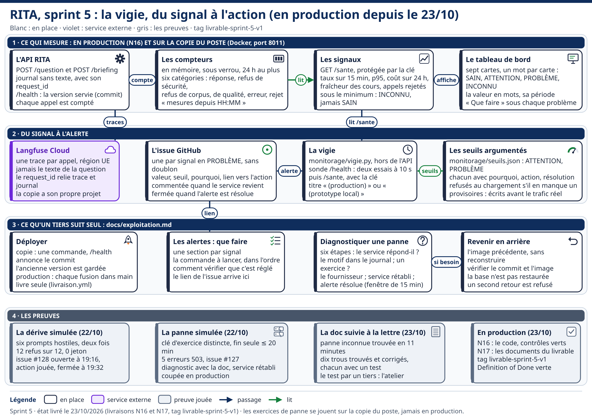

# Sprint 5 : synthèse

> La vigie et la démo, en production depuis le 23/10/2026. Synthèse du livrable remis sous le tag
> `livrable-sprint-5-v4` (26/10/2026) ; le détail et toutes les preuves sont dans le [livrable complet](livrable-sprint-5.md).

## Sommaire

1. L'essentiel en une minute
2. Avant et après le sprint
3. Les livrables demandés, et où les trouver
4. Comment la vigie est construite
5. Le parcours prouvé : une attaque, du signal à l'action
6. Les critères de la grille de l'atelier n°5
7. Les mesures
8. Ce qui n'est pas fait
9. Où trouver le détail
10. Glossaire

## 1. L'essentiel en une minute

- **RITA** aide un investisseur particulier à lire l'actualité des sociétés cotées. Elle rédige le briefing d'une
  valeur et répond à une question libre, toujours en citant ses sources. Elle refuse ce que ses articles ne couvrent
  pas et ne donne jamais de conseil d'achat ou de vente.
- **Le besoin du sprint 5** : rendre RITA pilotable et reprenable. Une personne qui n'est pas développeur doit pouvoir
  voir si RITA va bien, être prévenue quand elle va mal, et savoir quoi faire.
- **Le déroulé** : la vigie a d'abord été construite et éprouvée sur une copie de RITA lancée sur le poste, les 22 et
  23/10. Elle est passée en production le 23/10 au soir, par la livraison automatique N16. Elle y tourne depuis, et
  chaque version du livrable suit le même chemin : fusion, livraison automatique, puis tag.
- **La preuve principale** : le 22/10, une attaque simulée a suivi toute la chaîne. Les 12 messages hostiles sont
  refusés, sans aucun coût ; la carte du tableau de bord passe en PROBLÈME ; la vigie ouvre le ticket #128 à 19:16 ;
  l'action écrite dans la documentation est jouée à 19:17 ; le ticket se ferme seul à 19:32.
- **Ce qui reste** : la vigie de production se lance encore à la main ; la documentation n'a pas encore été suivie par
  une autre personne, ce sera le test de l'atelier n°5 ; les seuils sont provisoires.

## 2. Avant et après le sprint

Avant le sprint, RITA tournait déjà en production avec ses garde-fous. Pour savoir si elle allait bien, il fallait
pourtant lire le journal ligne par ligne. Le livrable du sprint 4 l'avait relevé (§ 7.10) : des durées sans p95 ni
seuil, un coût par appel sans cumul ni budget, des refus sans comptage, aucun tableau et deux alertes Langfuse
seulement.

| Avant | Après le sprint 5 | Ce que ça change |
|---|---|---|
| lire le journal ligne par ligne | un tableau de bord de sept cartes : un mot (SAIN, ATTENTION, PROBLÈME, INCONNU), la valeur en clair et « Que faire » | une personne qui n'est pas développeur voit l'état de RITA |
| deux alertes Langfuse | une vigie qui ouvre un ticket GitHub par signal en problème, le commente au retour du service et le ferme à la résolution | une alerte laisse une trace datée et ne s'oublie pas |
| aucune procédure écrite pour un tiers | `docs/exploitation.md` : déployer, diagnostiquer une panne, revenir en arrière, et une section par alerte | une autre personne peut reprendre le service |
| aucun exercice | une panne et une attaque simulées, jouées sur la copie du poste | on s'entraîne sans risque pour la production |

## 3. Les livrables demandés, et où les trouver

| Livrable du brief | Où le trouver | État |
|---|---|---|
| Le système complet en production avec sa vigie | le tableau de bord : <https://178-104-184-125.sslip.io/tableau-de-bord.html> (la page demande la clé d'API) ; la vigie : [`monitorage/vigie.py`](../../../monitorage/vigie.py) | en production depuis le 23/10 (N16) ; la vigie se lance à la main |
| La documentation d'exploitation | [`docs/exploitation.md`](../../exploitation.md) | suivie à la lettre par son auteur le 23/10, dix trous trouvés et corrigés |
| Le scénario de démo écrit et répété | [`docs/sprint-5/DEMO.md`](../DEMO.md) : 9 min 40 en six segments, avec un plan B | répété deux fois le 23/10, en 9 minutes et en 9 minutes 30 environ |

## 4. Comment la vigie est construite

Les traces disent ce qui s'est passé, appel par appel. Les mesures disent si c'est grave. Les alertes disent quoi
faire. Six choix de conception portent cet ensemble, chacun avec sa raison et ce qu'il fait accepter :

| Choix | Pourquoi | Ce qu'on accepte |
|---|---|---|
| Une copie de RITA sur le poste pour les exercices | provoquer des pannes et des attaques sans toucher la production | la production reçoit le même code par la livraison habituelle (N16) |
| Chaque appel compté dans une de six catégories : réponse, refus de sécurité, refus de corpus, refus de qualité, erreur, rejet | transformer le journal en chiffres, sans nouvelle base de données | les mesures repartent à zéro à chaque redémarrage |
| Sept signaux, chacun avec deux seuils écrits (ATTENTION, PROBLÈME), son pourquoi, son action et sa règle de résolution | une alerte sans raison ni action ne sert à rien ; un seuil incomplet est refusé au chargement, par un test | les seuils sont provisoires, écrits avant le trafic réel |
| Jamais SAIN sans assez de données : la carte dit alors INCONNU | éviter une fausse impression de sécurité | une carte parfois INCONNU juste après un démarrage |
| Une vigie hors de RITA, qui ouvre un ticket GitHub par alerte | une API arrêtée ne peut pas annoncer sa propre panne ; GitHub est déjà le lieu des incidents du projet | la vigie de production se lance encore à la main |
| Rien de sensible dans les mesures, les traces et les tickets : ni le texte des questions, ni les clés | sécurité et RGPD | le diagnostic passe par l'identifiant de requête, pas par le texte |

Le schéma de la page suivante montre la vigie telle qu'elle a été livrée le 23/10 : ce qui mesure, le passage du
signal à l'alerte, ce qu'un tiers suit seul dans la documentation, et les preuves.

## 5. Le parcours prouvé : une attaque, du signal à l'action

Le cas d'usage : quelqu'un essaie de détourner RITA avec des messages malveillants, et l'opérateur doit le voir et
savoir quoi faire. L'exercice a été joué sur la copie du poste le 22/10 ; les exercices ne visent jamais la
production.

| Heure | Ce qui se passe | Ce que voit l'opérateur |
|---|---|---|
| 19:15 | six messages hostiles connus, envoyés deux fois | 12 refus sur 12 et 0 jeton consommé : les garde-fous refusent avant d'appeler le modèle |
| 19:16 | 100 % de refus de sécurité, au-dessus du seuil de 30 % sur 15 minutes (au moins 10 requêtes) | la carte « Refus de sécurité » passe en PROBLÈME, avec sa consigne ; la vigie ouvre le ticket [#128](https://github.com/Ganda15/rita-agent/issues/128) |
| 19:17 | l'opérateur suit l'action écrite dans la documentation | 12 lignes de refus, traitées en 0 à 12 ms, toutes des attaques connues : rien à corriger |
| 19:32 | 15 minutes sans nouveau refus, plus une marge | la vigie ferme le ticket d'elle-même |

La panne simulée suit le même chemin (ticket [#127](https://github.com/Ganda15/rita-agent/issues/127)) : cinq erreurs
503 à 18:58, diagnostic en suivant la documentation, service rétabli à 19:00, puis alerte résolue et ticket fermé à
19:14, une fois les erreurs sorties de la fenêtre de 15 minutes.

## 6. Les critères de la grille de l'atelier n°5

| # | Critère | Preuve déjà obtenue | État |
|---|---|---|---|
| 1 | Du signal à l'action | l'attaque simulée du 22/10 : ticket #128 ouvert puis fermé par la vigie, action jouée (§ 5) | prêt |
| 2 | Tableau de bord lisible sans explication orale | chaque état testé ; vu sur la copie en panne, rétablie, puis en dérive | prêt ; la lisibilité, seul l'évaluateur peut la juger |
| 3 | Doc : déployer seul | suivie à la lettre par son auteur le 23/10, deux trous corrigés | le test par un tiers se fait à l'atelier |
| 4 | Doc : diagnostiquer la panne simulée | une panne de nature inconnue trouvée en 11 minutes en suivant la doc, cinq trous corrigés | le test par un tiers se fait à l'atelier |
| 5 | Doc : revenir en arrière seul | joué le 22/10 (6 s), rejoué à la lettre le 23/10 (5 s) : commit et image vérifiés, aucun trou | le test par un tiers se fait à l'atelier |
| 6 | Démo prête : 10 minutes, du réel | le scénario `docs/sprint-5/DEMO.md` (9 min 40) ; deux répétitions le 23/10 | prêt |
| 7 | Série complète : cinq grilles, journal des retours | grilles des ateliers 1 à 4 versées dans `eval/ateliers/` ; journal des retours au § 6 du livrable | la grille n°5 sera remplie par l'évaluateur à l'atelier |

## 7. Les mesures

| Mesure | Résultat |
|---|---|
| Suite de tests complète, lancée sur le poste (26/10, version 4) | 1 779 passés, 0 échec ; 24 ignorés, 2 échecs attendus |
| Couverture des neuf modules du sprint 5 (22/10) | 100 % des 764 instructions, 286 tests |
| Livraison automatique et passage du tag de la version 3 (26/10) | verts, image publiée |
| Production, vérifiée le 26/10 au matin | `/health` répond `status ok`, avec le commit du tag v3 (`bea3e64`) |
| Coût des exercices (22/10) | 0,009486 € estimés, sous le plafond de 0,10 € fixé avant |
| Test de la documentation à la lettre (23/10) | dix trous trouvés et corrigés, chacun couvert par un test |
| Répétitions de la démo (23/10) | deux, en 9 minutes et en 9 minutes 30 environ |

## 8. Ce qui n'est pas fait

- **La vigie de production se lance à la main** : pas encore de passage automatique toutes les 15 minutes.
- **La documentation n'a pas encore été suivie par une autre personne** : son auteur l'a suivie à la lettre, le test
  par un tiers se fait à l'atelier n°5.
- **Les seuils sont provisoires** : ils ont été écrits avant tout trafic réel et restent à relire sur des données
  réelles.
- **Les mesures vivent en mémoire** : elles repartent à zéro à chaque redémarrage de l'API.
- **Le coût est surveillé par une alerte**, sans coupure au-delà d'un budget.
- **La fraîcheur des cours en production** reste un écart ouvert (critère 1 du contrat du sprint 1).
- **La revue OWASP complète** (trois listes, 30 risques) reste à faire dans le RITA original ; le sprint 5 traite ce
  qui touche la vigie (livrable, § 4.1).

## 9. Où trouver le détail

| Pour lire | Document |
|---|---|
| tout le détail et toutes les preuves | le livrable complet : [PDF](livrable-sprint-5.pdf) ou [Markdown](livrable-sprint-5.md) |
| les procédures d'exploitation | [`docs/exploitation.md`](../../exploitation.md) |
| le scénario de la démonstration | [`docs/sprint-5/DEMO.md`](../DEMO.md) |
| l'index des preuves | [`evidence/sprint-5/README.md`](../../../evidence/sprint-5/README.md) |

## 10. Glossaire

- **Vigie** : le programme qui surveille RITA de l'extérieur et ouvre une alerte quand un seuil est franchi.
- **Signal** : une mesure suivie, par exemple la part des questions refusées pour sécurité sur 15 minutes.
- **Seuil** : la valeur à partir de laquelle un signal passe en ATTENTION ou en PROBLÈME.
- **Verdict** : l'état d'un signal, SAIN, ATTENTION, PROBLÈME, ou INCONNU quand les données manquent.
- **p95** : le temps sous lequel passent 95 % des réponses.
- **Jeton** : l'unité de texte que le modèle facture ; zéro jeton veut dire zéro coût.
- **Ticket GitHub (issue)** : une fiche datée dans le dépôt du projet, où l'alerte est écrite, commentée puis fermée.
- **Copie du poste** : une seconde RITA, lancée sur l'ordinateur avec Docker, réservée aux exercices.
- **Panne simulée, dérive simulée** : une panne du fournisseur ou une rafale de messages hostiles, provoquées exprès,
  sûres et réversibles.
- **Retour arrière** : relancer la version précédente, sans la reconstruire.
- **Livraison N16** : la mise en production automatique déclenchée par une fusion dans la branche principale.
- **Definition of Done** : la liste des vérifications calculées qui doit être verte avant de poser un tag.
- **Tag** : une étiquette Git posée sur une version précise du dépôt ; son lien ne bouge plus.
