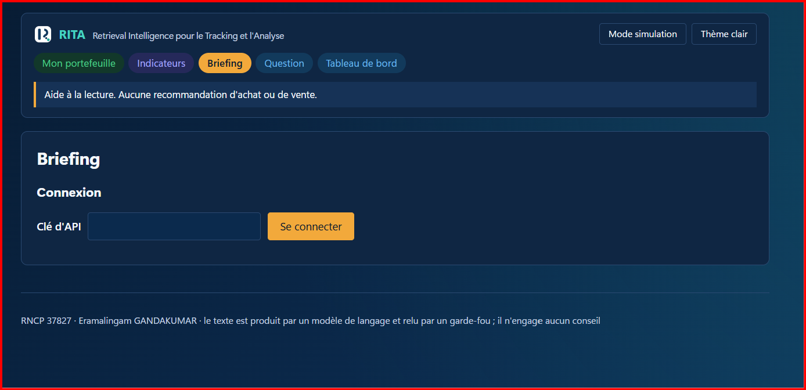
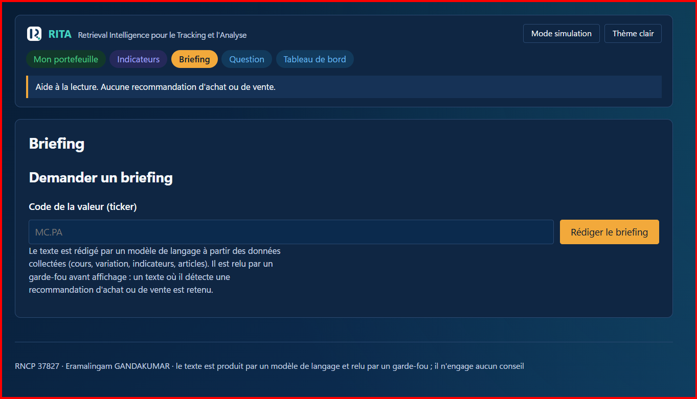

# #73 : vérification manuelle en production, 6 novembre 2026

**Ce qui est vérifié.** Le défaut #73 : l'écran Briefing gardait la clé d'API dans `sessionStorage` avant d'avoir vérifié
qu'elle fonctionnait. Corrigé le 01/11 (tests d'abord), déployé le 02/11 : la clé n'est plus gardée qu'après un appel
réussi (`frontend/commun.js`, ligne 67 : `garderCle` après une réponse acceptée ; `frontend/briefing.js`, lignes 366 à
384 : la clé saisie reste « en essai » jusque-là). Il restait la vérification à la main, en production.

**Conditions.** Production à l'adresse <https://178-104-184-125.sslip.io/briefing.html>, version `097b201`, en production depuis le 06/11 à 18 h 43 UTC
(`/health`, champ `construit_le`). Essais faits par Era dans son navigateur, le soir du 06/11.

| Essai | Ce qu'Era a fait | Attendu si #73 est corrigé | Ce qu'Era a constaté |
|---|---|---|---|
| 1 | une clé **fausse**, « Se connecter », puis F5 (recharger la page) | la clé est redemandée : la fausse clé n'a pas été gardée | la clé est redemandée |
| 2 | sa **vraie** clé, un briefing d'OR.PA obtenu, puis F5 | l'écran reste connecté : la clé a servi, elle est gardée pour l'onglet | l'écran reste connecté |

Un briefing obtenu avec la vraie clé le même soir est en capture :
`evidence/C8/captures-2026-11-06/rita-briefing-orpa-apres-correction-2026-11-06.png`.

**Les captures, prises par Era après chaque F5** (aucune ne montre de clé) :

**Ce que cette preuve ne montre pas.** Une capture montre l'écran après F5, pas la clé saisie, qui n'est jamais affichée :
quelle clé a servi à chaque essai, c'est Era qui le déclare.

## 📖 Glossaire

- **`sessionStorage`** : stockage du navigateur propre à un onglet, effacé à sa fermeture.
- **F5** : la touche qui recharge la page dans le navigateur.
